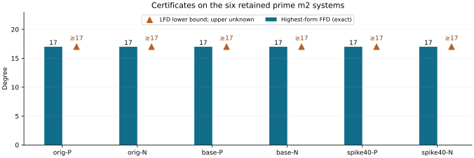

# Prime m2 first-fall and strict filtered-witness certificates

Run `n83-prime-first-fall-20261030-r1`, n83, m2, ell27. **6/6 producers, 6/6 fresh replays and 6/6 S3-restored replays passed.** Independent scientific review and full algebraic formalization remain pending.

| Retained input | Highest-form FFD | First strict filtered fall | LFD lower bound | Exact/global upper LFD |
|---|---:|---:|---:|---|
| original-prime-m2-planted | 17 | 17 | ≥17 | unknown |
| original-prime-m2-natural | 17 | 17 | ≥17 | unknown |
| baseline-prime-m2-planted | 17 | 17 | ≥17 | unknown |
| baseline-prime-m2-natural | 17 | 17 | ≥17 | unknown |
| spike40-prime-m2-planted | 17 | 17 | ≥17 | unknown |
| spike40-prime-m2-natural | 17 | 17 | ≥17 | unknown |

The six strict witnesses have degree-at-most17 derivations and degree16 normal forms outside V16 under the written filtered-space argument. All six production coefficient functionals are nonzero. The global LFD upper bound and exact LFD remain unknown. The unchanged original-top regularity is42. No factor-base quality ranking, performance gain or universal FFD/LFD conclusion follows. Original/baseline natural inputs repeat and are not independent samples.

## Exact polynomial data and proof boundary

The normalized source has selector equations `z_i^2=w_i*z_i`, `u_i^2=w_i*u_i`, and `f=S3(X,Y,t)`. Its highest form is `X^2Y^2`. Certified multiplication ranks are injective through multiplier degree12. The nonzero degree13 polynomial `H=product(z_2j-z_(2j+1))` annihilates `X^2` in the square-zero associated graded algebra. The written Koszul/annihilator argument gives highest-form FFD17.

The strict witness is `g=NF(H*f)`. It is stored exactly as `A0 tensor B0+A1 tensor B1+A2 tensor B2`, with all six sparse factors and the reconstruction circuit. No expanded coefficient is sampled or discarded. A direct complementary-mask pairing on those factors equals `2*(-2)^13*(sum(weights)-2*target_x)`. It is nonzero in all six retained cases and annihilates the lower-space leading image. The written injectivity/closure argument characterizes V16; this is not a materialized dense V16 basis or a full ideal upper certificate.

## Validation and preservation

- 12 native tests pass, including complete source/witness suffix checks and corrupt/truncated data rejection.
- 36 independent expanded-polynomial comparisons, 12 small dense filtered-closure comparisons, and 12 exceptional-target controls passed. Zero pairing is recorded as inconclusive for the affine witness.
- All 71 raw manifest payloads match before and after S3-restored replay. All previous datasets remain unchanged.
- Fixed limits:2GiB virtual memory,60s runtime controls,300s producer,300s fresh replay,+5s grace each,720s outer,no retries. Diagnostic batch boundaries:2026-10-30T05:30:23Z–2026-10-30T05:30:36Z. No timing or CRIU claim.
- EKS CLI role assumption was denied and MCP inventory timed out. No new EKS job was submitted; the established host fallback was retained without IAM/capacity changes.

Read `PRIME_FIRST_FALL_FORMAT.json`, `PRIME_FIRST_FALL_DESIGN.md`, `prime-first-fall-archives/README.md`, `experiment-prime-first-fall.export.json` and the storage/publication JSON records. The full three-family m2–9 goal, global LFD upper certificates, higher-m work and held-out elite-base search remain open.

Sources: [Caminata–Gorla Definitions1.3/1.5 and Section4](https://arxiv.org/html/2112.05579); [Phuong–Tran Theorem2.7 and proof](https://arxiv.org/pdf/2211.13548). The dataset-specific argument is written in PRIME_FIRST_FALL_DESIGN.md.

Source commit:`30cad456257df5250058717f0b5ae8f385cf30fd`. Protocol:`5c10dc03ea5f1447ed50430d297c691bbc008316dff21a9c6d7c3240c13f291f`. Data committed before this report:`8e6dc2ac89862f0f4ea5ad1e0317f27cb4b4c5a0`.
