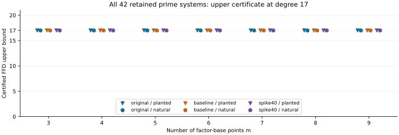

# Higher-m prime terminal annihilator certificates

Observations only; independent scientific review and full algebraic formalization are pending. Run `n83-prime-terminal-20261030-r3`: **42/42 producers, 42/42 fresh replays and 42/42 S3-restored replays passed**. No exact FFD or new LFD certificate is claimed.

| m | Retained cases | Highest-form FFD upper | Affine consequence degree | Exact FFD / new LFD |
|---:|---:|---:|---:|---|
| 3 | 6 | ≤17 | 16 | unknown |
| 4 | 6 | ≤17 | 16 | unknown |
| 5 | 6 | ≤17 | 16 | unknown |
| 6 | 6 | ≤17 | 16 | unknown |
| 7 | 6 | ≤17 | 16 | unknown |
| 8 | 6 | ≤17 | 16 | unknown |
| 9 | 6 | ≤17 | 16 | unknown |

Each group contains original/baseline/spike40 × planted/natural. Values are source-bound certificate outputs, not independent samples or a ranking. Every affine consequence has a derivation of degree at most17 and actual degree16. Other chain equations may derive it earlier: nonmembership inV16 was not tested. All strict-witness and new LFD fields are false/null. Previous prime m2 FFD17/LFD≥17 results remain separate.

## What is certified

The terminal highest form is `F=U^2*X^2`. Normalized last-block selectors satisfy square-zero top relations. The degree13 polynomial `H=product(z_2j-z_(2j+1))` has8192 distinct terms and `H*X^2=0` modulo selector squares. Project all variables outside the last selector block tozero. Every original top generator maps tozero while H survives. Hence H cannot be the terminal coordinate of a Koszul syzygy; the written argument gives a nontrivial degree17 syzygy and FFD≤17. No exclusion of earlier syzygies is claimed.

The affine consequence is `g=A0*B0(U)+A1*B1(U)+A2*B2(U)`, where A0=H,A1=NF(HX),A2=NF(HX²). All126 sparse factors are stored exactly with canonical coefficients. The three B-polynomials are explicit degree≤2 coefficient lists. No U field equation or new preprocessing is introduced. PRIME_TERMINAL_FORMAT.json specifies header bytes, masks, variables and reconstruction.

## Validation, failures and custody

- 18 native tests pass. Runtime controls include18 independent ordinary-exponent expansions and18 non-annihilator controls. Synthetic source tests cover21 arm/m layouts;source,base,witness,projection andcorrupt-factor failures are checked.
- All269 raw manifest payloads match before/after S3-restored replay. Unified export verifies with zero findings. Index19datasets/70hashes;original48regularityrows andbasebindings unchanged.
- R1 EKS JobUIDd91a1d5b-be44-4f06-ad23-2afca910bbf1 failed exit2 before native computation: worker file permissions. R2 JobUID553a48de-f5f6-46ed-9a62-9234b0045951 failed exit1 before native computation: source HeadObject403. Both frozen protocols,source bundles,images andlogs retained. R3 used establishedhostfallback,no IAM/capacitychanges.
- R3 limits:oneprocess,2GiBvirtual,60scontrols,300sproducer,300sfreshreplay,+5sgrace,720souter,no retries. Diagnostic interval:2026-10-30T06:32:02Z–2026-10-30T06:32:46Z;not timing evidence.
- Root library/Cargo inputs unchanged from prior completed delivery. Earlier full-library run and exact fixture rechecks remain the applicable record;this phase adds native certificate tests.

Hydrate `prime-terminal-archives/runs.tar.gz`,extract into a fresh ROOT,verify manifest,run `instrument replay ROOT ROOT/results`,thenverify manifest again. Source bundles and all failures are retained separately. See storage/publication JSON and DATA_INDEX.json.

The full n83 three-family m2–9 FFD/LFD and elite-base goal remains open. Prime exact/higher-m FFD,strict LFD/globalupper,binaryquarticfrontier andheld-out selection remain obligations. No elite-base or speed gain is established.

Source: [Caminata–Gorla Definition1.3 and Section4](https://arxiv.org/html/2112.05579);dataset-specific argument in PRIME_TERMINAL_DESIGN.md. Sourcecommit:`1ec2f68e9a2956dfc55c4e35354e9ce7c0fcaeab`. Protocol:`e197dbafacbee40a41a695ffcbf472c35951686d36af58899f58f7acb9b7d143`. Data before report:`71f819f5647c26d3ab0095e664d9c7aeeb5acd63`.
