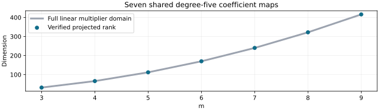

# Prime degree-five syzygy exclusion

Run n83-prime-linear-20261030-r1. All42 retained prime m3–9 cases passed producer, fresh-process and S3-restored replay. Seven template computations are shared evidence, not42 independent rank experiments. Independent scientific review and full proof formalization remain pending.

| m | Cases | Projected rank / columns | FFD lower bound |
|---:|---:|---:|---|
| 3 | 6 | 32 / 32 | ≥6 |
| 4 | 6 | 66 / 66 | ≥6 |
| 5 | 6 | 112 / 112 | ≥6 |
| 6 | 6 | 170 / 170 | ≥6 |
| 7 | 6 | 240 / 240 | ≥6 |
| 8 | 6 | 322 / 322 | ≥6 |
| 9 | 6 | 416 / 416 | ≥6 |

Each case keeps its original immutable2^27-candidate factor base, target and polynomial system. Six overlapping five-selector coefficient restrictions cover all27 selectors in each block while retaining every intermediate variable. Injectivity of the projected degree-five map forces every original linear syzygy coefficient to vanish. The regular sequence of selector squares accounts for the remaining Koszul syzygies. This is a lower bound on highest-form FFD, not an LFD or solving-degree result. Deficiency would be inconclusive for the original system.

The earlier terminal dataset supplies upperFFD17. Combined bounds are stored only after matching exact source and base-manifest hashes for all42 cases. ExactFFD remains unknown; no newLFD bound or elite-base improvement is established.

Validation:21 test invocations (five new tests plus two copies of eight inherited donor tests). Independent six-term polynomial expansion checks30 quartics; dense elimination compares six small-prime maps. Three-selector annihilators and incomplete coverage are detected. All149 raw payloads verify before and after restored replay. Frozen protocol fab78c9ce1792ae5aea977903df296df49f591d575725905de4010fa806f7198; source acbf026e945b486e461262b8093c598375993cf3; data commit 8882bd015df59c087067fffcbb54606be253cc3c.

One native process,2GiB,300s producer and300s fresh replay,720s outer,zero retries. Existing-host fallback follows retained EKS shared-bucket403; no IAM/capacity change or performance claim. Diagnostic interval 2026-10-30T07:12:06Z to 2026-10-30T07:12:13Z. The initial recovery note lacked required headings; its rejected version and logs are retained, and the corrected gate passed before production.

PRIME_LINEAR_FORMAT.json defines JSON fields, variable numbering, sparse matrix rows and pivot certificates. Hydrate prime-linear-archives/runs.tar.gz, extract into ROOT, verify manifest, run `instrument replay ROOT ROOT/protocol-prime-linear.json ROOT/results`, and verify manifest again.

Primary definitions: [Caminata–Gorla](https://arxiv.org/html/2112.05579), Definition1.3 and Section4. Study-specific covering argument: PRIME_LINEAR_DESIGN.md. The broader three-family m2–9 FFD/LFD and elite-base objective remains open.
