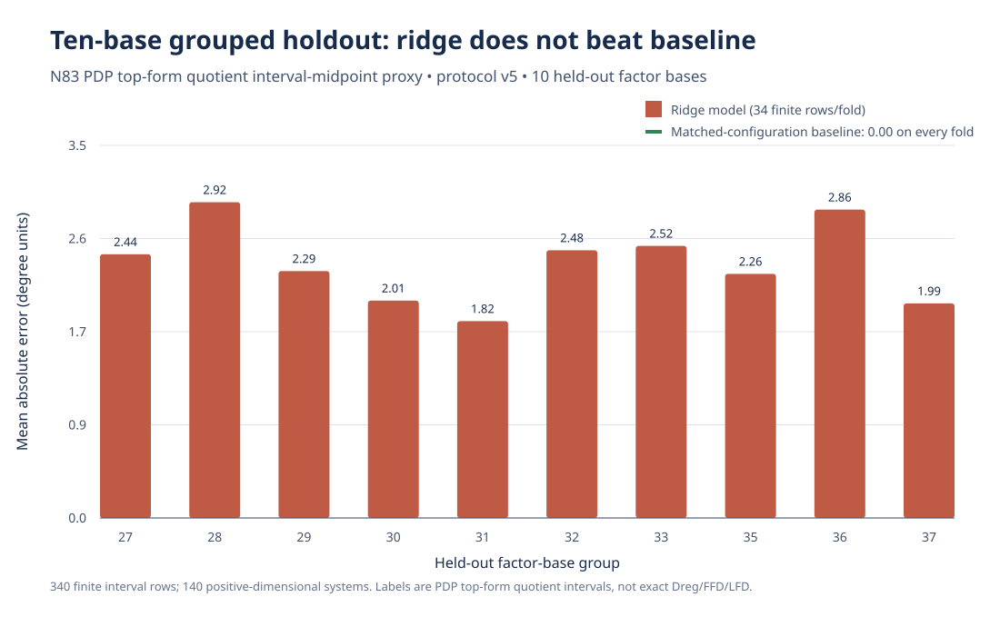

# Ten-base PDP proxy model report

**Run:** 2026-11-01 18:48 UTC onward  
**Frozen protocol:** v5, SHA-256 `3a041db64c7d6d70aa99200fe46500770998de5faffaf2acb7a2e366c855eb57`  
**Primary result:** the ten-base held-out ridge model did not beat the matched-configuration baseline on any fold.

The panel contains 480 systems across three curve families, m=2..9, natural/planted configurations, and ten fixed bases (spike27–33 and spike35–37). Of these, 340 have finite top-form quotient interval-midpoint labels and 140 are positive-dimensional. Each held-out base contributes 34 finite rows.

| Measure | Result |
|---|---:|
| Grouped folds | 10 |
| Ridge wins | 0 / 10 |
| Mean ridge MAE | 2.3598 |
| Matched-configuration baseline MAE | 0.0000 |
| Identical natural/planted outcome pairs | 48 / 48 |

The baseline is exactly zero on this panel because every base has the same finite midpoint mean (359.4118); ridge errors therefore do not establish a useful predictive lead. The labels bound the degree of a PDP top-form quotient polynomial. They are not exact degree-of-regularity, first-fall degree, last-fall degree, solving-degree, or ECDLP outcomes.

**Evidence:** `../../evidence/model-expansion-followup-20261101/attempt-08/model/result.json`; full predictions and training rows are in the same attempt directory. All 144 newly added top-form certificates were independently replayed before model training. `report-data.json` stores the exact per-fold values used by the figure.
