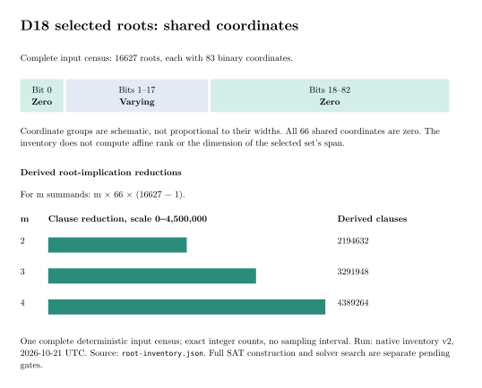

# D18 input census for shared-bit encoding

**Status: verified input inventory; full SAT construction and search are separate gates.**

The native inventory checks all 16,627 selected representatives from the frozen
D18 census. It finds **66 common zero coordinates: bit 0 and bits 18–82**.
Coordinates 1–17 vary within the selected list. This observation does not
establish an affine-rank or span-dimension result, and it is not a general
subgroup theorem.



| m | Derived removed root implications, m × 66 × (16,627 − 1) |
|---|---:|
| 2 | 2,194,632 |
| 3 | 3,291,948 |
| 4 | 4,389,264 |

These are arithmetic consequences of the observed common-bit count and the
replacement identity. They are not measured total SAT model sizes or solver
timings. The inventory performs no SAT construction or search.

## Identity and scope

- Curve: `icv1-f2m83-tm6151469093347-debefd74`.
- Input: `../n83_d18_subgroup_orbit_census_20261018/run-20261019T0142Z/selected-representatives.csv`.
- Input SHA-256: `534e58ced979e05ec747eb462aa1d63135d8004813d094c522a4d7160c03c4a4`.
- Source: [root_inventory.rs](root_inventory.rs), called by
  [`examples/n83_d18_root_inventory.rs`](../../examples/n83_d18_root_inventory.rs).
- Output: [root-inventory.json](root-inventory.json), including its source digest.
- Host: Apple arm64, shared local development host (L0); no time comparison.
- Input checks: exact file digest/header, 16,627 unique orbit keys and roots,
  field-width and source-width bounds, positive multiplicities.
- Negative checks: modified input rejected before creating output; existing
  output refused without replacement. Raw validation logs are retained.

The independent inventory uses a `u128` OR-of-XOR mask. The library-backed
construction tool uses its own `BigUint` per-coordinate check. Agreement with
that tool remains a separate gate until it completes.

The source representatives lie in the frozen 18-dimensional source space.
The field remains GF(2^83). Common coordinates constrain the selected root
before Frobenius; this does not remove any of the 83 phases or either sign
from the retained factor-base closure.

## Reproduce

```sh
cargo run --release --example n83_d18_root_inventory -- \
  research/n83_d18_subgroup_orbit_census_20261018/run-20261019T0142Z/selected-representatives.csv \
  /tmp/n83-root-inventory-new.json
cmp /tmp/n83-root-inventory-new.json \
  research/n83_d18_shared_bits_20261020/root-inventory.json
```

The observed local run compiled this same wrapper directly with `rustc`, using
already built `sha2` and `serde_json` dependencies. This avoided waiting for the
unrelated full library build; it does not satisfy the library-test gate.

The [Lean proof map](PROOF_MAP.md) covers the Boolean replacement under an
active selector and the exact clause-count identity. It does not verify this
Rust parser, the compiler, or the complete SAT engine. The full construction
tool also issues an identity certificate; that receipt is pending here.

## Disposition

The input gate passes. Full model allocation checks, exhaustive native solver
tests, constructed A/A and A/B controls, natural-query yield and useful rank,
complete cold/reused IC cost and matched rho remain separate obligations in
[PROTOCOL.md](PROTOCOL.md). Candidate and selected-best-runtime fields stay null.

Canonical runtime graphs (`docs/ic-leaderboard.html`,
`docs/index-calculus-scoreboard.html`, and `docs/ic/progress-timeline.json`)
are unchanged: this inventory provides no runtime or pipeline ranking. Its
structural data is graphed here. There is no new performance benchmark row.

Render the source-linked [PDF](inventory-report.pdf) and graph from the same
receipt:

```sh
cd research/n83_d18_shared_bits_20261020
typst compile inventory.typ inventory.svg
typst compile inventory-report.typ inventory-report.pdf
```
