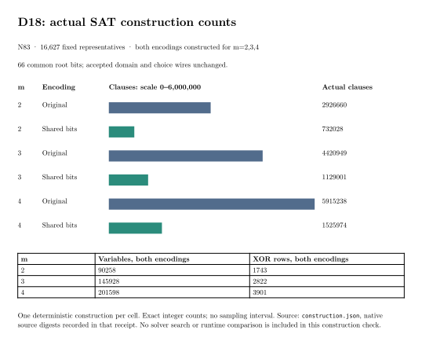

# N83 D18 shared-bit encoding

**Status: full-size local construction, 23 example tests, input inventory and
Lean proof pass on the retained implementation. The latest library run passed
the shared-bit tests but failed nine local-network tests under sandbox socket
restrictions. Full validation on the updated parent, bounded Linux construction
and the paired solver card remain pending.**

The encoding baseline is PR #2271 revision
`e294f8c927b019f59e6552039d32e6b4ba237f84`. Both policies retain the same
16,627 representatives and the same 2,760,082 signed-Frobenius points.
The working curve is `icv1-f2m83-tm6151469093347-debefd74`.

## Results and requirements

| Requirement | Status | Evidence or remaining gate |
|---|---|---|
| Apply the two approved benchmark index rows | Verified complete in PR #2271 | Both rows are committed in `e294f8c92`. |
| Get PR #2271 through CI and merge | Merged; historical CI failure retained | Merged at `18a6735fbefc53b0bffb2443a0075faa9c1ebfb0` on 2026-10-21. Its later workflow-parser job rejected the 45-minute harness timeout; the other applicable jobs passed. The current census parent already contains the named budget exception and separate historical-audit job. Follow-up validation remains required. |
| Preserve default encoding and exact finite domain | Implemented; executable validation pending | Explicit `FrobeniusOrbitRootEncoding::SharedBits`; old APIs retain `PerRepresentative`. |
| Check the complete D18 input list | Verified complete | [Native inventory](INVENTORY.md), [receipt](root-inventory.json), [inspected PDF](inventory-report.pdf). 66 shared zero bits; 17 varying coordinates. |
| Prove selector-implication factorization and clause identity | Verified complete within stated scope | [Proof map](PROOF_MAP.md), Lean 4.34.1 gate PASS. No compiler or full-solver proof is claimed. |
| Exhaustive native semantics, rejection/cap atomicity and worker/replay tests | Partial | The retained 23 affected-example tests pass. The fresh library run passed 4,395 tests including exhaustive shared-bit semantics; nine socket tests failed with `Operation not permitted`, and 118 were ignored. The complete gate is being rerun with local socket access. |
| Build both full-size encodings for m=2,3,4 | Local structural check passes; bounded host gate pending | All six actual models match preflight; choice wires, variable counts and XOR rows agree between policies. The frozen memory-bound gate additionally requires `run-construction.sh` on Linux. |
| Execute 22 controls, 22 replays, and 18 natural m=4 queries | Not attempted | Requires all validation gates, a committed host card and available SSH runner. Deferred Linux validation stopped at its other-container guard. |
| Natural useful rank, complete cold/reused cost, matched rho and best-base selection | Open | Original requirements remain in [the problem record](../../problems/n83-prebuilt-base-quality-m2-m4.md). |

The [construction receipt](construction.json) now verifies these actual total
SAT model counts. No solver search or runtime comparison was performed:

| m | Original clauses | Shared-bit clauses | Removed clauses | Variables, both | XOR rows, both |
|---|---:|---:|---:|---:|---:|
| 2 | 2,926,660 | 732,028 | 2,194,632 | 90,258 | 1,743 |
| 3 | 4,420,949 | 1,129,001 | 3,291,948 | 145,928 | 2,822 |
| 4 | 5,915,238 | 1,525,974 | 4,389,264 | 201,598 | 3,901 |



The local build agrees with the independently computed 66 shared zero bits.
Shared coordinates apply to roots before their Frobenius phase. Seventeen
varying coordinates do not establish affine rank. The
[construction report](report.pdf) separates these size counts from the open
memory-bound and solver-cost gates.

## Implementation and checks

- [Frozen protocol](PROTOCOL.md): same point set, fixed public corpus,
  limits, controls and failure handling.
- [Library module](../../src/cryptanalysis/binary_semaev_chain_sat.rs):
  data-dependent preflight and explicit shared-zero/shared-one factoring.
  Shared units are emitted after each domain's CNF/XOR construction, keeping
  the phase clauses unchanged by eager root-assignment simplification.
- [Native construction/control tool](../../examples/n83_d18_shared_bits.rs):
  six full-size models, exact actual/preflight count and wire checks,
  identity certificate and independently replayed control-pair admission.
- [Independent inventory](root_inventory.rs): a separate u128 XOR-mask
  implementation, exact pinned input and fail-closed output handling.
- [Bounded construction](run-construction.sh): 4 GiB, zero swap, one CPU,
  read-only inputs and no network. This command performs no solver search.
- [Card preparation](prepare-card.sh): checks native library/example/build
  exits, exact binary/source digests, checked Lean source, the construction
  receipt and the construction container's memory policy before preparing
  the immutable card. Arguments are source, build logs, binary directory,
  bounded-construction directory, proof directory and new output directory.
- [Card driver](run-card.sh): checks the release-library gate again and
  stops if a constructed control or fresh replay fails. Its fixtures test
  the complete schedule and failure paths; they are not executed solver
  controls.

## Execution record and resources

[Validation version 1](VALIDATION.md) preserves 48 records in a deterministic,
hash-checked archive, including the unsuccessful attempts below. Its input and
proof successes do not substitute for the pending native test suites.
The later [construction run report](reports/run-20261021T0203Z/RUN_REPORT.md)
and 20-file validation-v2 archive preserve the passing example/build/construction
gates and the first example-compilation failure.

The initial local release compilation was stopped after static review
identified unit-placement/count behavior; that attempt produced no test
result. A later compilation failed with `No space left on device` on the
shared SSD. Its logs are retained. Our own build cache and temporary directory
were moved to `/Volumes/T7/codex-n83-shared-bits-20261021/`, which had more
than 1 TiB free at the move. Other users' processes and caches were untouched.

The first Linux validation exited 143 before a result. Subsequent SSD and
deferred attempts refused to run alongside another benchmark container.
The deferred job ended with `BLOCKED_BY_ANOTHER_CONTAINER`; it is not running.
No shared-bit natural query has been launched.

The 2026-10-24 UTC resumption found T7 unmounted, so the unfinished T7 run
cannot be counted as a pass. The fresh SSD library run completed with nine
socket-permission failures; all three new shared-bit library tests passed.
The original branch remains at `99ba8febf`. Its isolated feature delta was
ported onto census parent `2e58bc5be60f609f1760d7834e40c5604d2b48e5` after
confirming that the affected native baseline files match `e294f8c92` exactly.
This avoids altering unrelated frozen evidence encountered in a parent merge.
The SSH runner retains the pinned U/D inputs and public corpus; its temporary
source checkout was lost. An unrelated benchmark occupied it at resumption.

After the library artifact compiled, the first affected-example build found
Rust error E0282 in the construction checker's count tuple. An explicit
`(u32, usize, usize)` annotation fixed it. All 23 examples tests and the three
release executable builds then passed, and all six construction checks passed.
The compiled source hashes match the retained implementation. The later SSD
library outcome above supersedes the previous pending-run status; it does not
rewrite either frozen validation archive.

Conductor's earlier connection/authentication failures remain in the historical
record. On resumption, task T-4563 was reattached and source, report and CI scopes
were granted. The shared problem index is held by another task and is not edited
in this continuation. The owner's earlier two-row override remains recorded.

## Reproduce and resume

Use the full native gates before pushing or launching the paired card:

```sh
cargo test --release --lib
cargo test --release \
  --example n83_d18_shared_bits --example n83_prebuild_cost_m23 \
  --example n83_small_m4_replay --example n83_full_m4_audit \
  --example n83_xor_cache_audit --example n83_full_m4_card_check \
  --example n83_prebuild_reuse_accounting
cargo build --release --example n83_d18_shared_bits \
  --example n83_prebuild_cost_m23 --example n83_small_m4_replay
ELAN_TOOLCHAIN=leanprover/lean4:v4.34.1 tools/lean/proof-gate.sh \
  --out /tmp/n83-shared-proof-new \
  research/n83_d18_shared_bits_20261020/lean/SharedRootBits.lean
```

The local gate's output directory is operational state, not committed evidence
of a pass. Retain its completed logs and exact tested source hashes before
updating this table. A local unbounded construction result is structural
validation only; use the Linux construction wrapper to meet the frozen
memory-bound requirement. Freeze and commit the actual host card before the
first paired solver run. Preserve any failure rather than resuming the same
consumed card.

Canonical runtime dashboards remain unchanged for the input inventory:
there is no new timing comparison or IC pipeline ranking. The inventory's
graph and PDF record the new structural observations.
