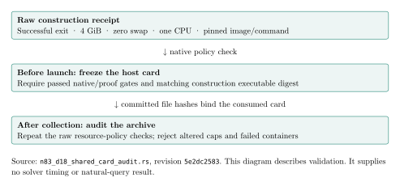

# Native construction-policy audit, 2026-10-24

Final review found that the native host-card freezer and archive auditor bound
the construction receipt by hash but delegated its resource-policy enforcement
to the shell preparer. Revision `5e2dc2583` makes both native entry points check
the actual construction container's successful termination, 4 GiB memory,
zero swap, one CPU on logical CPU 31, no network, read-only root, process/capability
limits, pinned image and exact independently capped command. It also checks
every native/proof exit and binds the construction executable's digest.

The test changes memory, swap, CPU, write access, networking, running state,
OOM state and exit status individually. Each changed receipt is rejected.
An empty container list is rejected. The original frozen limits are unchanged.

## Execution and evidence

The run used the shared Apple M4 Pro / arm64 host and explicitly selected Rust
1.98.0. The native busy lock serialized work; no timing-isolation claim is made.
The run started at `2026-10-24T06:40:42Z` and ended at `2026-10-24T06:42:50Z`.

| Gate | Observed result |
|---|---|
| Full release library | 4,478 passed, zero failed, 119 ignored |
| Eight affected examples | 29 passed, zero failed; shared-card auditor now has six tests |
| Updated release auditor | Build exit 0 |

The implementation, measured worker, independent general-field replayer and
construction executable are unchanged by this audit-only fix. The earlier
[six-model reconstruction](../run-20261024T0603Z/RUN_REPORT.md) remains its own
versioned evidence. This run executes no SAT query and measures no solver cost.

The visual is a policy-flow diagram because this run adds validation behavior,
without comparable runtime observations. [Editable diagram source](gate.typ).

[Validation v4](../../validation-v4.tar.xz) contains 17 files: exact commands,
compiler identity, tested commit and source digest, complete logs and exits.
Its [file manifest](../../validation-v4-files.sha256) and
[digests](../../validation-v4.sha256) were verified after extraction and an
identical repack. Archive SHA-256:
`aca521b35b0523e0e3732f1dcd2b2cbcec29c58e895717740bb40070f63ba7d6`.

The SSH construction/card and current-head PR CI remain separate open gates.
The queued worker source remains `4e1d311d8`; the archive auditor can independently
check that source's unchanged construction/worker receipts. Natural useful rank,
complete cold/reused costs and matched rho remain open. Canonical runtime charts
and benchmark entries are unchanged because there is no new timing comparison.

[Inspected PDF](RUN_REPORT.pdf); [editable PDF source](RUN_REPORT.typ).
