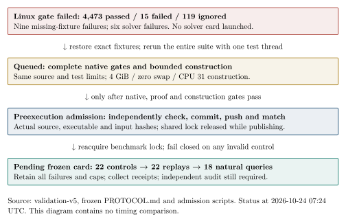

# Linux validation failure and bounded continuation

The full Linux release-library gate began at `2026-10-24T06:50:23Z`, using
Rust 1.99.1 and the unchanged worker source
`4e1d311d87571aa3309ed4bfac51d06539ef2297`. The authorized x86-64 SSH host
is shared (L0). The gate exited 101 with **4,473 passed, 15 failed and
119 ignored**. Examples, release-worker builds, bounded construction,
constructed controls and natural queries did not follow that failed gate.

## Failure evidence and repair

- Nine failures report absent runtime fixtures: the planner's evidence paths,
  the archived n37 SOURCE42 rows and the CryptoPro-B chain set. The sparse
  checkout's compile-time include materializer had not covered these runtime
  file reads. The exact committed paths and the optional native chain-set
  fixtures were subsequently materialized. The worker checkout remains clean.
- Six `jv_cover` solver assertions failed. Two logs explicitly report
  `timed_out: true`; three report zero qualifying trials; one reports a missing
  planted solution. The earlier statement that all six were confirmed deadline
  failures was too broad. Contention/deadline effects are a hypothesis for the
  remaining four until the full serial rerun resolves them.
- An unrelated benchmark container was active when the failure was inspected.
  The benchmark lock did not establish an uncontended interval. Neither these
  library outcomes nor the later solver card admit qualified timing on that basis.

The replacement performs the complete library suite with `--test-threads=1`
and `RUST_TEST_THREADS=1`, preserving every test and its original limits. It
then runs all affected examples, builds the native executables and performs
the original six-model construction under 4 GiB, zero swap and one CPU.
Its detached queue began at `07:24:42Z`, PID `1841122`; it has a four-hour
admission limit. This report records the queue, not a passing rerun.

## Local validation and admission implementation

The local Apple M4 Pro / arm64 rerun at `07:17:32Z–07:19:57Z` passed all
4,478 library tests and 29 affected-example tests, with 119 library tests
ignored by the existing suite. Workflow and shell checks pass. The standalone
notification-state unit test also passes. Linux event/timeout integration is
queued and is required before the notification executable is installed.

The native event notification waits on Linux file events. After all Linux gates
pass, one ordered pipeline prepares the host card while holding its inherited
benchmark lock. It releases the lock during publication. The detached local
publisher must independently freeze a copy using the stricter local auditor,
match the remote card except for its physical directory, commit and push that
exact card, and verify the remote branch before sending admission. The runner
then reacquires the benchmark lock and executes the unchanged frozen schedule.
Completed or failed run receipts are collected automatically. A failed gate,
changed local checkout, failed push, mismatching digest or expired admission
prevents launch. Final independent audit, reports and PR merge remain gates.

The diagram shows execution state. Native test populations differ across
platforms, so their pass counts are not a performance comparison. No solver
timing or new natural-query result is reported. Canonical runtime charts and
benchmark rows remain unchanged.

## Preserved evidence

[Validation v5](../../validation-v5.tar.xz) contains 39 files: complete failed
Linux library output, compiler/host/source records, the passing local rerun,
native admission sources and the versioned continuation commands.
[Every file hash](../../validation-v5-files.sha256) was checked after extraction,
and the archive repacked identically. [Archive and manifest digests](../../validation-v5.sha256).
Archive SHA-256: `0307e0c981f459e4d6b42ffbefa51806f337b670519b8cbbc1f2b580ecb67f56`.

The [original protocol](../../PROTOCOL.md), accepted point set, workload and
caps are unchanged. The preexecution host card and 22 controls, 22 independent
replays and 18 natural queries remain pending. Natural useful rank, complete
cold/reused costs, matched rho and best-base selection remain open.

[PDF](RUN_REPORT.pdf); [editable report](RUN_REPORT.typ); [diagram source](gates.typ).
