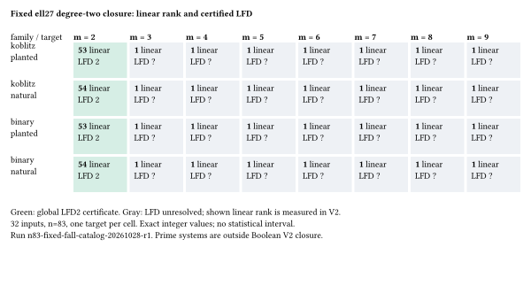

# Fixed-base n83 FFD/LFD certificate run

Observations only; independent scientific review remains pending.
Run: `n83-fixed-fall-catalog-20261028-r1`, 2026-10-28 05:00:50–05:04:37 UTC.
All 48 input cases completed:48 FFD computations,32 Boolean V2 computations,
80 fresh-process replays and48 source structural catalogs. No timeouts or
failed replays. These are exact per-instance computations, with no population
confidence interval or performance comparison.

| Inputs | FFD | LFD | Detail |
|---|---|---|---|
| Koblitz/binary, m2, planted/natural (4) |2|2|Global upper certificate plus nonzero lower witness|
| Koblitz/binary, m3..9, planted/natural (28)|2|unresolved, at least2|Only one independent linear constraint in V2|
| Prime, m2..9, planted/natural (16)|at least5|unresolved|Nonsingular coefficient minor excludes a fall through4|

Planted m2 cases have53 linear constraints on54 variables and two exhaustively
verified assignments. Natural m2 closures contain1. These facts concern the
saved presentations and do not imply a universal FFD/LFD theorem or lower
regularity for a different factor base.



The figure directly renders recorded linear ranks and certified LFD values
from [summary.json](../../evidence/summary.json). Gray cells mark unresolved
LFD, not an estimate. Rendering source: [closure-grid.typ](closure-grid.typ).

The protocol was committed before affected data. SHA256:
`ee0a5693e8302d1726012065d9bb59ef8bbf21e332c3c29b0db8612bab1d346c`.
Instrument source commit `390f82a33ad189491bb9a5dc7a458c39e57591ac`;
unchanged first-fall executable separately pinned in protocol extensions.
Seed/input identities are inherited unchanged from the fixed-base sweep.

Exact launch from repository root:

```sh
timeout --signal=TERM --kill-after=20 5400 \
  research/n83_fixed_fall_catalog_20261028/run.sh \
  /home/ec2-user/n83-fixed-degree-recovery/r1/results/inputs \
  /home/ec2-user/n83-fixed-fall-recovery/target/release/n83-fall-catalog \
  /home/ec2-user/n83-sweep-recovery/fall-target/release/fall \
  /home/ec2-user/n83-fixed-fall-recovery/r1
```

Existing-host fallback after EKS shared-bucket permission failure; no new IAM
or capacity changes. Sequential native processes,8GiB virtual memory,60-second
closure/replay limits,600-second catalog/FFD limits. Host and terminal receipts
are preserved. CPU-time measurements were not collected; wall timing is
unqualified diagnostic metadata only. Four native controls and inherited FFD
selfcheck passed. Every raw derivation is replayed by the producer tool in a
fresh process; this does not replace independent scientific review.

The raw archive contains401 manifest-listed files and its full downloaded
SHA256 matches `5d196259efd5bcffc0318932b990abdaf156a24e7f6bb7ca8613c3fa0ad91469`.
[FORMAT.json](../../FORMAT.json) describes bit-packed rows, binary header fields,
monomial columns, JSONL operations and source byte offsets. All raw files,
partial failures from earlier work, binaries, logs and source snapshots are
retained in S3. The unified export validates with zero findings; its unit is
one of the48 original-input cases, with all80 subcomputation receipts retained.

The broader elite-factor-base goal remains open. No factor base changed here.
A later frozen study needs matched base sizes, held-out targets and direct
regularity measurements. The preceding fixed-base regularity run obtained no
completed finite top-form regularity, and remains separately reported.
