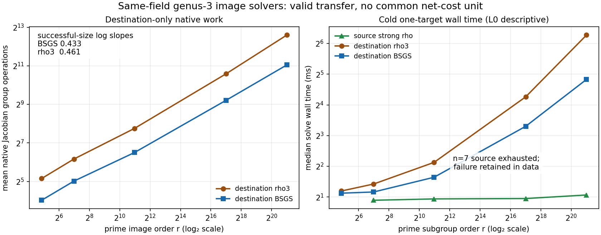

# Executive result

The pinned degree-three cover from the ordinary binary elliptic curve into a
genus-three hyperelliptic Jacobian is now an executed, scalar-preserving
transfer. Exact n=83 pullbacks, image order, typed pull/push composition,
exceptional fibers, and scalar recovery pass. Named BSGS and rho adapters solve
on the actual Mumford image and independently replay every recovered scalar on
the source.

The four faithful successful toy sizes are `n=9,13,19,23`. The preregistered
`n=7` source-reference exhaustion is retained. Across all measured trials, 400
of 400 destination attempts verified; 320 source attempts at the successful
sizes verified, and 80 source attempts at `n=7` exhausted. All 720 verified
measured records replayed identically.

This establishes a valid transfer and destination solver reachability. It does
not establish a weaker destination DLP or a net speedup: both destination
methods are generic square-root algorithms, native Cantor work has no certified
source-GAE conversion, and wall observations earned only L0 isolation.

# Exact transfer certificate

The exact source is `E_0: y^2+x*y=x^3+1` over the polynomial basis defined by
`z^83+z^45+z^2+z+1`, with prime subgroup order
`r=2417851639230796216685689`, cofactor four, pinned generator `P`, and public
known-answer `Q=[37]P`. The cover is

```text
C_0: v^2+u^2*v=u^7+u,
phi(u,v)=(u^3,u*v+1), degree(phi)=3.
```

The final post-panel certificate proves:

- `phi^*(P)` and `phi^*(Q)` are valid nonzero Mumford classes;
- both are killed by prime `r`, so `phi^*(P)` has exact order `r`;
- `[37]phi^*(P)=phi^*(Q)`;
- `phi_*phi^*=[3]` for `P`, `Q`, infinity, and the exceptional target `(0,1)`
  above the ramified point `(u,v)=(0,0)`;
- `gcd(3,r)=1` and `3^-1 mod r=1611901092820530811123793`; and
- bound-64 BSGS, without receiving scalar 37, recovers 37 and passes both
  destination verification and source replay.

The certificate scope is adapter reachability, not a full 81-bit discrete log.

# Solver and accounting design

`jacobian_image.rho3` is the generic destination control.
`jacobian_image.bsgs` is the generic memory-using candidate. Each cold process
constructs the cover, pulls back generator and target, solves in the image,
verifies there, and returns a scalar for independent source verification.

The measurement preserves unlike units. Destination additions/doublings,
scalar multiplications, table work, and walk steps are native counters marked
uncharged in source GAE. A zero GAE total therefore means “no conversion,” not
“free work.” Saved comparisons correctly decline to produce an operation-count
speedup.

# Measured panel

| n | r | source wall ms | destination rho3 native ops / ms | destination BSGS native ops / ms | BSGS/rho native ops | BSGS/source wall |
|---:|---:|---:|---:|---:|---:|---:|
| 7 | 29 | exhausted | 35.475 / 2.288 | 16.250 / 2.179 | 0.458 | -- |
| 9 | 127 | 1.857 | 71.675 / 2.681 | 32.375 / 2.238 | 0.452 | 1.205 |
| 13 | 2,003 | 1.915 | 215.150 / 4.369 | 90.375 / 3.122 | 0.420 | 1.631 |
| 19 | 130,873 | 1.931 | 1,535.725 / 19.187 | 592.000 / 9.863 | 0.385 | 5.107 |
| 23 | 2,095,853 | 2.092 | 6,194.475 / 77.399 | 2,113.250 / 28.421 | 0.341 | 13.586 |



BSGS beats rho within the destination by the expected generic time/memory
trade. Its successful-size native log slope is 0.433, versus 0.461 for rho3.
Neither is evidence of a special Jacobian-image weakness. Descriptive wall
time is worse than the source reference and the ratio grows across the panel.

# Integrity and chronology

The first strict session start refused before executing workloads because PSI
was unavailable. The unchanged frozen spec then ran with `--allow-busy`; all
rows earned L0 because isolation could not be certified. Session
`ECBS1h2f7b31083d9a` wrote all 768 planned records (672 verified, 96 exhausted)
and replayed 560 measured verified rows. After a committed follow-up protocol,
session `ECBS1hddc5cdbe0292` wrote 192 of 192 verified records and replayed all
160 measured rows. Both audits report no problems.

An exact implementation preflight ran before the panels and is retained. The
final exact n=83 gate ran after the combined four-size successful panel; the
two deterministic certificates are byte-identical. This report treats only the
post-panel receipt as the final requested gate.

# Verdict and next gate

The v3 verdict is:

| Gate | Verdict |
|---|---|
| valid transfer | supported |
| destination solver applicability | supported |
| modeled advantage | unknown |
| measured advantage | unknown |
| novel reduction | not applicable |

The next discriminating implementation is a complete small-field genus-three
index-calculus adapter, not full-order generic n=83 BSGS. It must cover factor
base, relation collection, linear algebra, individual logarithm, image access,
and source replay. It should first face the existing destination BSGS control
at `n=9,13,19,23`, with native field/memory/matrix counters. Only a lower
destination exponent or complete finite-size win should proceed to a common-unit
three-arm net comparison under L2 or stronger isolation on an independent host.

# Artifact map

- [Exact final certificate](runs/exact-n83-post-panel-20261031T044500Z/certificate.json)
- [Sealed sessions](sessions/)
- [Full run chronology and commands](RUN_REPORT.md)
- [Results](RESULTS.md) and [measurement guidance](GUIDANCE.md)
- [Machine-readable assessment](TRANSFER_ASSESSMENT_V3.json)
- [Open exit criteria](../../problems/genus3-image-destination-calculus-and-common-cost-missing.md)
