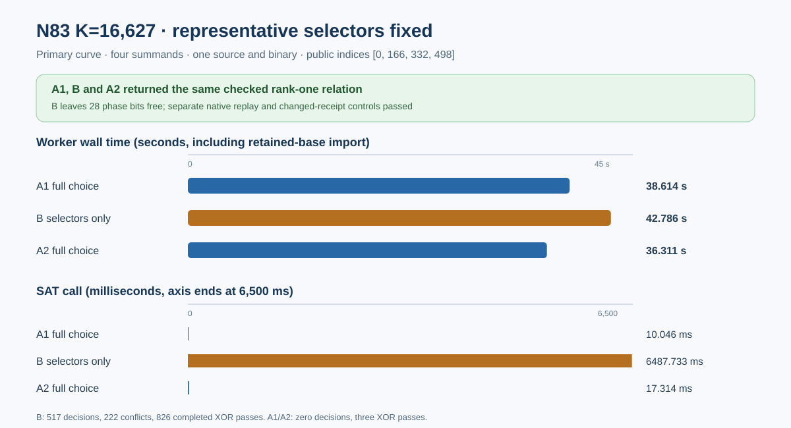

# N83 K=16,627 selector-only four-summand comparison

**Run:** 2026-10-18 09:21:26–09:26:49 UTC. **Derived status:** `PASS_THREE_CHECKED_ARMS` in [summary.json](summary.json). A1 fully pinned, B with only the four representative selectors pinned, and A2 fully pinned all returned the same checked rank-one relation on the public indices `[0, 166, 332, 498]`. The preregistered phase-only C arm was conditional on B reaching its 1,800-second cap; B returned a checked SAT relation, so C was omitted. The [protocol](PROTOCOL.md) was committed before implementation and execution.

## Frozen inputs and workload

The primary curve is `icv1-f2m83-tm6151469093347-debefd74`. The retained signed-Frobenius base has 16,627 columns and 2,760,082 stored points, with compressed-object BLAKE3 `1aa70cc1571f4cb25af42936699378329128a869f2ae8ad35efb375663d4e59d` and point-set BLAKE3 `564c6bb72b346b73112240bb0bddc4ef68b7525f7ef2556d6046e52c32f976e0`. [BUILD_RECEIPT.md](BUILD_RECEIPT.md) binds the six compiled worker files at source commit `48ebe3b370810e6da2d48e5234e42ba92bba259b`, all five panel inputs, the read-only source snapshot and Linux worker SHA-256 `ad449a56ee98ea014549fd699a54832daa458124bfac2754940b29672987970a` before A1. All arms used that one binary and the same exact seven x blocks.

The shared full all-affine chained-S3 orbit-domain model had 201,598 variables, 5,915,238 clauses and 3,901 XOR rows **before** x and choice units. A1 and A2 added four representative-selector and 28 phase-zero units. B added the same four selector units and no phase units; its phase wires were allocated but unpinned. Final clause counts include search learning and are not used as the common model-size measure. The native small-field control checked direct/observed SAT model equality, group lift and contradictory UNSAT across all three modes; the full touched exporter suite passed 20/20 in [exporter-example-tests.log](exporter-example-tests.log).

The Linux arm64 worker ran in the same pinned offline image under one CPU, a hard 4 GiB cgroup, zero swap, no network, a read-only root and a 1,800-second outer worker cap per arm. [run-arm.sh](run-arm.sh), [COMMANDS.md](COMMANDS.md) and each arm's `container-state.json` and `host-config.json` preserve the exact envelope. All three containers exited 0 without OOM. The container intervals and cgroup peaks were:

| Arm | UTC interval | Peak bytes |
| --- | --- | ---: |
| A1 full choice | 09:21:26.621515876–09:22:05.579979505 | 2,660,364,288 |
| B selectors only | 09:23:48.227625261–09:24:31.847300295 | 2,661,019,648 |
| A2 full choice | 09:26:12.040073633–09:26:48.636297011 | 2,660,749,312 |

## Measured work

| Arm | Base import ms | Model ms | Root ms | SAT call ms | Worker wall ms | Decisions / conflicts | Completed XOR passes / row scans |
| --- | ---: | ---: | ---: | ---: | ---: | ---: | ---: |
| A1 full choice | 38,117.484393 | 151.764375 | 138.581750 | 10.045541 | 38,614.439768 | 0 / 0 | 3 / 4,067 |
| B selectors only | 35,445.011225 | 193.014833 | 187.508125 | 6,487.732878 | 42,786.035270 | 517 / 222 | 826 / 1,124,379 |
| A2 full choice | 35,656.407766 | 157.174292 | 203.908667 | 17.313917 | 36,311.395725 | 0 / 0 | 3 / 4,067 |

Root propagation reached `Fixpoint` in every arm. A1 and A2 propagated all 201,598 variables at root. B propagated 197,586 at root, then returned one SAT model after 517 completed decisions, 222 conflicts, two restarts and 826 completed XOR passes in [its returned progress record](arms/b-selector-only/worker.json.progress.jsonl). B's completed XOR-pass timer was 6,574,799,621 ns and includes work outside the separately timed SAT call; it is not an exclusive CPU-time fraction. The worker wall values include cold object import. They are three L0 observations of a constructed witness, with variable import time, not a throughput estimate or a complete index-calculus timing comparison.

## Verification and boundaries

Each worker checked the original-field S3 chain and seven fixed x blocks, lifted the four summands to stored base points, checked their group sum, inserted the same rank-one row, and rejected a changed target. The row digest in all three receipts is `52b06cef457ecd736ba3f125f4c62bacd31d9bbfc84f2bf6b8d84513f947fe0f`. The separate Rust [relation verifier](../../examples/n83_selector_receipt_replay.rs) parsed the compressed object and each worker receipt without constructing SAT, recomputed the field, group and row checks, and returned `PASS_RELATION_REPLAY` for [A1](replay/a1.json), [B](replay/b.json) and [A2](replay/a2.json). It rejected changed-x and changed-row receipts for each arm, as [the six negative checks](replay/NEGATIVE_CHECKS.md) and their stderr files show. [raw-files.sha256](raw-files.sha256) binds 70 arm and replay files; [raw-files-check.log](raw-files-check.log) rechecks them byte for byte. The report renderer [n83_selector_only_report.rs](../../examples/n83_selector_only_report.rs) fails closed on source, object, common model, pin flags, returned status, group/rank receipt, replay hash and container state before generating [summary.json](summary.json) and the SVG.

The worker did not export SAT assignment bits, so the separate verifier cannot replay the SAT model. It shares the library's field and curve arithmetic with the worker and has not been run on a second host. This control establishes that free phase wires can be resolved for this one constructed x-chain once its representative selectors are supplied. It does not measure natural-query relation yield, useful natural rank, the cost of obtaining selectors for an unknown decomposition, or factor-base quality at m=2, 3 or 4. Cold index-calculus setup, collection, linear algebra, target work, independent-host validation, fastest external-tool comparison and matched rho remain open. `total_index_calculus_runtime_ms` and `selected_best_total_runtime` are null in the summary.

## Decision and next experiment

The successful B arm meets the frozen condition to omit C. The next discriminating experiment is to derive or propagate representative selectors soundly from the fixed x constraints, without injecting the known choices, under a newly frozen same-binary A/A/control protocol. This addresses the difference between the earlier unconditioned capped search and the selector-only checked relation. The prior unconditioned arm used a different source revision, so no paired speed ratio is inferred from it. A subsequent common public-query corpus and checked useful-rank comparison across K=16,627, the explicit 2,048-column base and the structured 2,001-column base is still needed to select a prebuilt factor base; m=2 and m=3 remain open under their separate support and resource gates. The canonical end-to-end cost and curve graphs remain unchanged because this run supplies a constructed control and no natural yield or complete-cost row.
