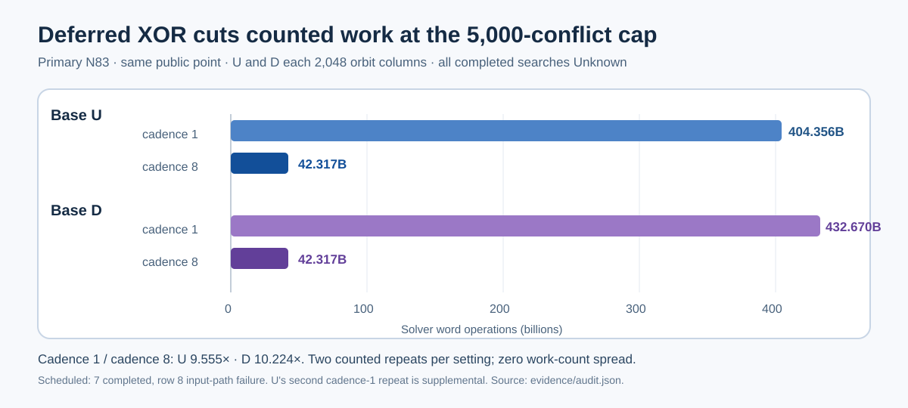

# N83 m5: 9.555–10.224× less work at the conflict cap

Cadence 8 reduced counted solver word operations at 5,000 conflicts from
404.356B to 42.317B for U and from 432.670B to 42.317B for D on the same
public N83 point. All completed runs returned `Unknown`. The exact
[audit](../../evidence/audit.json) reports zero work-count spread in the two
repeats per setting, with U's second cadence-1 run supplemental after the
scheduled position-8 path failure.

The [figure data](cadence_work.data.json) derives from the audit. The same
111,478-variable, 1,140,557-initial-clause, 4,980-XOR-row model was built
for both bases, with the only solver setting difference being
`set_xor_decision_cadence(1|8)`. The [source lock](../../SOURCE_LOCK.md)
fixes the worker SHA-256 and binary SHA-256 before execution. The
[protocol](../../PROTOCOL.md) fixes exact object/corpus hashes, public point,
schedule, caps and work-count endpoint. The [amendment](../../AMENDMENT_1.md)
retains the failed launch separately from the corrected supplement.

Cadence-8 traces matched across U and D through the cap: 25,314 decisions,
8,251 XOR passes, 15,257,233 XOR row scans, and 42,317,365,862 word ops.
This makes base-specific relation progress unresolved at this cap. Search
wall intervals were U 137.989–138.355 s (cadence 1) versus 15.359–15.430 s
(cadence 8), and D 148.408–157.289 s versus 15.446–15.657 s. The host was
shared Apple M4 Pro Darwin arm64, so these are descriptive L0 intervals.

The independent verifier rehashed both exact archived objects, replayed the
public point on its curve and subgroup, checked all receipts and calculated
the work ratios. A one-word-op mutation was rejected with no audit output.
The result is a solver-work gate. The next test must use an equal word-work
allowance, seek a natural relation and replay a rank increment before this
setting is adopted for the factor-base comparison. The canonical IC
leaderboard and progress timeline were checked and left unchanged because
these capped searches do not define a completed candidate.
