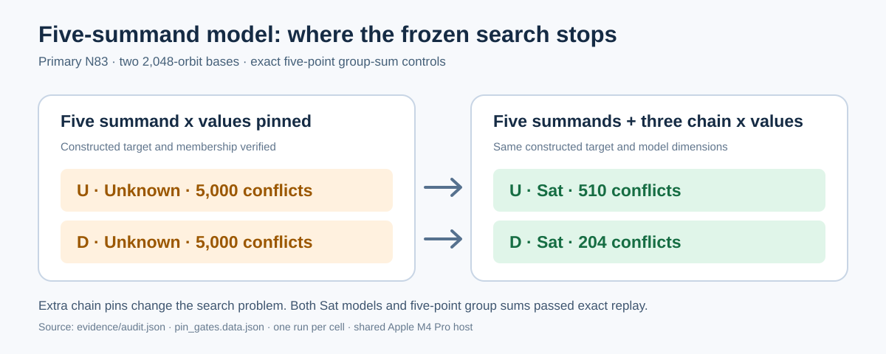

# N83 K2048 m5: verified full-chain satisfiability

Both exact K2048 bases yielded verified `Sat` models for constructed
five-point relations when the three internal chain x values were supplied.
Leaving those values free returned `Unknown` at the 5,000-conflict cap. This
pinning result locates the search gate in the free chain; it supplies no
factor-base ordering because U and D used distinct constructed targets.



The [figure data](pin_gates.data.json) is copied from the independent
[audit](../../evidence/audit.json). Each cell is one run, with no sampling
interval. [RESULT.md](../../RESULT.md) gives the exact curve, archive hashes,
model dimensions, four status and timing rows, source digests, and scope.

The workers were compiled with `cargo build --release --locked` for the two
named examples. For each exact U/D archive the command pattern was:

```text
target/release/examples/n83_k2048_m5_planted <U|D> <archive.jsonl.gz> <receipt.json>
target/release/examples/n83_k2048_m5_fullchain <U|D> <archive.jsonl.gz> <receipt.json>
target/release/examples/n83_k2048_m5_planted_verify <U archive> <D archive> <U receipt> <D receipt> <U fullchain receipt> <D fullchain receipt> <audit output>
```

The object paths were the content-addressed files named in
`research/n83_d18_k2048_20261027/RESULT.md`. The auditor passed on the
committed receipts, then rejected the copied U full-chain receipt with its
first target coordinate changed to zero. The negative-control result is
retained in `evidence/negative-control.json`. The host was shared Apple M4 Pro
Darwin arm64; times are solver diagnostics, without a Tier 0/Tier 1 timing
claim. This control was selected after the natural panel and has no prior
frozen U/D performance hypothesis. The canonical IC leaderboard and progress
timeline receive no new point from these control outcomes.

The immediate algorithm target is to constrain or solve the intermediate
chain from the public target and base without disclosing a constructed path.
An ordinary-query model, lifted group relation and verified rank increment
are the next gates before any complete factor-base comparison.
