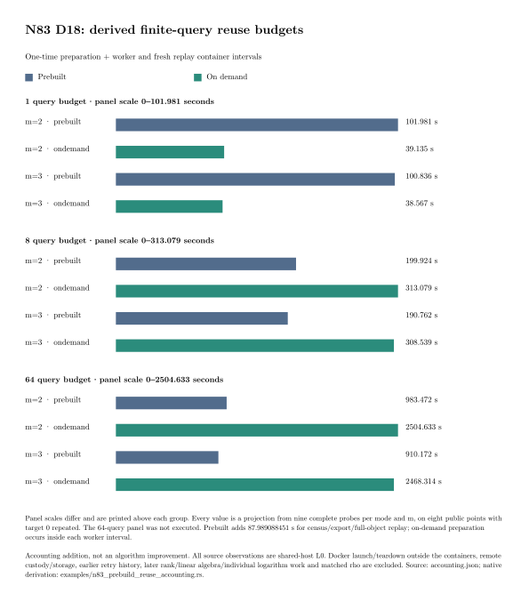

# N83 finite-query reuse accounting

**Classification: accounting addition, with no algorithm change or new
timed query.** The frozen preparation protocol specifies reuse counts
1, 8 and 64. This native reconstruction completes the missing 64-query
projection and explicitly adds fresh per-query replay and the worker
container boundary.

## Original interval and accounting correction

The earlier projections charged census, export, generic whole-base
replay and the mean query worker interval. They omitted fresh per-query
receipt replay and the interval outside the worker's internal timer.
The original numbers remain preserved as the worker-interval view.
The additional column below uses the actual worker and replay container
start/end intervals. Neither view is a complete cold IC cost.

Every number in this table is **derived**, in seconds:

| m | Reuse count | Prebuilt: setup + workers | On demand: workers | Prebuilt: setup + worker/replay containers | On demand: worker/replay containers |
|---:|---:|---:|---:|---:|---:|
| 2 | 1 | 97.838 | 35.131 | 101.981 | 39.135 |
| 2 | 8 | 166.777 | 281.045 | 199.924 | 313.079 |
| 2 | 64 | 718.292 | 2,248.356 | 983.472 | 2,504.633 |
| 3 | 1 | 96.818 | 34.601 | 100.836 | 38.567 |
| 3 | 8 | 158.617 | 276.812 | 190.762 | 308.539 |
| 3 | 64 | 653.009 | 2,214.496 | 910.172 | 2,468.314 |



Panel scales differ and are labeled. The 64-query panel was not executed.

## Native evidence reconstruction

[`n83_prebuild_reuse_accounting.rs`](../../../../examples/n83_prebuild_reuse_accounting.rs)
checks the pinned [paired manifest](../../runs/paired-mode-v1.sha256) and
all **833 files** it names. It requires all 36 expected complete probes,
their identical D point/label sets, exact finite attempt counts, all 36
fresh replay bindings, successful non-OOM container exits and nanosecond
timestamps on the frozen card date.

Each m/mode has nine observations: two at target 0 and one at each of
targets 1–7. All arity-2 probes complete 2,760,082 complement attempts;
all arity-3 probes complete `2^20` pair draws. Their finite-event relation
rows and ranks are zero. That does not estimate unrestricted natural yield.

| m | Mode | Mean worker interval (s) | Mean worker container (s) | Mean fresh replay container (s) |
|---:|---|---:|---:|---:|
| 2 | prebuilt | 9.848484 | 9.900365 | 4.091555 |
| 2 | on demand | 35.130566 | 35.182691 | 3.952197 |
| 3 | prebuilt | 8.828438 | 8.880963 | 3.965646 |
| 3 | on demand | 34.601494 | 34.651515 | 3.915884 |

Prebuilt setup is **87.989088451 s**: census 27.913872792 s +
export 39.372869997 s + generic full-object replay 20.702345662 s.
Each source receipt has an exact digest in [accounting.json](accounting.json).
The setup phases use separately recorded native revisions from the paired
query worker, on the same shared L0 host.

The new formula is `setup + q × (mean worker container + mean fresh replay
container)`. The earlier formula is `setup + q × mean worker interval`.
On-demand enumeration, closure and indexing are inside every on-demand
worker, so its separate setup term is zero.

The [native regression test](native-test.log) passes. It rejects
capped/failed container outcomes, nonpositive intervals, wrong dates and
malformed fractional timestamps. The [native reconstruction](native-run.log)
exited [zero](native-run.exit). CI repeats it and requires byte-identical
JSON. The graph and PDF read that JSON directly.

## Remaining costs and original requirements

Worker peak RSS reached 651,149,312 bytes prebuilt and 563,486,720 bytes
on demand. This is observed worker RSS, not a measured memory peak for
an unexecuted 64-query panel. Per-arm observations are retained.

The following remain outside these projections:

- Docker launch/teardown outside the container intervals, upload, custody
  and persistent storage.
- Earlier implementation/infrastructure retry history, retained in the
  original run directories.
- Natural useful-rank collection beyond these exact finite events,
  linear algebra and individual logarithm verification.
- Matched same-point rho and the external-fastest comparison.

The original card occupied 16 min 48 s including its setup, controls,
repeats, launches and replay operations. That observed card interval is
not replaced by this projection. `candidate_id`,
`selected_best_total_runtime`, `complete_ic_seconds` and
`matched_rho_gap` remain null.

This completes the specified reuse-count calculation and makes a
previously excluded verification interval visible. It does not close
the complete IC accounting or factor-base selection gates. Canonical
qualified-cost and boundary graphs remain unchanged. The original
[worker-interval result](../result-20261019/) is preserved; this
addendum supplies the expanded interval and all three reuse counts.

## Reproduction and artifacts

```sh
cargo test --release --example n83_prebuild_reuse_accounting
cargo run --release --example n83_prebuild_reuse_accounting -- \
  research/n83_prebuild_cost_m23_20261019 /tmp/reuse-accounting-new.json
cmp /tmp/reuse-accounting-new.json \
  research/n83_prebuild_cost_m23_20261019/reports/reuse-20261020/accounting.json
```

The [PDF](RUN_REPORT.pdf), [SVG](reuse.svg), [150 dpi PNG](reuse.png)
and editable [graph source](reuse.typ) / [report source](report.typ)
are kept together, with browsing copies in
[`benchmarks/20261020-n83-prebuild-reuse/`](../../../../benchmarks/20261020-n83-prebuild-reuse/).
