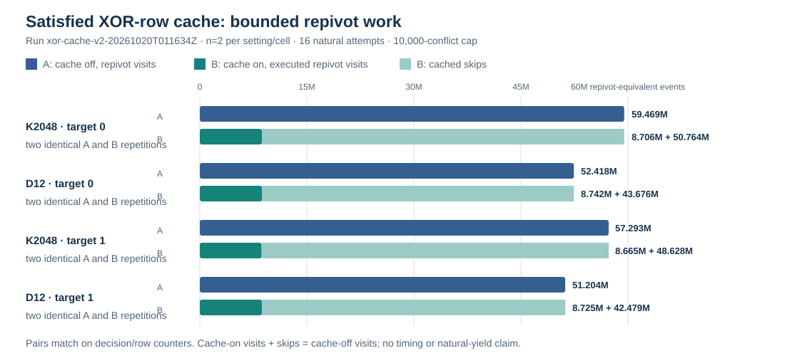

# XOR-cache v2 bounded work-counter run

**Run ID:** `xor-cache-v2-20261020T011634Z`  
**Status:** `COMPLETE_BOUNDED`; completed 2026-10-20 02:00:10 UTC  
**Frozen source:** worker `1de47a9d4186bff08abc84c224a111183e820106`; driver `f1667c313910a1021daed455c9e48cd03524f42a`.  
**Protocol:** [XOR_CACHE_PROTOCOL.md](../../XOR_CACHE_PROTOCOL.md), policy `small-m4-xor-cache/v1`.

## What ran

The existing authorized SSH card ran 16 fresh natural attempts in four cells: K2048 and D12 crossed with public target indices 0 and 1. Each cell ran A1/B1/B2/A2 (cache off/on/off/on). All 16 attempts reached the frozen 10,000-conflict cap and retained `UNKNOWN_search_cap`; no natural relation returned. Target 1 was the frozen fresh m=4 holdout.

Workers ran on the shared authorized Spot SSH host under a 4 GiB memory cap, zero swap, CPU 31 with one CPU quota, read-only inputs and no worker network. The run therefore earns L0 isolation. The scalar validation sidecar stayed outside worker containers. Four constructed controls and four independent general-field replays passed; see the [control report](../run-xor-cache-controls-20261020/RUN_REPORT.md).

## Recorded work counters

Each row below summarizes two repetitions per cache setting; A1=A2 and B1=B2 for all listed fields within that cell. Conflicts were 10,000 for every attempt. Values are recorded integer counters, not time estimates.

| Base | Target | Decisions | Restarts | XOR passes | Row ops | Row scans | Off repivots | On repivots | On cache skips |
|:--|--:|--:|--:|--:|--:|--:|--:|--:|--:|
| K2048 | 0 | 37,942 | 43 | 101,087 | 9,346,237 | 302,579,749 | 59,469,058 | 8,705,524 | 50,763,534 |
| D12 | 0 | 31,779 | 43 | 91,497 | 8,131,482 | 271,867,188 | 52,417,870 | 8,741,736 | 43,676,134 |
| K2048 | 1 | 37,931 | 43 | 98,153 | 9,221,780 | 293,792,777 | 57,293,217 | 8,664,828 | 48,628,389 |
| D12 | 1 | 31,795 | 43 | 89,997 | 9,757,009 | 267,151,225 | 51,204,462 | 8,725,194 | 42,479,268 |

For every pair, decisions, conflicts, restarts, XOR passes, row operations, and row scans match between settings. The cache conservation check also passes exactly: on repivot visits + cache skips = off repivot visits. The graph shows those counters; [work-counters.json](work-counters.json) contains the cell data.

## Limits and interpretation

This bounded event supports the component-level statement that the cache replaces repeated repivot work with cache skips while preserving the listed solver counters in these capped cells. It does **not** establish a wall-time improvement: shared-host elapsed values are retained in the archive but are not compared. Every natural attempt is censored at the conflict cap, so natural yield, useful rank, complete IC cost, and base selection remain unresolved. The default cache remains disabled pending qualified follow-up and the remaining gates in [the study result](../../RESULT.md).

No canonical IC leaderboard, performance-history series, or `benchmarks/README.md` row is updated: this card returned no natural relation/rank and admits no time or speed claim. The new study-local graph is the graphable counter result. Existing canonical charts and prior benchmark entries remain unchanged.

## Raw evidence and audit

The deterministic archive contains all 16 attempts, phase/progress receipts, worker records, container and image inspections, host exits, and frozen host/card files. Archive SHA-256: `cf3310c7cb597c144b30a427683ed41d37cf4e2ec2425945d259a1173e776abd`. The per-file manifest is [xor-cache-v2-final.files.sha256](../../runs/xor-cache-v2-final.files.sha256), SHA-256 `55a87e7e0ca6561c48d1ad558ec8b3d8ba385e4cb4c26a6b6188688732eea4ee`; archive: [xor-cache-v2-final.tar.xz](../../runs/xor-cache-v2-final.tar.xz).

## PDF rendering blocker

[RUN_REPORT.typ](RUN_REPORT.typ) is the source and embeds the SVG graph. No current PDF is committed. Typst, Pandoc, and LaTeX are absent; `groff -Tpdf` fails with a missing DESC file and invalid device. The managed executor's network-policy snapshot is absent and the `environment_status` connector is unavailable, so the Typst install fallback could not be used. No stale PDF is presented as current.
