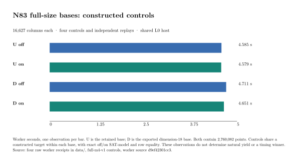

# N83 full-size bases: controls passed; public panel started

The `full-m4-v1` card started **2026-10-20 02:06:17 UTC**, after the
complete smaller-base cache audit passed. All four full-base constructed
controls and all four separate general-field replays passed. Both native
off/on pair checks passed on the runner and again locally from the exact
archived receipts. The eighteen-attempt natural panel then started.

## Exact bases and observed controls

U is the retained public-x-hash base and D is the exported dimension-18
direct-subgroup base. Both contain **16,627 signed-Frobenius columns and
2,760,082 points**, on `icv1-f2m83-tm6151469093347-debefd74`, a=0,
subgroup 2417851639230796216685689, cofactor 4, modulus
z^83+z^45+z^2+z+1. Their accepted sets differ.

| Base / cache | Worker interval (ms) | Root (ms) | SAT call (ms) | Cgroup peak (bytes) |
|---|---:|---:|---:|---:|
| U / off | 4,585.473245 | 194.155316 | 2.040952 | 974,344,192 |
| U / on | 4,578.888678 | 185.396011 | 2.023813 | 974,790,656 |
| D / off | 4,711.206577 | 191.111789 | 2.414447 | 976,572,416 |
| D / on | 4,650.842813 | 179.361219 | 2.200636 | 975,892,480 |

One observation per cell, zero decisions/conflicts, rank one for each
constructed witness. Every off control records 11,454 checked visits;
every on control records 7,719 checks plus 3,735 cached skips. Search
work and complete SAT-model / sparse-row digests agree within each base.
Different bases use different constructed targets. The same sparse
coefficient-row digest across bases does not equate their group points.

The native pair gates additionally bind the independent replay to the
exact worker bytes and require target/point/coefficient tamper rejection.
These are constructed correctness controls and shared-host L0 intervals;
they do not determine natural yield, rank or a timing winner.

## Execution, accounting and evidence

Worker/replayer source `d9ef42301cc3d22f437e1f89304e673836afb6a3`.
The [host card](../../FULL_M4_HOST_CARD.md) records both binary hashes,
input/card/audit bindings and the native Linux build/test window
02:01:21–02:01:35 UTC, after the preceding timed card ended. Final Linux
example tests passed 5 + 2 + 2 + 2; the unchanged solver/library tree is
covered by the earlier complete Linux suite of 4,403 passing tests.

Intel Xeon 6975P-C SSH Spot runner, CPU 31, one CPU quota, hard 4 GiB,
zero swap, no worker network, read-only root/inputs, no scalar sidecar.
Other workloads share the host. Control evidence copying occurred during
the subsequent natural arm; no remote compilation overlapped either
timed card. Worker intervals include import/index, corpus/model/root,
SAT, group checking and rank, ending before final receipt serialization.
Container/card intervals, independent replay, construction/export, whole-base
replay and final output/custody remain separate charges.

[Control snapshot](../../full-m4-v1/controls/README.md): **107 checked files**;
archive SHA-256
`3f017d34fd4a9a71c6af7a44a425c085f0be6df8dc34a405d9962d010d8b5d94`.
The plot reads four unmodified worker receipts in `data/`. The inspected
PDF, SVG and 150 dpi PNG have matching browsing copies in
`benchmarks/20261020-n83-full-m4-controls/`.

## Public panel and unresolved gates

The [protocol](../../FULL_M4_PROTOCOL.md) uses all eight frozen public
points, U,D,D,U at index 0 and alternating base order thereafter.
Eighteen cache-on natural attempts, free selectors/phases, one model,
10,000 conflicts, 1,790/1,800 s caps; at most nine hours of natural process
allocation. Every returned row must be independently replayed before
useful-rank aggregation. Caps, failures and interruptions remain retained.

At **02:10:07 UTC**, `t0-u1` was active; its 204,567.343978 ms sample
recorded 97,832 decisions and 145 conflicts in XOR propagation. This is
an in-progress observation, not a completed outcome. The
[live handoff](../../full-m4-v1/STATUS.md) gives the supervisor, paths and
collection requirements. The existing SSH script continues independently;
no automatic chat or PR check-in is configured.

Natural useful rank, all cold/reused IC phases, matched same-point rho,
external-fastest comparison and best-base selection remain open. Canonical
leaderboard/boundary rows and their twins remain unchanged because this
control gate supplies no newly qualified cost or selection. The PR's
pending solver merge conflict does not alter the pinned experimental code.
