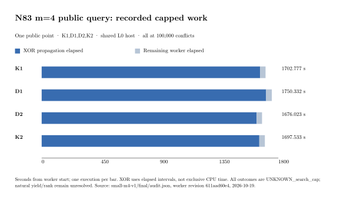

# N83 smaller-base m=4: completed bounded public-query card

**Observed outcome:** all four required natural arms finished at the
100,000-conflict limit with `UNKNOWN_search_cap`, normal exit and no OOM.
The card ran from 2026-10-19 18:54:41 to 20:48:34 UTC. Both constructed
controls and their separate general-field replays passed before public
search. The native receipt audit passes all 132 retained files.

## Workload and provenance

Primary curve `icv1-f2m83-tm6151469093347-debefd74`, a=0, subgroup
2417851639230796216685689, cofactor 4, polynomial z^83+z^45+z^2+z+1.
The bases are the pinned K2048 explicit-orbit object (2,048 columns,
339,968 points) and D12 structured closure (2,001 columns, 332,166 points).
Both retain the signed Frobenius symmetry; their accepted sets differ.

All searches used target 0 from the common eight-point public corpus,
SHA-256 `2895a78d28935a992d8d6155492eae928e165eafcc622e6c866080b8f91e70b5`:
(1834913121178197242856238, 8797964190732846213981377).
The solver received no validation scalar sidecar. Order K1,D1,D2,K2;
same deterministic solver, four summands, free selectors/phases, 100,000
conflicts, at most one model, 1,790-second process deadline, 1,800-second
outer cap, 300,000 variables and 8,000,000 domain clauses.

Worker commit `611aad60e4d9952d6239a3382a77184da3640eeb`; binary SHA-256
`3048550afc4ad1bdad1e390f74802112dfc6fadf96048cbff823f8f65364b0c3`.
Frozen [protocol](../../SMALL_M4_PROTOCOL.md),
[host card](../../SMALL_M4_HOST_CARD.md),
[v2 launch checks](../../SMALL_M4_HOST_CARD_V2.md).
The source revision is shared by all arms. This is one public point with
two repeated executions per base; it is not four independent targets.

## Measured receipts

| Arm | Worker wall (s) | Search (s) | Recorded XOR elapsed (s) | Decisions | Progress samples | Peak cgroup (bytes) |
|---|---:|---:|---:|---:|---:|---:|
| K1 | 1,702.777036 | 1,702.117256 | 1,661.246862 | 214,306 | 172 | 793,550,848 |
| D1 | 1,750.332048 | 1,749.695497 | 1,706.979651 | 208,142 | 176 | 774,057,984 |
| D2 | 1,676.022754 | 1,675.381801 | 1,634.681506 | 208,142 | 169 | 772,153,344 |
| K2 | 1,697.533479 | 1,696.853591 | 1,655.232491 | 214,306 | 171 | 800,825,344 |

Each arm recorded exactly 100,000 conflicts and 254 restarts. Both K
executions recorded 779,187 XOR passes, 476,855,934 repivot visits,
73,250,978 row operations and 2,233,220,055 row scans. Both D executions
recorded 764,997 passes, 467,890,580 repivot visits, 72,604,225 row
operations and 2,207,678,134 row scans. These equal repeated counts are
useful as a frozen search-path control. The counter named `repivots`
also counts visits to fully assigned rows; it does not count only actual
pivot changes (see `src/cryptanalysis/sat.rs::propagate_xors`).

All arms passed root propagation (`Fixpoint`, 89.345–93.593 ms), entered
search and returned `Unknown`. Progress is present through a final sample
whose counters equal the final worker receipt. Maximum sampling gap by
arm was 10.019, 10.030, 10.040 and 10.123 seconds. Samples use independent
relaxed atomic loads; intermediate counter tuples need not be simultaneous.

Derived recorded-XOR/worker-wall fractions are 97.561%, 97.523%, 97.533%
and 97.508%, respectively. The numerator is accumulated `Instant` elapsed
time inside completed XOR propagation calls; it is not hardware cycles or
exclusive CPU time. The plotted remainder is worker wall minus this
counter. No between-base speed ratio or statistical winner is admitted.

## Host and accounting boundary

The authorized SSH Spot runner was an EC2 m8i.8xlarge, CPU 31, one CPU
quota, hard 4 GiB memory, zero swap, network disabled, read-only inputs and
root. Other research and migration workloads shared the host. These are
**L0 observations**, with no quiet-host performance claim. The archive
preserves configuration and initial host activity. No timed run was
concurrent with our compilation.

Worker wall includes import/index, corpus checking, model construction,
root propagation and the capped search. The archive additionally retains
preflight/control/replay and container start/end intervals. Base
construction/export, earlier independent whole-base replay, Docker launch,
this later audit, complete relation collection, linear algebra, scalar
verification, external solver comparison and matched rho are outside the
worker interval. Their absence prevents a complete IC cost or base ranking.
Every capped search remains charged as observed work.

## Requirement status and next experiment

| Requested gate | Status after this card |
|---|---|
| D18 export and complete independent point/label replay | Verified in the parent census/export evidence; unchanged here |
| Durable m=4 progress | Verified through completed capped searches in both smaller arms |
| Common public-query comparison and useful rank | Partial: target 0 completed as four censored searches; targets 1–7 and natural rank remain open |
| Prebuilt versus on-demand full cost | Partial: prior same-set finite m=2/m=3 costs retained; complete IC and matched rho remain open |
| Independent m=2/m=3 policies | Frozen and executed for their finite events in the earlier panels; broader natural rank remains open |

The observed concentration of elapsed work in XOR propagation motivates
one implementation hypothesis: cache a fully assigned, satisfied XOR row
until any unassignment or matrix rebuild. The current implementation
revisits such rows when `pivot == None`. Validate backjump, restart,
incremental-row and conflict behavior before comparing fresh cache-off/on
runs. Preserve exact verdict/model/search semantics and add fresh public
holdouts under a separately frozen card. This is a proposed engineering
change, with no measured gain in this report.

No natural relation receipt was returned in these capped searches, so no
natural relation replay can be performed on this card. Natural yield and
rank stay null; caps do not prove that a relation is absent. The verified
IC baseline and distance to matched rho are not supplied by this component
experiment. Candidate and selected-best-runtime fields remain null.

Canonical `docs/ic-leaderboard.html`, boundary ledger/scoreboard and IC
progress graphs are unchanged: this closes receipt coverage for a bounded
search and admits no pipeline improvement or changed frontier. Historical
control and live-snapshot reports remain unchanged. Benchmark copies of
this report and graph are in `benchmarks/20261019-n83-small-m4-natural/`.

## Evidence and reproduction

- [Complete archive and native audit](../../small-m4-v1/final/README.md),
  [audit.json](../../small-m4-v1/final/audit.json).
- [Earlier independently replayed controls](../run-small-m4-controls-20261019/RUN_REPORT.md).
- [Study result](../../RESULT.md) and [open problem](../../../../problems/n83-prebuilt-base-quality-m2-m4.md).
- Plot source `natural.typ` reads the native audit JSON. Render from the
  repository root with `typst compile --root . --format svg .../natural.typ
  .../natural.svg`, render SVG at 150 dpi using `rsvg-convert`, and compile
  `run-report.typ` with the same root. Both PDFs embed this same SVG.

Archive SHA-256: `b319353bf163c91b3180d6bf863b5129c580d3b7852751f345e4fd257b5abee9`.
