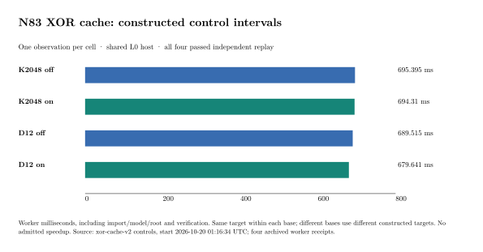

# N83 XOR cache: retained launch failures and replayed controls

The corrected `xor-cache-v2` card started at **2026-10-20 01:16:34 UTC**.
All four constructed controls (K2048/D12, cache off/on) passed, each followed
by separate native general-field replay. Each checked row has rank one.
Within each base, off/on returned identical complete SAT-model and sparse
row digests. The subsequent sixteen-public-search card started after
these controls. Its natural outcomes are outside this control snapshot.

## Preserved execution history

| Attempt | Observed outcome | Natural searches |
|---|---|---|
| `xor-cache-v1`, 01:08:07 UTC | Docker lacked the exact pinned image; stopped before worker execution, exit 1 | None started |
| `xor-cache-v1-image-restored`, 01:10:50 UTC | K2048 off control and replay passed; global shell label caused a doubled `-replay-replay` path, exit 2 | None started |
| `xor-cache-v2`, 01:16:34 UTC | Subshell-isolated driver passed full-card fixture tests; four actual controls and four replays passed | Public card entered search |

Both failed attempts remain archived, with 19 and 39 checksummed files.
The image was restored at the same digest; no image version changed.
The driver fix changes variable scope without changing solver policy.
Both continuations were committed before execution. The native fixture
harness tests all 24 calls in exact order, retention of a wall-capped arm,
continuation through the remaining cells, and refusal to reuse output.
Its receipts are fixtures for controller checks, not cryptographic results.

## Measured constructed controls

| Base / cache | Worker wall (ms) | Root (ms) | Search (ms) | Peak cgroup (bytes) | Cached row visits skipped |
|---|---:|---:|---:|---:|---:|
| K2048 off | 695.394585 | 100.907564 | 0.287170 | 227,422,208 | 0 |
| K2048 on | 694.309706 | 97.582885 | 0.291008 | 226,725,888 | 3,735 |
| D12 off | 689.514805 | 99.860792 | 0.275822 | 218,370,048 | 0 |
| D12 on | 679.640676 | 97.212915 | 0.293882 | 218,210,304 | 3,735 |

One observation per cell, with pinned selectors, phase zero and seven x
blocks. All four used zero decisions/conflicts. These correctness controls
are L0 observations on a shared host; no timing ratio or speedup is admitted.
Different bases have different constructed targets. The recorded cache
skips verify activation, not natural-query effectiveness.

The complete SAT-model digest for K2048 off/on is
`414830c5f6fbb3e20c0d8b9d70939602784f305e03a047d246163146ad4afdd8`;
for D12 off/on it is
`40225cd8d08b5c82a3e7bb21b29209dc562bf34c1834efd912b93f07d09c530d`.
All four sparse rows use the first four columns with coefficient one, so
their row digest matches despite different point sets and targets. Each
separate replayer checks the actual point/group sum, subgroup, phase/sign
labels and coefficients, and rejects changed target/point/coefficient.

## Exact policy, host and validation

Curve `icv1-f2m83-tm6151469093347-debefd74`, a=0, order
2417851639230796216685689, cofactor 4, polynomial z^83+z^45+z^2+z+1.
K2048 has 2,048 columns / 339,968 points; D12 has 2,001 / 332,166.
Worker revision `1de47a9d4186bff08abc84c224a111183e820106`; same binary for
both cache settings. All object, corpus, source and binary hashes are in
[the host card](../../XOR_CACHE_HOST_CARD.md) and each archive manifest.
The general-field verifier is a separate executable with distinct arithmetic
from the worker's fast field/group path.

Authorized SSH host, Intel Xeon 6975P-C, 32 logical CPUs; one CPU quota
on CPU 31, hard 4 GiB, zero swap, no worker network, inputs and root read-only.
Other workloads shared the host. Compilation and tests finished before
the card; small evidence snapshots were copied while the public card ran.
The host qualification is L0. Worker wall includes import/index, model,
root, search, group checking and rank insertion. Base construction,
Docker launch, independent replay and failed-launch overhead are outside
the worker interval and remain separately retained. This table does not
give a complete cold IC cost. The worker elapsed field ends before final
receipt serialization; retained container start/end times include the
process boundary. Output/custody costs must still be charged in a complete
comparison.

Validation: candidate Linux release library 4,403 passed / zero failed /
118 ignored; final worker 3, receipt auditor 2, general-field replayer 2,
and driver-sequencing fixture 2 release tests passed. The local cache
invalidation and 400-case differential tests passed. A cancelled local
duplicate example build is retained and excluded from passing checks.
See [validation details](../../XOR_CACHE_VALIDATION.md).

## Remaining gates and sources

The natural card uses targets 0 and 1 (fresh holdout for this m=4 policy),
K2048 and D12, A1/B1/B2/A2 in each cell, 10,000 conflicts and the same
1,790/1,800 s caps. Preserve all failures, compare equal completed work,
and independently replay any returned relation. Natural yield/rank, full
IC cost, same-point rho, external-solver comparison and best-base selection
remain open. Candidate and best-runtime fields remain null. The cache is
off by default. This control gate makes no qualified performance claim.

- [Frozen protocol](../../XOR_CACHE_PROTOCOL.md),
  [image continuation](../../XOR_CACHE_IMAGE_CONTINUATION.md),
  [driver continuation](../../XOR_CACHE_DRIVER_CONTINUATION.md).
- Failed launch archive SHA-256 `b1383ed0e20f1bad665bf152060297e25f62e377cdcc3e6a42af4b9bed1b3754`;
  driver failure `abc3de188f719a3c784b06d45fb023f0fe3bd01f8dfc77ea7a6b8f6d24dc7515`,
  under `../../xor-cache-v1/`. Extract each archive in a new directory and
  run `shasum -a 256 -c files.sha256`.
- Control archive: `../../xor-cache-v2/controls/controls.tar.xz`, SHA-256
  `fcaa18926f019f0fcc9fdd739827e58beaa8ce675bac355aa276656468c24f84`;
  all 104 file hashes passed. Four worker JSON copies in `data/` are
  byte-identical to the archived receipts and directly supply the plot.
- [Completed prior 100,000-conflict card](../run-small-m4-natural-20261019/RUN_REPORT.md).

The study plot/PDF and `benchmarks/20261020-n83-xor-cache-controls/` copies
share the same Typst/SVG source. Canonical leaderboard, boundary and
progress graphs stay unchanged: the natural comparison is still pending
at this control boundary and this report selects no winner.
