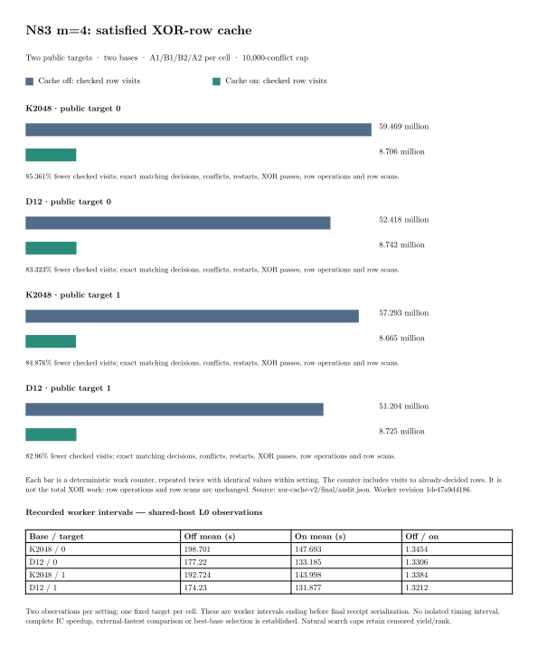

# N83 m=4: complete matched XOR-cache diagnostic

**Completed:** all sixteen natural attempts, four constructed controls and
four independent control replays. The card ran 2026-10-20 01:16:34–02:00:10
UTC. Every natural attempt exited normally at exactly 10,000 conflicts
with `UNKNOWN_search_cap`, without OOM. Natural yield/useful rank remain
censored. The native audit passes all **294 archived files**.

## Exact workload and baseline

Curve `icv1-f2m83-tm6151469093347-debefd74`, a=0, subgroup
2417851639230796216685689, cofactor 4, polynomial z^83+z^45+z^2+z+1.
K2048 has 2,048 columns / 339,968 points; D12 has 2,001 / 332,166.
Both are the pinned signed-Frobenius closures from the preceding study.

The baseline for this component comparison is cache off under the same
worker revision `1de47a9d4186bff08abc84c224a111183e820106`. The candidate
changes only satisfied-row caching. Binary SHA-256:
`a9b8599761c6cce8a169602086c3426af9f9f7a55a8108124daed56059ffb3bc`.
This is distinct from the earlier 100,000-conflict card; its timings are
not combined with those earlier observations.

Public corpus SHA-256
`2895a78d28935a992d8d6155492eae928e165eafcc622e6c866080b8f91e70b5`,
indices 0 and 1. Target 1 was a fresh m=4 holdout. Each cell runs
off/on/on/off as fresh processes. Cell order K2048/0, D12/0, K2048/1,
D12/1. Four free summands, one model, 10,000 conflicts, 300,000 variables,
8,000,000 domain clauses, 1,790 s internal / 1,800 s outer caps. The
validation scalar sidecar was excluded. See the frozen
[protocol](../../XOR_CACHE_PROTOCOL.md), [host card](../../XOR_CACHE_HOST_CARD.md)
and [driver continuation](../../XOR_CACHE_DRIVER_CONTINUATION.md).

## Matched work and observed intervals

| Base / public target | Checked visits off | Checked visits on | Cached skips | Fewer checked visits | Mean worker off (s) | Mean worker on (s) | Off / on |
|---|---:|---:|---:|---:|---:|---:|---:|
| K2048 / 0 | 59,469,058 | 8,705,524 | 50,763,534 | 85.3613% | 198.700559 | 147.693254 | 1.345360 |
| D12 / 0 | 52,417,870 | 8,741,736 | 43,676,134 | 83.3230% | 177.219626 | 133.184731 | 1.330630 |
| K2048 / 1 | 57,293,217 | 8,664,828 | 48,628,389 | 84.8763% | 192.723953 | 143.998058 | 1.338379 |
| D12 / 1 | 51,204,462 | 8,725,194 | 42,479,268 | 82.9601% | 174.230091 | 131.876607 | 1.321160 |

Each setting has two executions per cell. Search decisions, conflicts,
restarts, XOR passes, row operations and row scans match exactly across
all four executions within each cell. Repeat visits/skips are identical
within setting. In every cell, on-visits plus skips equal off-visits.
The counter called `repivots` includes checked visits to already-decided
rows. This is **5.869–6.831 times fewer such visits**, not a reduction by
that factor in total XOR work. Row operations and row scans are unchanged.

This is a verified reduction in repeated checking work for these bounded
searches. Worker off/on ratios are descriptive **L0 observations** on a
shared host; two repeats and two public points do not establish a qualified
timing improvement or a factor-base winner. The cache remains off by
default. All candidate/best-runtime fields stay null.

## Correctness, host and accounting

The four constructed controls pass separate native general-field replay.
Off/on complete SAT-model and sparse-row digests match within each base.
Directed cache-invalidation tests and 400 exhaustive mixed CNF/XOR cases
pass; the complete candidate Linux library suite passed 4,403 tests,
zero failures, 118 ignored. The archive audit checks exact source/input
and binary identities, 24 container records, serial order, phases and
all durable progress through matching final counters.

Intel Xeon 6975P-C SSH Spot host, CPU 31, one CPU quota, hard 4 GiB,
zero swap, no worker network and read-only root/inputs. Other workloads
shared the machine. This session also read input metadata, hashed the U
object and transferred the next source bundle during this L0 card; no
remote compilation overlapped it. The next build began only after the
card ended. No isolated wall-time claim is made.

Worker intervals include import/index, corpus validation, model/root and
search; constructed controls also include group checking/rank. They end
before final receipt serialization. Container/card boundaries, controls,
replays and failed-launch history remain available separately. Construction,
export, whole-base replay, final output/custody, complete relation/rank
collection, linear algebra, verification, external solver comparison and
matched same-point rho remain outside the reported worker ratios.

## Evidence and next step

[Archive and audit](../../xor-cache-v2/final/README.md), archive SHA-256
`cf3310c7cb597c144b30a427683ed41d37cf4e2ec2425945d259a1173e776abd`.
The earlier missing-image and shell-label launch failures remain archived;
their controls and cost boundaries are described in the
[preceding report](../run-xor-cache-controls-20261020/RUN_REPORT.md).

The next [full-base public panel](../../FULL_M4_PROTOCOL.md) compares the
original two 16,627-class bases over all eight public points, with full
off/on control/replay gates before its eighteen natural attempts. This
returns the implementation improvement to the user's factor-base question.
Its execution state is recorded separately and cannot be inferred from
this completed diagnostic.

Canonical `docs/ic-leaderboard.html`, its table twins and boundary rows
were checked and left unchanged: this card supplies component work
counts and shared-host intervals, with no newly qualified pipeline cost
or selected best candidate. The component diagnostic and inspected
PDF/SVG/150 dpi PNG are copied to `benchmarks/20261020-n83-xor-cache-natural/`.
Full natural useful rank, cold/reused IC cost and matched-rho obligations
remain open.
