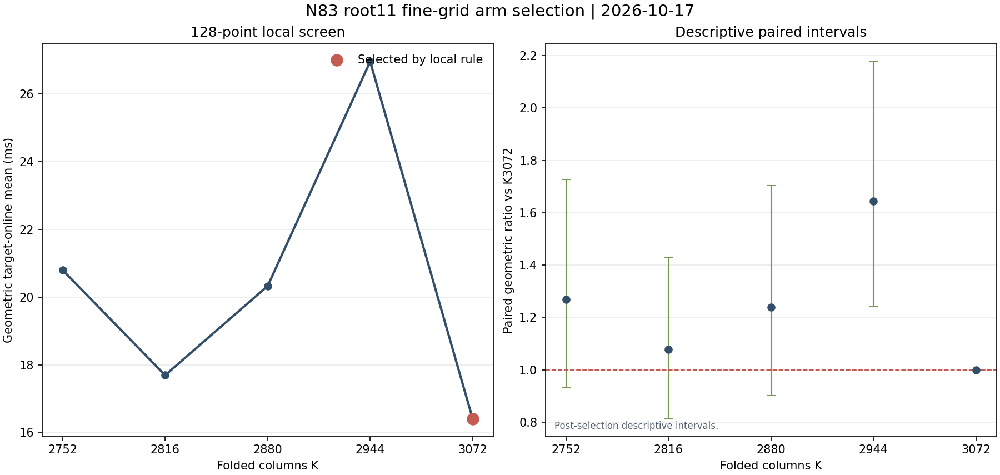

# N83 root11 fine-grid screen - results

Selection: K3072/root11 under the frozen minimum-geometric-mean target-online rule on these same 128 points. This is a selected local screen, not an independent confirmation set.

| K | Usable points | Folded columns | Geometric online mean (ms) | Median online (ms) | Complete shared-setup process (s) | Geometric ratio K/K3072 | Descriptive paired 95% interval |
| ---: | ---: | ---: | ---: | ---: | ---: | ---: | ---: |
| 2752 | 456,832 | 2,752 | 20.796 | 27.618 | 529.493 | 1.268 | [0.931, 1.727] |
| 2816 | 467,456 | 2,816 | 17.690 | 20.418 | 367.939 | 1.078 | [0.813, 1.430] |
| 2880 | 478,080 | 2,880 | 20.326 | 22.193 | 383.417 | 1.239 | [0.901, 1.703] |
| 2944 | 488,704 | 2,944 | 26.956 | 29.794 | 386.406 | 1.643 | [1.240, 2.177] |
| **3072** | 509,952 | 3,072 | 16.405 | 23.821 | 491.832 | 1.000 | reference |

K3072 has the lowest observed target-online geometric mean (16.405 ms). K2816 had the shortest complete shared-setup process (367.939 s); K3072 took 491.832 s. K3072 was faster than K2816 on 64 of 128 points. The paired K2816/K3072 geometric ratio is 1.078 with descriptive 95% interval [0.813, 1.430].

Intervals use paired per-point log ratios and the 1.979 standard-error multiplier specified in the source result. Since K3072 was selected on these same points, intervals are descriptive after selection and do not establish a general speedup. Do not treat this local screen as a fresh-point result.

## Limits of the separate cloud panel

The separate 24-point cloud Tier 1 selector remains BOUNDED_UNKNOWN. Corrected independent replay admits relations and scalars but marks stratum 3 NOT_ADMITTED: point 18 calibration spreads are 12.519% for K2816 and 11.739% for K3072, both above the frozen 10% threshold. See [STRATUM3_CENSORED.md](../../results/STRATUM3_CENSORED.md) and canonical [stratum3_analysis.json](../../results/stratum3_analysis.json).

The earlier producer diagnostic reports different point-18 spreads (12.471% and 13.355%). That discrepancy has not been reconciled; this report uses corrected independent-replay values above and does not rely on the producer diagnostic calibration percentages. No cloud-wide selector result or speedup is claimed.

## Provenance

Selected candidate: IC1N83Ckb1a1fb509952PDP4rootRCguidedLAgaussTDdirectISO0hec7ae07d8b9a. The 128 public target input SHA-256 is 72486b7d708023838db1104a4a5e75a04b915d6f6d4013057c934fb31000aa87. The 640 per-arm target intervals and probe counts remain in the committed [result files](../../results/). See [RESULT.md](../../RESULT.md) for the full run record. Source tree, protocol, inputs, source binding, and replay receipts remain the record of truth.

