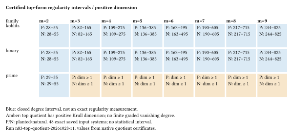

# Fixed n83 graded quotient certificates

Observations and explicit input-specific mathematical certificates; independent
scientific/formal review remains pending. Run `n83-top-quotient-20261028-r1`,
2026-10-28 05:24:08–05:25:18 UTC. All48 producer certificates and48 fresh-process
replays completed. All hashes match the previous fixed-base FFD/LFD inputs.



The figure directly renders recorded bounds/statuses from
[summary.json](../../evidence/summary.json). Blue intervals are rigorous bounds,
not statistical intervals or exact degrees. Amber cells prove positive Krull
dimension of the top quotient. Drawing source: [bounds-grid.typ](bounds-grid.typ).

There are34 finite intervals and14 positive-dimensional top-ideal certificates.
For binary/Koblitz m2,28<=dreg<=55; for m3..9,27m+1<=dreg<=nvars+1.
Prime m2 has29<=dreg<=55. Prime m3..9 maps onto Fp[u0], so no finite first degree
where the graded quotient vanishes exists under this convention. Neither
infinite Castelnuovo–Mumford regularity nor positive affine dimension is claimed.

The earlier four binary/Koblitz m2 inputs have FFD=LFD=2. Their original top-form
regularity is now at least28, separating these quantities for these exact inputs.
LFD remains unresolved for larger m and prime. No new LFD is inferred here.

The protocol was frozen and committed before affected data. Its SHA256 is
`4337e3059205595ab6839558e65b162f68077b30c025bff3175d39203adec660`.
Instrument commit `2de2ca48ec7e9fbb584146bf7e0b776d18ab6198`; clean instrument
source, existing-host backend, sequential native processes,8GiB virtual memory,
600-second producer/replay caps and1500-second outer budget. Exact launch:

```sh
timeout --signal=TERM --kill-after=20 1500 \
 research/n83_top_quotient_20261028/run.sh \
 /home/ec2-user/n83-fixed-degree-recovery/r1/results/inputs \
 /home/ec2-user/n83-top-quotient-recovery/target/release/n83-top-quotient \
 /home/ec2-user/n83-top-quotient-recovery/r1
```

Five native controls pass. No target-case failures, timeouts, restarts or removed
candidates. The producer retains failed projection attempts and all surviving
monomials. Replay recomputes every source check and certificate in a new process;
this is not independent research review. Times are diagnostic only; CPU times
were not collected and no solver speed comparison is claimed.

[DESIGN.md](../../DESIGN.md) gives the quotient-map proofs.
[FORMAT.json](../../FORMAT.json) specifies source identities, top-term hashes,
zero-based monomials, certificate fields and logs. The complete60-file archive
was downloaded again; SHA256 and manifest match. All original datasets remain
unchanged in their original S3 locations. This report and raw dataset are also
preserved in Git/S3 with content-addressed pointers.

The full elite-factor-base objective remains open. Future comparisons must
match base size, use held-out targets and hold preprocessing fixed. Adding
valid low-degree consequences changes a top ideal without improving a base;
retain original and transformed systems and report their metrics separately.
