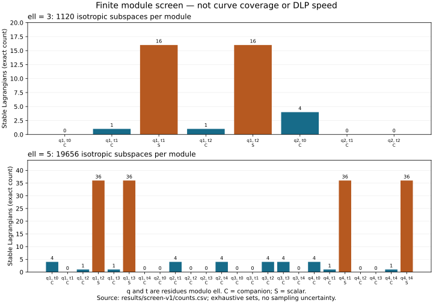

# Five ECDLP leads after the three-leads experiment

2026-10-19. **Search round plus an exact abstract-module screen.** No new
end-to-end DLP result or speedup is claimed. PR #2229 and its frozen evidence
remain unchanged. Work is on `codex/new-leads-20261019`; Conductor T-10/T-11.

The request was to put PR maintenance aside and discover more leads to chase.
This round audits the local research frontier against primary literature,
identifies five specific follow-up experiments, and executes the first finite
kernel screen. The mechanisms in the literature are established work; “new”
here means a new, explicit experiment for this workstream, not mathematical
priority or a claim that the entire repository has never mentioned it.

[Illustrated PDF](reports/search-report.pdf) · [Exact protocol](PROTOCOL.md) ·
[Native source](native/kernel_screen.rs) · [Run receipt](results/validation.json)

| Lead | Concrete question | Evidence now | First next action |
| --- | --- | --- | --- |
| L1: cubic odd-torsion transfer | Can an actual rational odd-torsion quotient of a cubic Weil restriction reach a smooth quartic? | 32 abstract-module cases screened; published construction exists; no new actual transfer executed | Replay Tian's published example with actual torsion and quotient/descent certificates |
| L2: odd-kernel escape from Smith-negative inputs | Can a 3- or 5-torsion quotient reach a quartic when the existing 2-torsion route does not? | Published genus-3 mechanism; local comparison proposed | Replay its published fixture, then a frozen 20-input Smith-negative holdout |
| L3: mixed-fiber PKM solver | Do separate tower fibers for the summands lower total root-and-lift cost? | New local hypothesis; no measured advantage | Small complete m=3 systems with homogeneous, mixed and random controls |
| L4: target-useful genus-2 rank | Can collection reach a useful target dependence sooner? | Existing 1,244/1,260 later-dependence observation; candidate unbuilt | Replay incumbent, instrument rank/cycle differences, freeze a target-blind policy |
| L5: projective genus-2 pipeline | Can checked arithmetic and normalization choices lower complete transfer IC cost? | Existing generic backend cost; no replacement measured | Establish model applicability, then replay the same full cohort against equally optimized rho |

**Chase order.** L1 is the first construction question. L4 is the most direct
next experiment on the verified genus-2 implementation; L5 follows with an
independent arithmetic change. L2 can reuse an odd-kernel implementation from
L1 but starts on a different source variety. L3 is a solver experiment, with
no expectation of extra relations. This ordering is research judgment, not a
measured ranking of eventual speedups.

## What the search ruled out as new directions

The [October 18 review](../ic_leads_review_20261018/README.md) already covers
large-memory solving-degree cells, the GHS genus-3 pipeline, quasi-subfield
bases and equal-advice rho. The quasi-subfield and Kummer-Fourier toy studies
record negatives within their stated domains. The
[supersingular-auxiliary study](../pkm_supersingular_aux_20261015/README.md)
already tests that PKM variation. Simply proposing any of those again would
not add a new discriminating question.

Tian's cubic odd-isogeny mechanism is also already cited in the weak-curve
atlas audit and general state-of-the-art note. What this round adds is an
executable module screen and concrete construction gates, not its discovery.
No claim of a repository-wide absence is made: this audit inspected named
reports, the problem/backlog indexes, and exact-term searches of tracked
research Markdown, source and examples at the pinned baseline.

## Exact module screen: completed

The standalone Rust program enumerates all rank-three subspaces of
`F_ell^6` by unique RREF bases and retains those isotropic for the standard
alternating form. It then checks invariance under each specified model
Frobenius matrix, for every nonzero `q mod ell` and every `t mod ell`, with
both companion and available scalar repeated-root modules. These are
**abstract modules**, not named experimental elliptic curves.

| ell | Rank-three subspaces enumerated | Lagrangians | Model cases |
| --- | ---: | ---: | ---: |
| 3 | 33,880 | 1,120 | 8 |
| 5 | 2,558,556 | 19,656 | 24 |

Every invariance decision agrees with a separate stacked-matrix rank
calculation. All finite matrix multiplier checks pass, the identity retains
the full Lagrangian population, and the rank-three non-isotropic control is
rejected. Debug/overflow-checked and optimized builds produce byte-identical
counts, witnesses and stdout. This is same-source replay, not independent
implementation or independent-host validation.

A useful distinction occurs at `ell=3, q=1, t=1`: the companion model has
**1** stable Lagrangian, the scalar model **16**. At `ell=5, q=1, t=2` the
counts are **1** and **36**. Thus trace and determinant alone do not determine
the candidate-kernel population. Some model cases have zero stable kernels,
for example `ell=3, q=1, t=0` in the companion case. Complete counts and first
basis witnesses are in [counts.csv](results/screen-v1/counts.csv) and
[modules.jsonl](results/screen-v1/modules.jsonl).

The model definition and limitations are frozen in PROTOCOL.md. The screen
checks no elliptic realizability, polarization indecomposability, rational
quartic equation, Serre/twist descent obstruction, map, prime subgroup, or
DLP solve. The specified modules are not asserted to exhaust all symplectic
conjugacy classes. Zero counts reject only their exact model/ell case;
positive counts do not certify an attack. No universal algebraic identity or
new asymptotic theorem is claimed from this finite enumeration.

## L1

**Cubic Weil restriction through an actual odd-torsion kernel.**
[Tian's construction](https://arxiv.org/html/2012.07173) motivates a route
that avoids requiring the original elliptic curve to have full rational
2-torsion. Its published example uses a 3-torsion kernel. Our new screen is
only its preliminary linear-algebra gate.

Start by reproducing the published `q=523` example, registering the exact
curve/subgroup before new curve experiments. Compute actual torsion and its
Frobenius action, check pairing isotropy and stability, reconstruct the
quotient and rational quartic, and verify transfer/dual recovery on 100
public known-answer targets. Handle exceptional points explicitly. Only
then freeze a disjoint curve cohort and measure complete kernel search,
construction, transfer, quartic solving and verification against source rho
and destination generic solving. A quotient existing geometrically does not
by itself establish a usable rational destination.

[Draft card](../../backlog/XP-20261019-cubic-odd-torsion-transfer/README.md).

## L2

**Odd-kernel exits from the current two-torsion route's rejected inputs.**
[Tian's genus-3 isogeny work](https://arxiv.org/html/2007.03172) provides a
separate starting point on a hyperelliptic Jacobian. This differs from
walking only the existing Smith two-torsion neighbors. Replay its published
`F_257` fixture, then freeze 20 odd-characteristic Smith-negative inputs and
screen actual 3- and 5-torsion before constructing quotients. These primes
are not a claim that the construction succeeds for either on every input.

A useful first result is a verified rational quartic and subgroup-injective
map on a held-out rejected input, with every failed kernel search retained.
This establishes additional construction coverage only. Price the complete
new path before inferring solver benefit. Extension-only quotients and
unresolved twists are failures of the rational-destination gate, not wins.

[Draft card](../../backlog/XP-20261019-genus3-odd-kernel-escape/README.md).

## L3

**Mixed tower fibers as a relation-solving question.** The three-leads study
measured fixed two-summand tower fibers; it did not measure every
heterogeneous multivariate construction. The PKM authors'
[presentation](https://www.iacr.org/workshops/pkc2016/troll.iis.sinica.edu.tw/pkc16/slides/6-1--Algebraic_approaches_for_the_Elliptic_Curve_Discrete_Logarithm_Problem_over_Prime_Fields.pdf)
is the background, not evidence for the proposed mixed-fiber variant.

Assign a separate prescribed fiber to each summand in an m=3 system.
Compare with homogeneous fibers and random sets matched for rational point
counts and sign orbits. Use disjoint training/holdout targets. Start with
small complete solution-set checks and msolve/full-F4 references; charge
fiber choice, setup, every root, rejected lifts and unsuccessful targets.
A smaller nominal degree or a fast first root does not establish a cheaper
complete relation oracle. Continue to full one-target IC only after that
oracle gate passes. This could also increase degree; retain that outcome.

[Draft card](../../backlog/XP-20261019-pkm-mixed-fiber-solver/README.md).

## L4

**Target-useful rank rather than graph cycles.** In the verified
[actual-order genus-2 cohort](../three_leads_e2e_20261018/README.md),
1,244 of 1,260 solves require a dependence later than the first graph cycle.
A cycle, a sign anchor and a dependence with a nonzero target coefficient
are different events. The lead is an explicitly charged collection policy,
not the invalid shortcut of stopping at a cycle.

Replay and label the existing records first. Train a policy on separate
public fixtures that can inspect current relation coefficients and component
state but never the planted scalar or future draws. Compare the frozen
candidate over the entire 1,260-target cohort against the incumbent,
equal-cost random selection and independent trials. Charge every rejected
relation, restart and rank update. Recompute every answer on the source.
A complete IC improvement is meaningful even if rho remains cheaper; state
the remaining gap. No new exponent is implied.

[Draft card](../../backlog/XP-20261019-genus2-target-rank-collector/README.md).

## L5

**Projective arithmetic with the real normalization and recovery bill.** The
current generic Jacobian addition's `70M+3S+I` is an observed backend cost,
not an optimum for every model. Complete Jacobian-coordinate formulas and
[genus-2 recovery from Kummer arithmetic](https://arxiv.org/abs/1510.03174)
motivate another backend experiment. A Kummer model alone does not supply
arbitrary addition with signs for a relation walk.

Check applicability on all 42 exact transfer models. Build a generic
projective arm first; use Kummer only where its field and recovery
requirements are verified. Include coordinate recovery, normalization at
root extraction, full additions and exceptions. Replay the 1,260 exact-order
targets with unchanged relation seeds and equally optimized projective or
batched source rho. Report complete primitive counts and instructions
separately; qualified walls still require L2/A/A controls. The existing cost
gap is not claimed to vanish through one formula replacement.

[Draft card](../../backlog/XP-20261019-genus2-projective-transfer/README.md).

## Readiness, reproducibility and graphs

All five cards are **draft**, not scheduled: actual construction/solver
producers, independent checkers, checkpoints, runtime estimates and frozen
execution protocols remain required. Their TODO warnings are intentional;
none is represented as ready or funded. L1's abstract module screen alone is
complete. No production-target experiment or cloud job was launched.

Run `./research/new_leads_20261019/reproduce.sh /tmp/new-leads-replay`.
The protocol/source commit was `1f0656cbb9e8ad76fdac2425d775870892cf2bba`,
based on `555eb93adc0d097aa9c2a702effa86110084d927`. The record includes
commands, compiler, host class, exit status and hashes. Rendering Python
reads the saved CSV and lays out documents; Rust does all mathematics.

The dashboard, `docs/ic/progress-timeline.json`, leaderboard and curve/cover
atlas views were considered and left unchanged: there is no new complete
DLP ratio, registered curve, executable transfer edge or qualified speed
result to promote. The new finite-module graph is study-local. Source-linked
literature and bounded existing-work audit are in [SOURCES.md](SOURCES.md).
