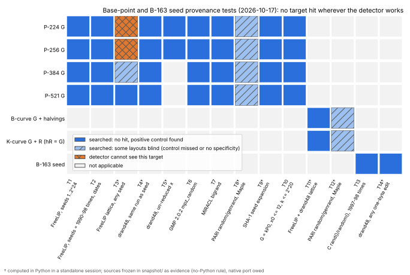

# NIST base points and the B-163 seed: generator searches (2026-10-17)

**Status.** Measured negative result. No tested generator, library or
derivation reproduces the base points of P-224, P-256, P-384, P-521, the five
B-curves or the five K-curves, or the B-163 seed. This is about the provenance
of published constants. It has no bearing on ECDLP hardness: any point of
order `n` is an equally good generator.

**Question.** The 2026-10-16 posts (Anthropic; Valsorda, "seeds solved")
and [`../nist_seed_provenance_20261016/`](../nist_seed_provenance_20261016/README.md)
explained the seeds and the six May-1997 base points (FreeLIP `zrandom`).
Four prime-curve base points, every binary-curve base point and the B-163
seed were still unexplained. The standards never say how a published `G`
was chosen. FIPS 186-4 D.1.1.5 says "Any point of order n can serve as the
base point". X9.62-1998 A.3.1 draws a random `R` and sets `G = hR`, with no
rule for the sign of `y`.

## The binary-curve correction

On a binary curve with cofactor `h = 2` or `4`, X9.62 A.3.1 gives `G = hR`.
The random draw is `x(R)`, not `Gx`, so testing `Gx` alone cannot find the
generator. So
every B- and K-curve target below includes all `R` with `hR = G`: 2 halvings
for B-curves and K-163, and 4 quarter points for K-233 through K-571. Each
coordinate is tested in both the polynomial and the normal basis.

`gnb.gp` first checks the basis conversion. For all five B-curves, the
normal-basis `b` equals the SHA-1 seed output in exactly one orientation, and
both halvings double back to `G` (2 of 2). The K-curve targets come from
`gnb_k2.gp`: 2 or 4 points `R` per curve (`out/gnb_k.log`). There are 137
binary targets in total, 50 B-curve and 87 K-curve.

## Results (measured)

*Figure: which searches covered which targets. Blue: searched, no target hit,
positive control found. Light hatched: some layouts in the family were blind.
Orange cross: the detector cannot see the target. Drawn by `plot_coverage.py`
from `out/coverage.json`, which is transcribed from the records named there.*

Every row below found its planted positive controls and no target. Rows
marked † were computed in Python in a standalone session before this note was
written; see "Python snapshot" below.

| id | search | targets | scope | record |
|---|---|---|---|---|
| T1 | FreeLIP `zrandomb`, small seeds | P-224…P-521 `Gx` | seeds 1…2^24, NBITS ∈ {26, 30, 62}, offsets 0…255; controls P-192, prime239v1 and 2 synthetic | `freelip_brute*.out` |
| T2 | FreeLIP, seed = Unix time or an encoded date | same | 1990-01-01…1999-01-01, offsets 0…63; 52,300 date-encoded seeds (`date_seeds.txt`), offsets 0…255 | `freelip_ts*.out`, `fl_list.out` |
| T3† | FreeLIP lattice, any seed | `Gx`, `Gy` | 26-bit limbs of the 107-bit state, read through mod `p` | `freelip_widths.out`, `fl384w62.out` |
| T4† | drand48, continuing the seed run | P-224…P-521 | after the published seed block, byte/word/lrand48 layouts | `samerun_bp.out` |
| T5† | drand48 chunks, un-reduced `x = X mod p` | P-224, P-256 | 8-bit chunks with 1–2 extra, 16-bit with 1 extra | `unreduce_scan.out` |
| T6 | GMP 2.0.2 `mpz_random` | P-224…P-521 `Gx`, `Gy` | glibc / 4.3BSD `random()`, 32- and 64-bit limbs, seeds 0…2^24 and 1997–98 `t`, `t/2`, depth 2048 | `gmp_bp.out` |
| T7 | MIRACL `bigrand` | same | `(37,24,14)` and `(21,6,8)`; default state offsets < 2^20; `irand` seeds 0…2^22 and run times ±1 day; `x + j`, `j < 256` | `miracl_bp.out` |
| T8† | PARI `random()`/genrand; Maple V `rand` | same | 5 packings, seed-agnostic, chain of ≥ 3 outputs | `libs_bp.out` |
| T9† | SHA-1 expansion of the curve seed | same | X9.62 style, counters 0…2^16, mod `p` or truncated | `hash_bp.out` |
| T10 | `G = kP0` from the smallest-`x` points | same | `x0 ≤ 12`, `k ≤ 2^20` | `smallk.out` |
| T11† | FreeLIP and drand48-family lattice | 137 binary targets | as the earlier scan | `scan_bin.out`, `scan_k.out` |
| T12† | PARI / Maple patterns | 137 binary targets | 6 patterns | `libs_bin.out` |
| T13 | C library generators | B-163 seed | glibc and 4.3BSD `random()`, SysV, BSD and MSVC `rand()`; seeds 1997–98 `t`, `t/2`; depth 2048; byte and 16-bit layouts, both byte orders | `b163_brute.out.gz` |
| T14† | drand48 family, one edit | B-163 seed | every short window at widths {8, 15, 16, 24, 31, 32}, which covers any single-byte substitution | `b163_edit.out` |

**Where the detector is blind.** These cells are untested, not negative:

- **T3, P-224 and P-256.** Controls found: 0 of 3 at every width. The mod-`p`
  reduction hides the limbs, as in the earlier note.
- **T3, P-384 at NBITS = 62.** The two-limb window has no specificity. It
  flags 126 of 200 random values and 3 of 5 controls, so its "hits" on `Gx`
  and `Gy` carry no information (`out/fl384w62.out`).
- **T8 and T12, Maple V `rand`.** Its control was missed on every curve.
  The other five patterns found their controls (20 of 20).

**T13 record.** `b163_brute.out.gz` holds 23,330 lines. Every hit line is a
planted control. Several 15-bit-generator seeds reproduce the same planted
bytes. The 12 target layouts have 0 hits.

## Python snapshot

[`AGENTS.md`](../../AGENTS.md) ("Implementation language: no Python") forbids
Python for research result generation here. Eight searches (T3–T5, T8, T9,
T11, T12, T14) were written and run in Python in a standalone session before
this note existed. Their sources are kept in `snapshot/` as frozen evidence of
how the records in `out/` were made, as that section requires, and are not
repository tooling: `run.sh` does not run them, and nothing here should
extend them. Their results are observations until a native (Rust or C) port
reproduces them. That port is owed before any of them is cited as repository
evidence. The other searches (T1, T2, T6, T7, T10, T13) and the target
construction are C or PARI/GP and re-run with `run.sh`. `plot_coverage.py`
only lays out recorded values.

## FreeLIP square root (side check)

For `p ≡ 3 (mod 4)`, FreeLIP's `zsqrtmod` (lip.c) returns `a^((p+1)/4)` and
takes no seed or generator input. Three of the six FreeLIP base points use the
negated root, so the calling code, which is lost, chose the sign. The
seed-parity fit for that sign (even FreeLIP seed, standard root; 6 of 6) stays
a post-hoc lead.

## CM-discriminant screen of the skip filter (side test)

[`PREREGISTRATION_DISCRIMINANT.md`](PREREGISTRATION_DISCRIMINANT.md) was
self-dated before computing. It was not committed first, so its timing rests
on the session record only. It asked whether the 10 published candidates are
those with a fundamental discriminant `D = t² − 4p`. Run on the 21 accepted
candidates (`disc.gp`, `out/disc.out`):

- **Published:** 8 of 10 have conductor proxy `f = 1`. The other two have
  `f = 5` (p239 candidate 2320) and `f = 3` (P-224).
- **Skipped:** 10 of 11 have `f = 1`.
- **Result:** H1 and H2 are not supported.
- **Control:** synthetic `q²r` was classified correctly.

The broader H7 test in
[`../nist_seed_skip_filter_20261017/`](../nist_seed_skip_filter_20261017/README.md)
supersedes this screen and agrees with it.

## Caveats

- **Wall times were not recorded.** The scope of each search is what its
  "done:" line states.
- **Some invocations are reconstructed.** The ones in `run.sh` are rebuilt
  from those lines. The date-seed search (`fl_list.out`) was re-run from
  `run.sh` and matches its record. `fl384w62.out`, `libs_bin.out` and
  `fl_list.out` were first recorded on 2026-10-22; the first two are Python
  snapshot runs.
- **T13 and T14 cover only the drand48 family and the five C generators.** A
  B-163 seed from another source, or with more than one edit, is untested.
  T14 assumes the 48-bit state with 24 bits of margin.
- **Spent leads.** FreeLIP with another discard count or seed range, and draws
  that also include rejected candidates, were covered only as far as T1–T3
  reach.
- **Untested libraries.** Magma, SIMATH, KANT, ZEN/BigNum and libI (LiDIA 1.3)
  were not tested; their 1997 generator sources were not found.
- **No independent review yet.**

## What this leaves

The four 1997–98 prime-curve base points, all ten binary base points and the
B-163 seed are still unexplained by any reproducible generator. The record
supports two hypotheses, and neither can be tested from public data:

1. A generator not covered here.
2. A choice that is not a function of a recoverable seed.

Bob Reiter (NSA), who wrote the 1997 generation code, is the only named
person who might know.

## Files

| file | what it is |
|---|---|
| `src/` | the native searches (C, PARI/GP), the binary target lists and the date-seed list |
| `snapshot/` | frozen Python sources of the † searches and their shared library; evidence, not tooling |
| `out/` | records; `coverage.json` is the figure's transcription |
| `coverage.svg`, `coverage.png`, `plot_coverage.py` | figure, 150 dpi render, plotting-only source |
| `report.typ`, `report.pdf` | PDF report with the figure |
| `run.sh` | re-runs any native step into a scratch directory, never into `out/` |

Reproduce: `research/nist_basepoint_provenance_20261017/run.sh t2d` (about
25 s on 4 cores). With no arguments it runs every native step. Needs gcc, GMP
and PARI/GP.
