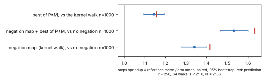
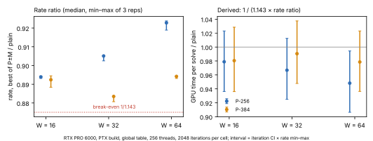

# Best of P+M and P−M in the gpu/nist small-batch rho kernel (2026-10-27)

**Audit status (2026-10-27): BEST2 stays disabled.** The estimates below
are historical diagnostics, not measured GPU solve costs or validated
benchmark claims. See [the seeded-walk audit](seeded-audit-v1/README.md)
for native tests, independent OpenSSL checks, the infinity-restart replay
fix, warmup-count correction, and the outstanding experiment protocol.

Question: does stepping to the better of `P + M_j` and `P − M_j` pay in the
`gpu/nist` P-256 / P-384 rho kernel, whose batched inversion covers only
W = 16–64 walks per thread? This is the open lead of
[`research/rho_walk_leads_20261014`](../rho_walk_leads_20261014/) (PR #1829),
and the prime-field counterpart of ECC2K-130's `SIGMA_SIGN` (`ecc2k130/BEST-OF-TWO.md`).

## The change

`RHO_BEST2=1` (`gpu/nist/nist_rho.cuh`, `make ... BEST2=1`, default 0):

- An ADD step computes both images from the one inverse `1/(x_M − x_P)`:
  the slopes differ only in the sign of `y_M`. That costs one extra
  multiplication and one extra squaring, and `y` is computed only for the
  image kept.
- It keeps the image with the higher score, with ties going to `+`. The
  score is limb 1 of `x`, which the partition and the distinguished-point
  test (limb 0) do not read.
- The choice rides in bit 1 of the aut code. The host replay
  (`nist_rho_host.hpp`) subtracts `(c_j, d_j)` when `P − M` was taken.
- Doubling and cycle-escape steps are unchanged.

## Results so far

**Correctness.** `make -C gpu/nist test` passes with `BEST2=0` and with
`BEST2=1`:

- the batched and single steppers agree bit for bit at every W;
- `batch_inv_w` matches `batch_inv`;
- the toy-curve end-to-end solve recovers the planted `k` through the new
  subtract path.

**Iterations** (`iterations-v1/`, Modal CPU). The model walk mirrors the
kernel's: rho_walk_leads harness `e4` with the negation map and the
kernel's table size r = 256, 64 walks with distinguished points at 2^-8,
N ≈ 2^36, 1,000 paired trials per arm.

| arm | mean steps | escapes / 10^6 steps |
|---|---:|---:|
| no negation map | 304,222 | 0 |
| negation map (the kernel's walk) | 227,092 | 1,931 |
| negation map + best of P±M | 198,711 | 2,570 |

Best of P±M against the kernel's walk, paired: **1.143× fewer steps,
95% CI 1.094–1.194**. The in-degree prediction is √(4/3) = 1.155.
Fruitless 2-cycles rise by a third; the kernel's existing doubling escape
handles them.

**Status: diagnostic.** This ratio comes from the standalone
rho-walk-leads harness. It has no ecbench spec, sealed session or replay
receipt, as AGENTS.md §12 requires for a cited rho-variant comparison.
Every collision in it is solved and checked against the planted secret,
but the figure is a diagnostic input to the GPU-time estimate below, not
a verified result. An ecbench run is owed before any claim or row.



**GPU rate** (`gpu-ab-v2.log`, the raw output of `gpu/nist/best2_ab.sh`;
summary `gpu-ab-v2.summary.jsonl` from `rho_walk_leads gpuab --in
gpu-ab-v2.log`). Setup: one RTX PRO 6000 (driver 610.57.04) on Modal,
commit 5ef52df7d, PTX build, global table, 256 threads, 2,048 iterations
per cell, three repetitions in alternating order. The bench sha256 values
are in the log's `BUILD` lines.

Both builds pass the CPU suites in the image. The `k_rho` instantiations
sit at the same register counts as before (255 at W = 32 and 64).

| curve | W | plain Gstep/s | best of P±M | rate ratio (min–max) | GPU time per solve (range) |
|---|---:|---:|---:|---:|---:|
| P-256 | 16 | 1.448 | 1.295 | 0.894 (0.886–0.894) | 0.978 (0.936–1.031) |
| P-256 | 32 | 1.771 | 1.600 | 0.903 (0.903–0.905) | 0.969 (0.925–1.012) |
| P-256 | 64 | 2.020 | 1.866 | 0.924 (0.923–0.925) | **0.947 (0.905–0.990)** |
| P-384 | 16 | 0.473 | 0.422 | 0.892 (0.891–0.892) | 0.981 (0.939–1.026) |
| P-384 | 32 | 0.636 | 0.560 | 0.881 (0.881–0.882) | 0.994 (0.950–1.038) |
| P-384 | 64 | 0.757 | 0.677 | 0.893 (0.892–0.896) | 0.980 (0.935–1.024) |

**Earlier run `gpu-ab-v1` (historical).** The first A/B used the same
CUDA binaries, but a Python driver in `gpu/nist/modal_app.py` ran the
cells and parsed them into `gpu-ab-v1.json`. That breaks AGENTS.md's
no-Python rule, so the driver was replaced with the shell script above
and the A/B was rerun. v1 is kept as recorded and agrees with v2 within
0.003 in every rate ratio.

How the last column is derived: GPU time per solve = 1 / (1.143 ×
rate ratio). The range combines the iteration interval (1.094–1.194)
with the min–max of the rate ratio.



**Preliminary model estimate, superseded as a performance verdict.**
Best of P±M costs 8–12% of the measured physical-iteration rate. Combining
this with the different standalone walk's iteration ratio suggests a
1–5% saving; that saving has not been measured or validated.

- **P-256 at W = 64** has a derived estimate of 0.947, with the combined
  range below 1. This range is not an end-to-end 95% confidence interval.
- **The other cells** have derived estimates of 1–3% savings, with combined
  ranges crossing 1.
- **Cost against batch size.** Against the CPU model's expectation, the
  relative cost is smallest at W = 64, where the kernel already spills
  registers.

An engineering gain has not yet been established. The standalone harness
uses hashed scores and DP predicates and does not restart after each DP,
unlike this CUDA kernel. A validated comparison must account for those
differences and all physical cycle work.

**Open observations, reported as measured.**

- **Distinguished-point counts on P-256.** With best of P±M they ran
  2–8% below the 2^-24 expectation: observed/expected 0.923, 0.946 and
  0.974 at W = 16/32/64, about 2–3σ, with each W one sample because the
  repetitions replay identical walks. The plain build (0.981–0.996) and
  P-384 (0.991–1.019) sit at the expectation. The score (x limb 1) and
  the DP test (limb 0) read different limbs, so no cause is identified.
- **Cycle iterations the step model doesn't count.** The kernel walks up
  to `RHO_CYCLE_DEPTH + 1` = 6 extra iterations per detected fruitless
  cycle, and the harness's step count leaves these out. At the measured
  cycle rates that is about 1.2% (plain) against 1.5% (best of two) of
  iterations: roughly 0.4% more GPU time for best of P±M (derived).

**Not in `benchmarks/README.md`.** The validation gate
(`docs/VALIDATION_GATE.md`) admits a benchmark row only with a replay
certificate, a validator report and a matched rho reference. This run has
the matched reference (the plain kernel, same binary family and unit) but
neither of the other two, so the result stays in this research directory.

## Reproduce

The commands below reproduce the historical diagnostic methodology. The
current `best2_ab.sh` additionally varies seed namespaces and excludes
warmup DPs; use the frozen protocol in `seeded-audit-v1/PROTOCOL.md` for
the new comparison. Its `SEED` markers are not understood by the old
`rho_walk_leads gpuab` summarizer as independent samples.

```sh
make -C gpu/nist test BEST2=1
cd research/rho_walk_leads_20261014 && modal run modal_run.py --plan nistbest2 --out ../nist_best2_small_batch_20261027/iterations-v1
cat ../nist_best2_small_batch_20261027/iterations-v1/*.jsonl | harness/target/release/rho_walk_leads summary --ref neg_canon
cd ../../gpu/nist && ./best2_ab.sh 2048 3 > best2.log   # on the GPU host; or, via Modal:
modal run modal_app.py::best2_main --iters 2048 --reps 3 --out best2.log
rho_walk_leads gpuab --in best2.log --speedup 1.1428 --lo 1.0944 --hi 1.1943
```
