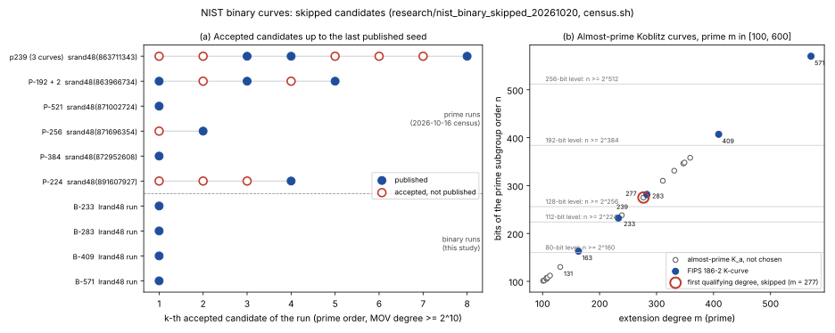

# NIST binary curves: skipped candidates (2026-10-20)

**Status.** Measured census. This concerns how the FIPS 186-2 binary curves
were chosen. It has no bearing on ECDLP hardness.

**Question.** In the 1997–98 prime-curve seed runs, 11 of the 21 accepted
candidates were never published, and nobody knows why
([`../nist_seed_provenance_20261016/`](../nist_seed_provenance_20261016/README.md),
[`../nist_seed_skip_filter_20261017/`](../nist_seed_skip_filter_20261017/README.md)).
This study asks the same question of the binary curves:

1. **B-curves.** Did the 1998-04-17 `lrand48` runs that produced B-233,
   B-283, B-409 and B-571 also pass over valid candidates?
2. **K-curves.** The Koblitz curves have no seed. Their only free choices are
   the degree `m` and `a ∈ {0, 1}`. Which almost-prime Koblitz curves were
   passed over, and which choices does no simple rule explain?



*Figure: (a) each run's accepted candidates, in order, up to the last
published seed. The prime runs come from the recorded 2026-10-16 census
(`../nist_seed_provenance_20261016/census/summary.json`); the binary runs
come from this study (`census/summary.json`). (b) Every prime `m ∈ [100, 600]`
where `K_a` has an almost-prime order, plotted as the bit length of the prime
subgroup order against `m`, with the FIPS security thresholds `n ≥ 2^{2s}`
(`census/koblitz_sweep.txt`). Drawn by `plot_census.py` from those records.*

## Method

```text
research/nist_binary_skipped_20261020/census.sh     # about 30 s on one core
cargo test --release --lib nist_seed_provenance     # 8 tests
```

- **Candidates (Rust).** `examples/nist_binary_seed_candidates.rs` reads
  candidate `i` of a run as five `lrand48()` words after `srand48(run)`
  ([`binary_seed`](../../src/cryptanalysis/nist_seed_provenance.rs)). It
  derives the X9.62 A.3.3.2 value `b₀ ‖ SHA-1(seed+1) ‖ … ‖ SHA-1(seed+s)`
  ([`x962_binary_candidate_b`](../../src/cryptanalysis/nist_seed_provenance.rs)),
  with `b₀` the rightmost `m − 160s` bits of `SHA-1(seed)`, and drops
  `b = 0`.
- **Basis (GP, `census.gp`).** The hash output is `b` in the **Gaussian normal
  basis** of `GF(2^m)`, not in the polynomial basis. Read directly in the
  polynomial basis, it is not the published `b` (test
  `the_binary_b_is_not_the_polynomial_basis_value`).
  - `census.gp` takes the type-`T` Gauss period, finds its minimal polynomial,
    and takes its `m` roots `β^{2^j}` in `GF(2)[z]/(f)`, with `f` the FIPS
    reduction polynomial.
  - It then keeps the root `β` and the bit order that turn each published
    seed's value into the published polynomial-basis `b`.
  - **Measured:** all five FIPS curves, B-163 included, match exactly one
    root, and all five use the same bit order (most significant bit = the
    coefficient of `β`). A random `b` would match by chance with probability
    about `2m / 2^m`.
- **Root choice and orders.** Changing the root to another `β^{2^j}`
  rotates the normal-basis coordinates, which applies the Frobenius to
  `b`. That leaves `#E` unchanged, so the census orders do not depend on the
  root. The root fixes only the polynomial-basis `b`, and with it the ICV1
  name, of each candidate.
- **Point counting (GP).** `ellcard` on `y² + xy = x³ + x² + b`, PARI/GP
  2.15.4.
- **Acceptance rule.** The B-curves' own rule: `#E = 2n` with `n` prime, and
  `2^{mk} ≢ 1 (mod n)` for `k < 2^10` (MOV).
- **Checks on every row** (independent of the counting algorithm):
  - `#E ≡ 2 (mod 4)`;
  - `#E` within the Hasse bound;
  - `[#E]P = O` at three random points.
- **Koblitz sweep (Rust).** `examples/koblitz_degree_sweep.rs` computes
  `#K_a` by the Lucas recurrence, applies Miller–Rabin with 20 bases to
  `#K_0/4` and `#K_1/2`, and computes the least Gaussian-normal-basis type
  of each `m`.

## Results (measured)

### B-curves: no candidate was skipped

| run (`srand48`) | curve | candidates up to the published seed | rows passing the checks | accepted | accepted indices | published index |
|---|---|---:|---:|---:|---|---:|
| 446413329 | B-233 | 155 | 155 | 1 | 155 | 155 |
| 446413432 | B-283 | 32 | 32 | 1 | 32 | 32 |
| 446413509 | B-409 | 60 | 60 | 1 | 60 | 60 |
| 446413564 | B-571 | 73 | 73 | 1 | 73 | 73 |
| **total** | | **320** | **320** | **4** | | |

- **Positive control.** The pipeline regenerates each published B-curve
  from its `lrand48` run state. At the published index it gives the
  published polynomial-basis `b`, and `#E = 2n` with `n` the published
  order, for all four curves.
- **Answer.** In every binary run, the published seed is the **first**
  candidate that passes. No B-curve candidate was skipped.
- **B-163.** Its seed is still not `lrand48` output (open since 2026-10-16).
  Without a run there is no candidate list to check. The normal-basis
  calibration does cover B-163.

### K-curves: one unexplained skip

Every prime `m ∈ [100, 600]` with `#K_0 = 4n` or `#K_1 = 2n`, `n` prime
(`census/koblitz_sweep.txt`):

| m | a | bits(n) | GNB type | FIPS |
|---:|---:|---:|---:|---|
| 101, 103, 107, 107, 109, 113 | 1, 0, 0, 1, 1, 1 | 101–112 | 2–10 | |
| 131 | 0 | 130 | 2 | (ECC2K-130) |
| 163 | 1 | 163 | 4 | **K-163** |
| 233 | 0 | 232 | 2 | **K-233** |
| 239 | 0 | 238 | 2 | |
| **277** | **0** | **275** | **4** | |
| 283 | 0 | 281 | 6 | **K-283** |
| 283 | 1 | 283 | 6 | |
| 311, 331, 347, 359 | 1 | 310–358 | 2–6 | |
| 349 | 0 | 348 | 10 | |
| 409 | 0 | 407 | 4 | **K-409** |
| 571 | 0 | 570 | 10 | **K-571** |

**The rule tested.** For each FIPS security level `s`, take the smallest
almost-prime degree with `bits(n) ≥ 2s`.

| level `s` | need | smallest qualifying `m` | FIPS `m` |
|---:|---:|---:|---:|
| 80 | 160 | 163 | 163 |
| 112 | 224 | 233 | 233 |
| **128** | **256** | **277** | **283** |
| 192 | 384 | 409 | 409 |
| 256 | 512 | 571 | 571 |

**The unexplained skip** is the curve `y² + xy = x³ + 1` over `GF(2^277)`
(`a = 0`). Its order is 4 times a 275-bit prime,
and its ICV1 identity is
`icv1-f2m277-t412886371405096939848969796546990392459541-c0810384`.
No published polynomial exists for degree 277, so the identity uses the
registry's rule for that case: the least sparse irreducible. The criteria
available here do not separate it from `m = 283`:

| criterion | `icv1-f2m277-…-c0810384` | K-283 |
|---|---|---|
| `bits(n) ≥ 256` | yes (275) | yes (281) |
| `a = 0`, as for K-233, K-283, K-409 and K-571 | yes | yes |
| least Gaussian normal basis type | 4, the same as K-163 and K-409 | 6 |
| irreducible trinomial | none (as for 163, 283 and 571, which use pentanomials) | none |

**At m = 283, K-283 is the smaller of the two.** `K_1` also has an
almost-prime order there, with a 283-bit `n` against K₀'s 281 bits. FIPS took
`K_0` anyway, which fits `a = 0` on the four large K-curves.

## Derived (not measured)

- **The prime runs.** Up to their last published seed, the six prime runs
  accepted 21 candidates and published 10. In the four single-curve runs,
  the published seed was the 1st, 1st, 2nd and 4th accepted candidate.
- **The binary runs.** All four published their 1st accepted candidate.
- **A crude comparison.** Treat each accepted prime-run candidate as
  published independently with probability 10/21. Then four runs that all
  publish the first one have probability `(10/21)^4 ≈ 0.05`. The model
  ignores that the multi-curve runs published several curves. It is a
  contrast, not a test.
- **How long each binary run lasted.** An odd `n ≈ 2^{m−1}` is prime with
  probability about `2 / ((m − 1) ln 2)`, which predicts a first acceptance
  around candidate 80 (m = 233), 98 (283), 141 (409) and 197 (571). The
  runs stopped at 155, 32, 60 and 73.

## Registry

`census/registry_records.json` records the `m = 277` curve (`a = 0`,
least sparse irreducible modulus, `koblitz: true`), so
`scripts/build_curve_registry.py` registers it as
`icv1-f2m277-t412886371405096939848969796546990392459541-c0810384`
(`end = −7`). The B-curve runs skipped nothing,
so they add no new curves.

## Open

- The B-163 seed.
- The base points of the binary curves.
- Why `m = 283` over `m = 277`. Nothing in this census explains it.
- The prime-curve skip filter (unchanged).

## Files

| file | what it is |
|---|---|
| `README.md`, `report.typ`, `report.pdf` | this report and its PDF |
| `census.svg`, `census.png`, `plot_census.py` | figure, its 150 dpi render, plotting-only source |
| `census.sh`, `census.gp` | driver (shell); basis calibration, point counting and checks (GP) |
| `census/published_nb.txt` | the normal-basis `b` of each published seed (Rust) |
| `census/candidates_<run>.txt` | every candidate `i seed b_nb` of each run (Rust) |
| `census/orders_<curve>.txt` | `calib` line, then `cand i seed b_pb N prime mov checks` (GP) |
| `census/summary.json` | per-run counts and accepted indices |
| `census/koblitz_sweep.txt` | the Koblitz degree sweep (Rust) |
| `census/registry_records.json` | the `m = 277` curve's model, the registry's source for it |
| `../../examples/nist_binary_seed_candidates.rs`, `../../examples/koblitz_degree_sweep.rs`, `../../src/cryptanalysis/nist_seed_provenance.rs` | native enumeration, sweep and tests |
