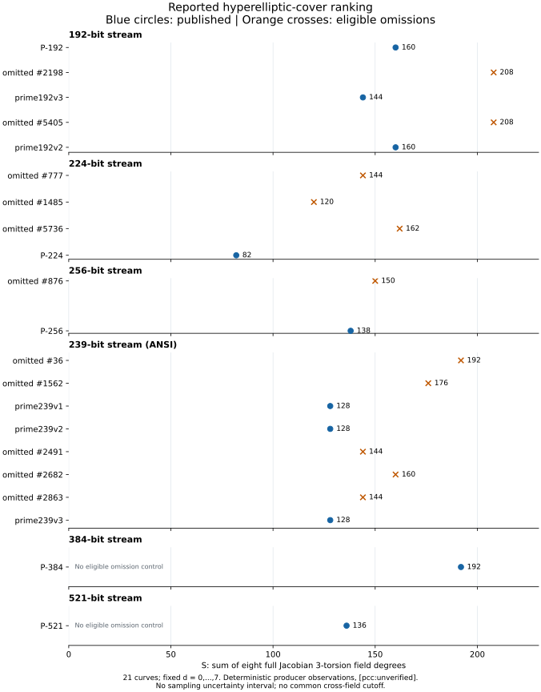
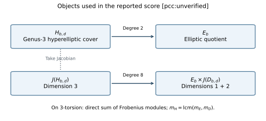

# Hyperelliptic-cover ranking of the NIST/ANSI seed candidates

**Status:** historical producer observations, imported for review; **PCC unverified**.
Claim record: [`PCC-20261115-009de9`](../../pcc/claims/PCC-20261115-009de9.json).
There is no signed independent verdict for the underlying curve arithmetic.

The reported result is one common **within-stream ranking**: the sum of the
full Jacobian 3-torsion field degrees of eight explicitly specified genus-3
covers places each published candidate below every eligible omitted candidate
in its own reconstructed seed stream. This holds in the four streams with
omitted controls. It is a post hoc numerical observation, and does not
establish the generator's primary selection criterion. [pcc:unverified]

Read the [PDF](REPORT.pdf), [score table](data/scores.csv),
[cover observations](data/cover-metrics.csv), and
[expanded search record](data/search-summary.json).



## Request and scope

The research question is whether a property of **hyperelliptic covers**, rather
than only an elliptic split-prime statistic, distinguishes published curves
from eligible candidates omitted in the reconstructed generation streams.
This PR records the work and explains it; it does not close the broader
historical-selector question.

The pool contains ten published curves and eleven eligible omissions. The
192-bit stream contains P-192 and ANSI `prime192v2/v3`; the 239-bit stream
contains ANSI `prime239v1/v2/v3`, not NIST P-curves. P-384 and P-521 each have
only one eligible candidate in the recovered prefix, so their scores are
observations without same-stream omission controls. [pcc:unverified]

The inherited eligibility screen uses the published root convention, prime
group order, the order-size restriction, nonanomalous order, and the original
embedding-degree screen. The exact parameters, candidate indices, seeds and
source fingerprint are in [models.json](data/models.json). This is a bounded
pool, not every possible elliptic curve or every alternative twist.

| Requirement | Recorded status and evidence |
|---|---|
| Same cover construction for every candidate | Formula below; `d=0,...,7` for the reported score |
| Include every eligible omitted candidate | All eleven appear in `scores.csv` |
| Include P-384/P-521 | Scores included; no eligible omitted controls |
| Separate cover properties from elliptic-only splitting | Use full genus-3 Jacobian 3-torsion, including the genus-2 quotient |
| Explain the common ranking | Defined score and complete table below |
| Establish the original selection criterion | Open; post hoc separation is insufficient |
| Independent signed arithmetic verification | Open; producer checks do not establish PCC standing |

## The covers and their elliptic quotient

For the published short model

$$E_b:\quad y^2=x^3-3x+b$$

over the prime field $\mathbb F_p$, use

$$H_{b,d}:\quad v^2=(t^2-1)\big[(t^2+d)^3
-3(t^2+d)(t^2-1)^2+b(t^2-1)^3\big].$$

The degree-two map to $E_b$ is

$$x=\frac{t^2+d}{t^2-1},\qquad
y=\frac{v}{(t^2-1)^2}.$$

Substitution gives the elliptic equation. The smooth projective models are
intended at the poles of these affine formulas. The historical producer
reported smooth genus-3 models for all cover parameters used here.
[pcc:unverified]

The other involution quotient is the genus-2 curve

$$D_{b,d}:\quad w^2=u(u-1)\big[(u+d)^3
-3(u+d)(u-1)^2+b(u-1)^3\big].$$

The construction supplies a degree-eight $(2,2,2)$ polarized isogeny
$J(H_{b,d})\longrightarrow E_b\times J(D_{b,d})$. Since its degree is coprime
to 3, it identifies the 3-torsion Frobenius modules. The cover Jacobian has
dimension three; $E_b$ is one factor, and the genus-2 factor supplies
additional arithmetic data. [pcc:unverified]



## What the score means

Write $A_{b,d}=J(H_{b,d})$. Define

$$m_{b,d}=\min\{m\geq1:A_{b,d}[3]\subseteq
A_{b,d}(\mathbb F_{p^m})\},\qquad
S(E_b)=\sum_{d=0}^{7}m_{b,d}.$$

There are $3^6$ geometric points of $A_{b,d}[3]$, including the identity.
Frobenius acts on this group as a six-dimensional linear transformation over
$\mathbb F_3$. Its order is exactly $m_{b,d}$. Thus this score adds eight
extension degrees. It is not a point count, isogeny degree, runtime, or
measured DLP-transfer cost. [pcc:unverified]

The product decomposition gives the computational rule

$$m_{b,d}=\operatorname{lcm}\big(m_E,m_{D,b,d}\big),$$

where the two terms are the full 3-torsion field degrees of $E_b$ and
$J(D_{b,d})$. For P-256 and its omitted candidate, $m_E=6$ in both cases;
their different cover scores therefore use information from the genus-2
quotients, beyond this elliptic 3-torsion invariant. [pcc:unverified]

For example, the recorded P-256 degrees are

$$30,30,18,12,6,12,18,12,$$

whose sum is $138$. Its eligible omission, candidate 876, has

$$12,12,12,12,18,30,30,24,$$

whose sum is $150$. Every term is retained in `scores.csv`.
[pcc:unverified]

## Results, including the omissions

| Stream | Published candidates and scores | Eligible omitted candidates and scores |
|---|---|---|
| 192 | P-192 #139: 160; prime192v3 #5228: 144; prime192v2 #6013: 160 | #2198: 208; #5405: 208 |
| 224 | P-224 #7026: 82 | #777: 144; #1485: 120; #5736: 162 |
| 256 | P-256 #1842: 138 | #876: 150 |
| 239 | prime239v1 #2185: 128; v2 #2320: 128; v3 #3048: 128 | #36: 192; #1562: 176; #2491: 144; #2682: 160; #2863: 144 |
| 384 | P-384 #2688: 192 | None in the recovered eligible prefix |
| 521 | P-521 #1136: 136 | None in the recovered eligible prefix |

These are imported producer observations. [pcc:unverified]

In each of the four controlled streams, the largest published score is
strictly below the smallest omitted score: respectively $160<208$,
$82<120$, $138<150$, and $128<144$. Equivalently, choosing the lowest $k$
scores in each finite candidate pool reproduces its published set, with $k$
fixed to the number of curves retained in that stream. This is a ranking
rule with a specified selection count, not a label-free universal predicate
on an arbitrary new curve. [pcc:unverified]

There is no single cross-field cutoff: a published 192-bit score of 160
exceeds an omitted P-224 score of 120. P-384/P-521 supply no discrimination
test because their pools have no eligible omissions. [pcc:unverified]

For P-224, replacing $b$ by $-b$ gives an isomorphic elliptic model. Both
model signs were checked in the historical work: the selected model scores
82 or 104, while every eligible omission under either sign scores at least
108. The P-224 ordering survives arbitrary choices between those isomorphic
model signs. [pcc:unverified]

## How the historical arithmetic was checked

The producer used two descriptions of genus-2 3-torsion. A monic quintic
model $f_5$ represents a nonzero order-three divisor by a monic quadratic
$U$ and a cubic $C$ satisfying

$$f_5=C^2-c_3^2U^3.$$

A full scheme calculation accounts for 80 nonzero points. A second
calculation works with the 40 pairs $\{P,-P\}$ and recovers the Frobenius
sign from a quadratic character in each component field. These are two
algorithmic checks within the producer's work, not independent signed
adjudication. [pcc:unverified]

The producer records report 200 explicit cover-certificate checks: the
168 original-model covers used for the 21 scores, plus 32 opposite-sign
P-224 covers. The wider work reports 306 actual Frobenius matrices and
canonical Weil forms: the 304 covers in the controlled `d=0,...,15` grid,
plus P-384/P-521 at `d=1`. Nineteen characteristic polynomials agreed with
earlier complete Magma computations; the two previously incomplete cases
were completed locally. [pcc:unverified]

The family-specific `data/modules-*.json` exports retain the small
Frobenius/Weil matrices, subgroup counts and extension data. The archived
`.py.txt` files retain the historical implementation provenance. They are
not an approved native research execution path. The full original finite-
algebra and raw-service response tree is not included in this log; its
complete durable archival and native curve-arithmetic replay remain open.

## What the search establishes, and what it does not

The eight-cover prefix was found while searching. The expanded search tests
35 effective metrics on every contiguous interval inside `d=0,...,15`,
using sum/minimum/maximum and either published-lower or published-higher
ordering. That is $35\cdot136\cdot3\cdot2=28,560$ rules. One separates all
four controlled streams: the full-3-torsion-field-degree sum on `d=0,...,7`.
None supplies a single global numerical cutoff. [pcc:unverified]

The metrics also include rational isotropic subgroups of orders 9 and 27
and the minimum extension degree admitting a maximal isotropic 3-isogeny
kernel. A Frobenius-stable kernel can be defined over a field without all
its points being rational there. Thus its minimum field differs from the
full-torsion field used in $S$. The historical work computed both quantities
instead of treating them as equivalent. [pcc:unverified]

There are
$\binom53\binom41\binom21\binom83=4480$ labelings preserving the published
count in each stream. Of these, 684 admit some separator in this search,
about 15.27%. This is an exact restricted-family relabeling calculation,
not a probability that the historical selector used the score. It does not
adjust for earlier cover families, torsion primes, or other investigations.
It therefore leaves substantial room for a search artifact. [pcc:unverified]

Further recorded checks found no separator among 24,960 rules based on
Prym four-torsion over the base and cubic-extension fields on `d=0,...,63`.
All 1,344 compact Kummer calculations were compared with direct PARI field
calculations in the historical work. This excludes those finite tests,
not every cover-level criterion. [pcc:unverified]

Smith's 2008 construction concerns isogenies between genus-3 Jacobians;
it is not an isogeny from a dimension-one elliptic curve to a dimension-three
Jacobian. An elliptic cover introduces the larger Jacobian first. The
reported existence of a suitable Smith target for all 21 candidates in a
separate `d=0,...,63` search does not distinguish the labels. The random-
genus-3 proportion cannot be assigned to this special elliptic-cover family.
[pcc:unverified]

## Reproducing the observation-table audit

This PR's native C++ audit operates only on the imported scalar observations.
It checks the eight-term score sums and label ordering, then reproduces the
35-metric window search and its relabeling count. It does not recompute
finite-field arithmetic, curve orders, smoothness, or the geometric meaning
of the module data. Its success cannot promote those inputs to independently
verified curve facts. [pcc:unverified]

```sh
c++ -std=c++17 -O2 audit.cpp -o /tmp/nist-cover-log-audit
/tmp/nist-cover-log-audit data/scores.csv data/cover-metrics.csv
```

`evidence/table-audit.txt` retains the output. `render_figures.py` only plots
recorded values; it computes no curve or search result. The PDF is rendered
from this README with the vector figures embedded. The source manifest is
post-call provenance, not a retrospective preregistration.

`sh check.sh` also checks rejection of a corrupted score and an incomplete
cover table; the retained output is
[`native-audit-controls.txt`](evidence/native-audit-controls.txt).
[pcc:unverified]

## Sources checked and remaining obligations

- [Strict-Elkies census](../nist_skip_criterion_20261025/strict_elkies_20261029/README.md):
  the earlier within-field split-prime ranking and its distinct search family.
- [Split-prime rationales](../split_prime_ecdlp_20261107/rationales/README.md)
  and [PR #3699](https://github.com/isogeny-labs/crypto/pull/3699):
  why a numerical deficit alone does not identify its historical rationale.
- [Smith, *Isogenies and the discrete logarithm problem in Jacobians of
  genus 3 hyperelliptic curves*](https://arxiv.org/abs/0806.2995):
  the relevant genus-3 isogeny construction and rationality assumptions.
- The reconstructed seed scan is fingerprinted in `data/models.json`.
- **Sources checked (KB):** no KB MCP tools were loaded;
  `scripts/research-kb status` reported no executable. The repository sources
  above were used as the documented fallback.

No existing performance chart, leaderboard or benchmark row is promoted by
this log. The earlier strict-Elkies chart describes a different statistic and
retains its frozen data. This study's new graph is explicitly producer-status.

The original primary-selector objective remains open. A successor needs a
specified native arithmetic replay and independent signed verification,
followed by a rule frozen before evaluation on genuinely new eligible
candidates or independent historical evidence. Merely fitting another
in-sample rule does not close that objective.
