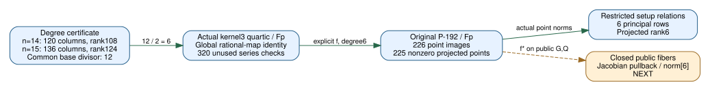

# An explicit degree-6 map from the kernel3 quartic to P-192

The reconstructed kernel3 quartic has an explicit degree6 morphism to P-192 over the original prime field. Its closed fibers give an executed public transfer into the target Jacobian:zero,doubling,cancellation and the known-answer G/Q relation pass. The retained destination pool supplies six source-bound principal relations. The later [quotient report](POLARIZED_QUOTIENT.md) now identifies the full source map using actual kernel witnesses and a written degree27/polarization3 proof. All results have unsigned producer standing;generic transpose-dual execution and index-calculus individual descent remain open. [pcc:unverified]



## What is explicit

Write the base-field quartic as $F_C(x,y)=0$ and the source elliptic curve as

$$E:Y_E^2=X_E^3-3X_E+b,$$

with the standard P-192 prime and coefficient. The native result retains polynomials $A,B,V,L$ over that prime field and defines

$$X_E=\frac{A}{B},\qquad Y_E=\frac{V}{2LB^2}.$$

The exact coefficients,selected local point and retained series are in [elliptic-backmap-v1/result.json](evidence/elliptic-backmap-v1/result.json),pinned by PCC-20261116-00cca4. The [kernel3 quartic equation](evidence/p192-d7-kernel3-plane-quartic.json) is copied byte-for-byte from its completed reconstruction. This is an equation-level map on that curve. The older kernel1 candidate and its point pool are separate inputs. [pcc:unverified]

The global check is

$$V^2-4L^2B(A^3-3AB^2+bB^3)\equiv0\pmod {F_C}.$$

Its native normal form is exactly zero. Changing the recovered numerator rejects. The rational map is nonconstant and extends to the smooth projective curves,including points where the displayed affine fractions need a local limit. All coefficients lie in the original field. [pcc:unverified]

## How the map was recovered

The polarized quotient predicts a dual elliptic map with composition $[6]$: the original cover has degree2 and the isogeny/dual composition is $[3]$. Let $D=\sqrt{s}M_0$ be the candidate differential identification from the existing kernel3 receipt. The candidate dual differential is obtained from $3\ell_H D^{-1}$.

Here the native source basis must be read from its Hamiltonian flow. Since that code uses $dX=2Yh$ and trace velocity $h$,the basis is $X^j dX/(2Y)$. For $c=1024$,the original cover gives

$$\pi^*\frac{dx_E}{2y_E}
=\left(\frac{16X}{c^2}+\frac{16X^2}{c}\right)\frac{dX}{2Y}.$$

The cleared polynomial differential identity is checked natively. On the base-field quartic,the target canonical basis is $(x,y,1)dx/F_{C,y}$,so the resulting candidate has the form $L(x,y)dx/F_{C,y}$ for a linear polynomial $L$. The original marked-polarization argument remains a separate identification question; the recovered rational functions are accepted only after their independent global equation and degree checks. [pcc:unverified]

The algorithm chooses the first retained point with nonzero $F_{C,y}$ and $L$,and translates the elliptic target so this point maps to infinity. It lifts the quartic locally to112 terms,integrates the differential,and constructs the elliptic Laurent series. It then seeks $A/B$ using the22 monomials $x^iy^j$,with $j<4$ and $i+j\leq6$,for each numerator and denominator. [pcc:unverified]

| Check | Native outcome |
|---|---:|
| Numerator/denominator coefficients | 44 |
| Training coefficient equations | 64 |
| Linear rank / kernel dimension | 34 / 10 |
| Unused series comparisons | 320 |
| Globally equal reconstructed ratios | 10 |
| Global elliptic-map equation | Zero normal form |
| Changed-numerator control | Rejected |

Set $\delta=F_{C,y}\partial_x-F_{C,x}\partial_y$. The numerator is

$$V=B\delta A-A\delta B.$$

This construction fixes the differential of $X_E$; the global elliptic equation tests whether that candidate differential integrates to the required rational map. The successful equation check goes beyond a formal-series fit. [pcc:unverified]

## Why the degree is six

Homogenize $A$ and $B$ to sections of $\mathcal O_C(6)$,which has degree24. The native homogeneous quotient $S/(F_C,A,B)$ has dimension12 in both degrees14 and15; the corresponding matrix ranks are108 and124. [pcc:unverified]

Let the common base divisor have degree $d\leq24$. On this smooth genus3 quartic,the pencil exact sequence in degree $n$ has kernel of degree $4(n-12)+d$. For $n\geq14$ this exceeds $2g-2=4$,so its first cohomology vanishes. Consequently the computed quotient dimension equals $d$,giving $d=12$. The moving function $A/B$ therefore has degree $24-12=12$. Since the elliptic x-coordinate has degree2,the curve map has degree6. This argument and its arithmetic implementation have producer standing; they are not a signed or formal proof. [pcc:unverified]

## Source-bound restricted relations

The unchanged kernel3 point window contains226 rational points and seven fully split vertical fibers. Evaluating the actual backmap sends one point to infinity and gives225 canonical nonzero elliptic points after sign/duplicate merging. Each finite image passes the original P-192 equation and multiplication by the exact subgroup order. The one limit chart has checked numerator/denominator valuations. [pcc:unverified]

Comparing each split fiber with the reference fiber yields six principal line relations. Their actual elliptic sums vanish,and the merged coefficient rows have rank6 modulo the source order. The full point images,index/sign mapping and projected rows are in [backmap-relations-v2/result.json](evidence/backmap-relations-v2/result.json),PCC-20261116-e2980e. These are setup relations;public-target descent and scalar recovery remain required. [pcc:unverified]

## Executed public divisor-class transfer

The curve map defines pullback $f^*:E\to J(C)$ and norm $f_*:J(C)\to E$,with $f_*f^*=[6]$. The source prime-order subgroup is coprime to6. To construct its image without the infinity fiber,fix $S=2G$ and use

$$F(P)=[D_{P+S}-D_S],\qquad D_T=f^{-1}(T).$$

Native Sylvester resultants,exact denominator saturation and residue-algebra gcd recover four complete squarefree degree6 ideals $(U,y-v)$ over the original field. Every ideal passes the quartic,public image and denominator-unit checks. The four signed-divisor norms equal $[6]P$;inverse6 returns the original public point. All52 coefficients pass prime-Frobenius checks. The exact fibers and divisor pairs are in [closed-fibers-v2/result.json](evidence/closed-fibers-v2/result.json),PCC-20261116-73bb6a. [pcc:unverified]

For target arithmetic,the implementation adds the same auxiliary rational degree6 divisor $R$ to each fiber. This gives effective degree12 inputs represented by $H^0(3D_0-D_T-R)$,of dimension22. Subtracting the reference input cancels $R$ and $D_0$,leaving $F(P)$. The unchanged large-model Khuri--Makdisi backend uses85 evaluation points and its general equality/preimage test. [pcc:unverified]

| Public target-class check | Native outcome |
|---|---:|
| Zero/nonzero fixtures | Passed |
| $F(2G)=F(G)+F(G)$ | Passed |
| Cancellation | Passed |
| $F(Q)=[37]F(G)$ for public $Q=[37]G$ | Passed |
| Norm compositions from closed representatives | 4 |
| Prime-Frobenius class-coordinate checks | 7480 |
| Completed addflip calls | 28 |

The class spaces and scalar-multiple witness are retained in [public-classes-v2/result.json](evidence/public-classes-v2/result.json),PCC-20261116-8599e0. Scalar37 is used only by the known-answer checker;the public-fiber/class constructor consumes public coordinates. These tests do not recover a scalar by individual descent,and target multiplication by the full subgroup order was not executed. [pcc:unverified]

The global source evaluator passes its exact equations,differential and public bridge checks. The later [quotient proof](POLARIZED_QUOTIENT.md) now identifies its actual kernel,degree27 and polarization3(PCC-20261116-3f440b,PCC-20261116-ce4a7b,PCC-20261116-8559fc). A generic transpose-dual evaluator remains separate from this executed elliptic norm. [pcc:unverified]

The retained first seven-variable inverse call used the exact Fp24 bridge and round-tripped762 distinct coefficients. It reached its predeclared60-second limit without a basis. This is a bounded execution result. The backmap construction proceeds independently of that root solve. Large program/stdout files and the earlier expanded coefficient result remain local with explicit pending-artifact manifests;the current uploader lacks the AWS CLI. No remote-byte verification is asserted. [pcc:unverified]

## Reproduction and certificate scope

With ROOT the extracted completed kernel3 study,run each command into a new output directory:

```sh
./check-elliptic-backmap.sh "$ROOT" "$MAP_OUT"
./check-backmap-relations.sh "$ROOT" "$MAP_OUT/result.json" "$ROWS_OUT"
./check-backmap-identity.sh "$IDENTITY_OUT"
./check-closed-fibers.sh "$ROOT" "$MAP_OUT/result.json" "$FIBERS_OUT"
./check-public-classes.sh "$ROOT" "$MAP_OUT/result.json" "$FIBERS_OUT/result.json" "$CLASSES_OUT"
```

Structural identity records are `IDC1hae5adae69bb1a568` for the generic cover differential and `IDC1h8d27f9064cb875c7` for generic elliptic denominator clearing. Each has32 derived-point checks and an added-one corruption control in the mandated field $2^{61}-1$. They do not verify the P-192 coefficient computation or supply a formal proof. Actual P-192 checks are the native receipts above. The initial understated syntactic-degree metadata and point-evaluator compile rejection are retained. [pcc:unverified]

Additional structural records `IDC1h43a2ccf526839b41` and `IDC1h837d35b860476d8b` cover the generic Bareiss determinant step and linear auxiliary cancellation in the same limited field/scope. The actual residue-product-algebra,CRT,altered-fiber and changed-class-coordinate controls are native P-192 checks. [pcc:unverified]

Sources checked: Tian arXiv:2007.03172 sections4.2.3,4.3 and Remark4.3;the original cover and checked differential/curve receipts;the smooth-curve Riemann--Roch pencil argument stated above. KB tools and repository wrapper were unavailable. No novelty claim or performance measurement is made.
