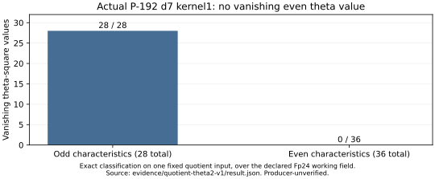

# Actual P-192 cover: quotient functions and a base-field quartic candidate

2026-11-16. Same P-192 d7 genus3 cover and actual mixed3 kernel1 as the preceding native replay. **The construction emits a smooth plane-quartic candidate over the original P-192 prime field. A conditional exact differential comparison now finds a nonsquare twist scalar for kernel1.** The executable divisor-class isogeny and independent justification of that marked-ppav comparison remain open. These are native functional development results with unsigned producer standing, not an ECDLP recovery or performance trial. [pcc:unverified]

## Executed construction

| Component | Recorded checks | PCC record |
|---|---|---|
| Actual kernel principal functions | 26 exact norm identities | PCC-20261116-c2aac9 |
| Normalized level3 Weil set | 2187 multiplication equations;81 symmetry/Frobenius/section identities each | PCC-20261116-c2aac9 |
| Special charts | 81 regular comparisons;52 colliding evaluations;26 nonzero symmetry receipt checks | PCC-20261116-b4a705 |
| Source level2 input | 64 distinct classes, symplectic frame, six actual Frobenius checks | PCC-20261116-6df666 |
| Quotient theta squares | 384 heldout normalization equations;64-value equality at two kernel representatives | PCC-20261116-24c1ba |
| Riemann candidate | Seven exact bitangent restrictions; rank36 in the45-by36 smoothness matrix | PCC-20261116-3d4c82 |
| Candidate curve descent | 28 labelled bitangents/Frobenius correspondences; nonsingular Hilbert90 matrix; all coefficients in Fp | PCC-20261116-901321 |
| Destination geometry | Fixed x-window contains234 points, six split fibers and five principal relations of coefficient rank5 | PCC-20261116-d2bdb3 |
| Target Jacobian arithmetic | 85 evaluations; dimensions10/22/34/46; point addition/direct-divisor comparison, cancellation and principal relation | PCC-20261116-94a153 |
| Target Weil functions | Eight contact divisors;22 exact conic intersections; eight diagonal/heldout normalization checks; sanitizers | PCC-20261116-06f27b |
| Conditional differential comparison | 384 source normalization equations;12 source/12 target derivative checks; four common quadratic forms; nonsquare scalar | PCC-20261116-08b9be |
| Fresh dependency chain | All seven stage result files match separate runs byte for byte | PCC-20261116-98512d |

All rows are producer-unverified assertions, with exact sources and receipts linked below. [pcc:unverified]



## What changed geometrically

The earlier coset representation encoded the group image without a target curve. For the fixed actual kernel, this continuation constructs rational functions whose divisors define the descended polarization. It computes level2 quotient moduli and applies Tian's Riemann/Aronhold reconstruction. The auxiliary field is Fp24, an explicitly checked cubic tower over the archived Fp8; its cubic generator satisfies e³-3e+b=0.

For an actual nonzero kernel divisor D=(u,v), lift v modulo u³. A9-by7 nullspace produces h=A(x)+B(x)y, with degA<=4 and degB<=1, satisfying the exact polynomial identity

$$A^2-B^2f=c\,u^3.$$

Tian's determinant Weil formula reduces on a regular Mumford chart to a cubic determinant ratio times a resultant. The normalized functions satisfy the theta-group equations on three separate classes. Their sum provides the invariant theta section; Frobenius covariance is checked on the actual divisors.

At support collisions, Cramer's formula has a removable zero denominator. The precision24 formal flow x'=2y, y'=f'(x) moves all three support points, including branch points. Its characteristic polynomial and interpolation recover a deformed Mumford pair. Taking the cancelled constant term agrees with regular evaluation and gives the kernel-support values used later. This is an implemented regularization, not replacing a failed value with zero. [pcc:unverified]

The quotient theta-square vector has28 vanishing odd values and no vanishing even value. This selects the nonhyperelliptic reconstruction branch. The resulting quartic is checked by exact restrictions along seven bitangents and by its homogeneous Jacobian ideal: degree7 products of the three cubic partials span all36 monomials, giving a geometric smoothness check. [pcc:unverified]

The structural Riemann expansion is retained as evaluated certificate IDC1h899228c0e35f7049, under PCC-20261116-c81a6e. It expands $(X+Y-Z)^2-4XY$ into $X^2+Y^2+Z^2-2XY-2XZ-2YZ$, with X,Y,Z each a coordinate times a linear form. The certificate's fixed field is $2^{61}-1$; it checks this generic structural identity, not the P-192 coefficient computations or descent. It is producer-issued, with no formal proof or independent signature. [pcc:unverified]

## Descent to the original field

The first quartic equation has extension-field coefficients. Squared Jacobi derivative products recover the remaining21 labelled bitangents; their theta ratios are checked in a second frame. The actual source branch Frobenius and characteristic shift determine a permutation of all28 labels. The resulting projective transformation carries the quartic's Frobenius equation to itself and passes every labelled-line check.

An exact norm preimage normalizes the24-step scalar cocycle. Constructive matrix Hilbert90 produces a nonsingular change of coordinates B, with M B^p=B. After this change, every normalized coefficient lies in Fp and the smoothness rank is again36. The [complete descent receipt](evidence/descent-v1/result.json) retains M, B and every labelled line. The [standalone model](evidence/p192-d7-kernel1-plane-quartic.json) records the resulting15 terms; their exact coefficients follow in this report. [pcc:unverified]

This establishes candidate-curve descent. The differential comparison below addresses the Jacobian's Serre sign separately. Its conditional nonsquare result points to the opposite quadratic sign for kernel1; independent normalization justification and an executable divisor map remain required before a source DLP transfer is claimed. [pcc:unverified]

## Relations on this actual curve

The factor base is fixed before data: every affine Fp point with x in0,...,255. Native root extraction finds234 such points and all six simple fully split vertical fibers in that window. Comparing each with the first split fiber gives five relations

$$\operatorname{div}\left(\frac{X-aZ}{X-bZ}\right)
 =\sum_{R\in C\cap\{X=aZ\}}R-\sum_{R\in C\cap\{X=bZ\}}R.$$

Exact fiber factorizations check the supports. Their coefficient rank modulo the public source prime is5. This is a restricted coordinate-window subcollector and a target-arithmetic fixture; five relations do not determine234 logarithms. No source-image binding, subgroup projection, full Diem collector or scalar recovery is supplied by this fixture. [pcc:unverified]

## Target divisor arithmetic

The active native target backend is quartic_km_v3.cpp. It uses Khuri-Makdisi's evaluation-space model on this actual base-field quartic, with D0 three times the first split fiber and85 evaluation points away from the poles. All relevant products have pole degree at most84, so evaluation at85 distinct points is injective. The ambient dimensions are10,22,34,46. Native checks compare point addition with a separately constructed effective divisor, check cancellation, and check one vertical principal relation both as a zero class and by explicit function membership. This validates the declared rational-support fixture; conversion of a general isogeny image into target divisor classes is still required. [pcc:unverified]

The initial version rejected its point/zero screen. An intersection shortcut did not apply to representatives sharing the base-divisor support. V3 uses the general equality preimage test from Khuri-Makdisi Theorem4.1; it retains the same point/addition/principal acceptance checks. The failed source and receipts remain available under PCC-20261116-21b046. The successful target-arithmetic record is PCC-20261116-94a153, unsigned. [pcc:unverified]

## Target functions and the conditional twist result

The target function layer represents degree3 effective divisors by exact cubic ideals, without splitting their supports into points. Translation by a bitangent difference uses two residual conics; every intersection is checked by exact factorization and both curve/conic equations. Riemann--Roch conic bases then give determinant Weil functions. On the fixed four odd labels63,38,41,13, normalization at even2-torsion61 agrees with the quotient theta data, the diagonal cocycle, and separate heldout even classes. The successful address/undefined sanitizer execution retains eight contact divisors,22 exact intersections, eight normalization checks and two rejected controls. Earlier compile/lifetime failures remain preserved. PCC-20261116-06f27b is unsigned. [pcc:unverified]

The new differential implementation uses exact dual numbers. At an odd theta zero, a Weil function is a square times a nonzero factor, so its quadratic leading form follows from the first derivative of the underlying section or determinant. Hamiltonian flows on H and C supply tangent directions; trace matrices convert them to canonical Abel coordinates. The target differential basis change includes the determinant and equation-scaling factor of the existing descent matrix.

For the fixed four labels, the producer obtains an original-field projective matrix M0 and one nonzero scalar s satisfying

$$Q_A=s\,M_0^t Q_C M_0.$$

All four full quadratic forms agree, and s lies in Fp with quadratic character-1. The execution also checks384 source normalization equations,12 source and12 target derivatives and the declared discriminator/corruption controls. Exact forms, source representative, matrices and scalar are in evidence/differential-twist-v2/result.json. The run exits0 and post-call source hashes match. PCC-20261116-08b9be is unsigned. [pcc:unverified]

Under TWIST_PROTOCOL's marked-ppav normalization argument, s nonsquare means the differential identification requires the quadratic extension, pointing to a nontrivial Serre obstruction for kernel1. Kernel2's fresh chain agrees. Kernel3's resumed unchanged descent suffix now completes with an original-field scalar of character+1 (PCC-20261116-ba8a27). The general argument and implemented normalizations still need independent review; actual map/Frobenius checks remain required. Kernel3 is now the input for the [eight-function coordinate construction](KUMMER.md), whose target fit and source public-point evaluator have completed their declared checks. [pcc:unverified]

## Evidence and reproduction

Native stage runners: check-weil3.sh, check-weil-chart.sh, check-level2-input.sh, check-quotient-theta2.sh, check-riemann.sh, check-descent.sh and check-destination-relations.sh. Each requires a new output directory and records pre-call hashes. Their protocols are preserved beside the sources. Corresponding raw results are under evidence/weil3-v2, weil-chart-v1, level2-input-v1, quotient-theta2-v1, riemann-v1, descent-v1 and destination-relations-v2.

The isolated fresh-chain runner is

```sh
research/nist_cover_three_tests_20261116/check-geometry-e2e.sh /tmp/nist-geometry-new-output
```

It copies only source and original kernel inputs; later stages consume its freshly recomputed predecessors. The complete run is preserved as a [raw archive](evidence/geometry-e2e-v1.tar.gz), [payload manifest](evidence/geometry-e2e-v1/MANIFEST.sha256) and [completion receipt](evidence/geometry-e2e-v1/COMPLETE.txt). All seven stage result files are byte-identical to the separate runs. Compiled export binaries are excluded from the archive; pre-call digests are retained. PCC-20261116-98512d is unsigned. The separate target-arithmetic command is check-target-km.sh; the previous small-curve scalar solver remains reproducible with check-e2e.sh. [pcc:unverified]

Source review: Tian arXiv:2007.03172 sections2--5; Dalla Piazza--Fiorentino--Salvati Manni arXiv:1409.5032 section3 and Proposition5.1; Fiorentino arXiv:1612.02049 section5; Khuri-Makdisi math/0105182 and the current Sage small-model equality/addflip implementation. KB was unavailable; the repository inputs/native implementations and primary papers were inspected. No novelty or priority claim.

## Next executable acceptance test

Let A=J(H)/K. The present kernels have order27, giving a (3,3,3) quotient; this differs from Smith's original (2,2,2) construction. Kernel3 passes the current conditional same-field differential criterion and supplies the coordinate-lift input. Preserve kernels1/2's opposite sign and every intermediate. An extension-field route requires explicit field accounting; a nonhyperelliptic curve cannot absorb the opposite Jacobian sign by the usual hyperelliptic curve-twist construction. [pcc:unverified]

Next implement the quotient map $\phi$ on divisor classes, lifting its Kummer coordinates to actual J(C) classes and checking exceptional inputs. Acceptance requires $\phi(D+k)=\phi(D)$ for every k in the actual kernel, compatibility with Frobenius and addition, and a dual $\psi$ satisfying $\psi(\phi(D))=[3]D$ on the tested domain. Combine it with the existing cover pullback and norm: $F=\phi\circ\pi^*$ and $T=\pi_*\circ\psi$ must satisfy $T(F(P))=[6]P$. The current coset implementation checks this identity; the new test must execute it in target divisor coordinates. [pcc:unverified]

Finally transfer the public points P and Q, verify F(Q)=[k]F(P) on public known-answer controls, and bind the destination relations to that same source subgroup. Relation rank must be measured after projection and duplicate merging. Recovering k from a restricted-base relation system, then checking [k]P=Q on the original elliptic curve, is the scalar-recovery acceptance criterion. The present five vertical relations do not meet it.
