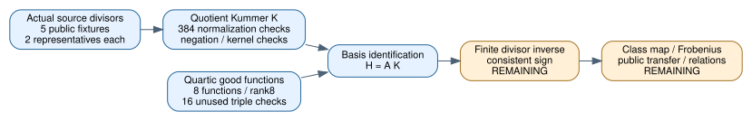

# Kernel3: explicit quotient coordinates and the remaining divisor inverse

2026-11-16. The actual P-192 d7 cover now has executable quotient-coordinate evaluation on public elliptic pullbacks and an exact8-by8 match to functions on the reconstructed kernel3 quartic. All results below have unsigned producer standing. The remaining construction is the finite inverse to destination divisors, including its sign and divisor-class arithmetic. [pcc:unverified]

The subgroup construction has an executed route through the [degree6 map from the quartic to P-192](BACKMAP.md). A separate [global correspondence and source evaluator](FORMAL_RECONSTRUCTION.md) passes exact equations,differential traces,the public G/Q bridge and generic group fixtures. The later [quotient proof](POLARIZED_QUOTIENT.md) supplies all26 actual kernel witnesses and a degree27/polarization3 argument. This proceeds without solving the seven-variable Kummer inverse described below. Generic transpose-dual execution and individual descent remain separate. [pcc:unverified]



## Why kernel3 is used

The eight recorded maximal isotropic3-kernels are paired by the cover involution as(1,2),(3,7),(4,8),(5,6). Kernels1/2 have differential comparison character-1. Kernel3 has character+1 under the same frozen marked-polarization argument; it passes this conditional compatibility component over the original field. Its full reconstruction is retained in [kernel3-resume-v1.tar.gz](evidence/kernel3-resume-v1.tar.gz), with manifest and completion receipts (PCC-20261116-ba8a27). The actual map and Frobenius checks must still establish the field of the divisor-class transfer. [pcc:unverified]

## Functions on the destination quartic

In the Riemann coordinate chart, the fixed infinity bitangent is Z=0, with contacts infinity1 and infinity2=(1:m2:0). Tian section4.2.3 uses the8-dimensional space of sections with poles bounded by6*infinity1+4*infinity2. The native implementation uses

$$1,x,x^2,y,y^2,xy,x(y-m_2x)^2,y(y-m_2x)^2.$$

Its120 symmetric products on three points are restricted to the diagonal(P,P,Q). The fixed sample schedule produces rank112, hence eight kernel functions h0,...,h7. There are128 unused diagonal checks and rank8 on eight generic triples. The published dimension/containment argument, together with symmetry, supplies the theoretical double-diagonal vanishing; sampling alone would not prove that property. Full coefficients are in [good-functions-v2/result.json](evidence/good-functions-v2/result.json), PCC-20261116-41d5db. [pcc:unverified]

Let omega be the determinant of the three projective point rows. The rational functions H_i=h_i/omega^2 form the destination basis to match with Kummer coordinates. Conic residual intersections and quadratic contact algebras evaluate the eight needed even Weil functions. A vertical bitangent requires parameter Y rather than X; all27 finite contact algebras pass curve,line,square-factor and squarefree checks, including this vertical case. The original pinned finite-X implementation remains unchanged. [pcc:unverified]

For labels S=(0,b), b=0,...,7, let f_b be the normalized even Weil functions and w_(a,b) the pinned theta-square constants. The chosen theta-null coordinates are

$$X^0_a=\sum_b(-1)^{a\cdot b}w_{(a,b)},\qquad
K_a(D)=\frac{\sum_b(-1)^{a\cdot b}f_b(D)}{X^0_a}.$$

All eight denominators are checked nonzero. The signed-sum origin identity,64 torsion values,64 subgroup equations,four path-order commutators and eight Heisenberg sign actions pass. On the eight retained generic triples the native solver determines A with H=A*K. All eight coordinates agree on16 unused triples; an altered matrix coefficient rejects. [target-kummer-v3/result.json](evidence/target-kummer-v3/result.json) retains A,normalizing scalars,paths and heldout values (PCC-20261116-29e27d). These evaluations plus the common section-space argument justify the proposed basis identification; they are not an independently formalized proof. [pcc:unverified]

## Evaluate the actual source quotient

For source divisor D, choose a recorded kernel representative k and put Z=D+delta+k. With the source-normalized two-Weil function eta_S, evaluate

$$f_S(D)=(\alpha_S\eta_S(Z))^3
\left(\frac{\theta(Z+S)}{\theta(Z)}\right)^2.$$

Swapping the two three-bit halves converts target labels to the source convention. Applying the same signed sums gives source quotient Kummer coordinates. The source normalizing constants are recomputed with384 heldout cocycle equations. Two regular representatives must give exactly equal function vectors; excluded chart indices are retained under the fixed selection rule. [pcc:unverified]

The public fixtures are origin,pull(G),-pull(G),pull(Q),and pull(G)+k1, where G is the standard P-192 generator and Q=37G is constructed outside the evaluator. The evaluator takes only divisor classes. All five fixtures pass both representative checks; origin constants,negation,actual-kernel invariance and an altered-coordinate rejection pass. Full source divisors,coordinates and representatives are in [source-kummer-v2/result.json](evidence/source-kummer-v2/result.json), PCC-20261116-4ed451. This supplies public-point coordinate data to the inverse construction. [pcc:unverified]

## What must be inverted

Given source K, compute projective H=A*K. For an ordered destination triple P1,P2,P3, use three quartic equations and seven cross-coordinate equations

$$H_j h_i(P_1,P_2,P_3)-H_i h_j(P_1,P_2,P_3)=0\quad(i\ne j).$$

Choose j with H_j nonzero and saturate by h_j*omega to exclude zero/projectively undefined and collinear triples. A recovered ordered triple may need a field extension even when its degree3 divisor ideal is defined over the working field. Solving in an extension must retain that distinction and check Frobenius on the resulting class.

The native constructor now checks this system on all16 retained target triples:304 exact value/equation comparisons,16 altered-image rejections and three saturation controls pass. It computes the exact normalized G/Q image vectors and expands the shared functions. The complete5.3MiB coefficient result is local and pinned by unsigned PCC-20261116-9e79ae; [ARTIFACT_PENDING.json](evidence/lift-system-v1/ARTIFACT_PENDING.json) records its hash and the unsuccessful storage handoff. The maintained uploader currently reports that the AWS CLI is unavailable. No roots are computed by this component. [pcc:unverified]

Kummer coordinates identify a class with its negative. Inversion must therefore orient the map consistently, verify the divisor class rather than just its coordinates, and handle exceptional charts. Required class checks are kernel invariance,Frobenius,addition and dual composition[3]. With the existing degree2 cover maps, the elliptic transfer composition must be[6]. Public-point transfer and destination restricted-base relations must then recover/check a scalar on the original elliptic curve.

The tested plain modular Giac mode fails its actual-prime control and is excluded. The exact Fp24 primitive bridge now passes native basis arithmetic and independent native replay of the backend's reduced basis,roots and S-pair(PCC-20261116-21485b). All762 distinct coefficients of the actual G inverse system round-trip. The one declared60-second lexicographic solve times out without a basis;it does not solve this inverse system. The backmap route above proceeds independently. No paid/performance campaign was launched. [pcc:unverified]

## Reproduction and retained failures

Extract the kernel3 archive and supply its replay-study path as ROOT. Each OUT directory must be new:

```sh
./check-good-functions.sh "$ROOT" "$GOOD_OUT"
./check-target-kummer.sh "$ROOT" "$GOOD_OUT/result.json" "$TARGET_OUT"
./check-source-kummer.sh "$ROOT" "$SOURCE_OUT"
```

The runners compile native C++/GMP, retain pre-call input/source/binary hashes and post-call source hashes, and reject failed checks. Preserved earlier attempts include mixed-auto build errors,unsupported vertical contacts,and the missing local field-decoder build. Target v3 completed exit0; the provisional interruption diagnosis was retracted after recovering its original session result. The unnecessary v4 repeat was cancelled with143. Raw diagnostics remain retained. Root cargo is unavailable in this environment; no Rust source changed. [pcc:unverified]

Sources checked: Tian arXiv:2007.03172 sections2,3,4.2.3; existing native Weil/descent/differential receipts; installed Giac GF/gbasis help. KB tools and wrapper are unavailable. No novelty or independent-verification claim.
