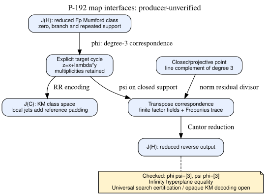

# P-192 divisor maps: both directions and exceptional representations

2026-11-17. The existing genus3 quotient now has an executed transpose map,
closed-point trace, and a reverse path at the projective boundary. The forward
map also has a representation for colliding coordinates and repeated support.
The underlying quotient remains the same degree27 polarized isogeny from
[POLARIZED_QUOTIENT.md](POLARIZED_QUOTIENT.md). These are native producer results,
not independent verification or compiled geometric proofs. [pcc:unverified]

## What the maps accept

The source is the retained odd model H: Y^2=h(X) over the original P-192
field. The target is the retained smooth plane quartic C. Its reference
divisor Eref is the three rational points indexed225,224,223.

The forward function accepts a reduced rational Mumford class (u,v),degree
d<=3,including zero,branch support and repeated support. It returns an explicit
target divisor cycle minus d*Eref. A cycle is represented as

    f(z)=0,  x=x(z),  y=y(z),  z=x+lambda*y.

This format retains multiplicities and the actual target coordinates;z is
not silently substituted for x. The forward KM conversion uses these actual
coordinates and adds reference multiplicities with local jets. The separate
forced-moving path can return a larger signed divisor instead of a KM space.
The mathematical constructions and executed fixtures have producer standing.
[pcc:unverified]

The reverse functions accept closed affine target divisors and use explicit
finite fields and Frobenius trace. The line-complement path additionally
accepts projective closed points Q=(1:m:0). Their output is a reduced source
Mumford class. Input divisor degrees must balance;normalization to the chosen
rational point Q0 cancels from a degree-zero signed divisor. An opaque KM
evaluation space is a different input representation: decoding it to a
geometric divisor has not been implemented here.

## Executed evidence

| Component | Fixed native qualifier | Outcome and standing |
|---|---|---|
| Forward cycle reconstruction |complete-maps-v1|Eight source fixtures,direct and forced movement;six pinned regular images agree;three negative controls. PCC-20261117-3afdeb |
| Coordinate collision |complete-maps-v1|Three distinct actual points sharing x require lambda1 |
| Repeated cycle |complete-maps-v1|A length3 cycle is retained,not deduplicated |
| Rational transpose |transpose-maps-v1|Eight fibers;five finite degree9,three finite degree8;seven target-side composition checks. PCC-20261117-6ebf8b |
| Closed transpose |closed-transpose-v1|All six pinned source-side compositions,including repeated factors. PCC-20261117-4ff1c3 |
| Reverse line movement |moving-transpose-v1|Eight direct/moving agreements,six source compositions,34 retained witnesses;all use parameter0. PCC-20261117-501577 |
| Infinity boundary |moving-transpose-v1|One degree4 closed point;degree12 residual field;complete infinity/finite hyperplanes have equal source images |
| Actual denominator inventory |pole-cases-v1|Degree72 radical has no factors of degrees1,2,3. PCC-20261117-905d71 |
| Forward KM conversion |complete-km-v3|Eight source fixtures;six pinned comparisons;lambda1 collision;reference multiplicity3 padded to5;50 addflips. PCC-20261117-fd5c89 |

Every row is a producer assertion. Its statement claim cannot become verified
merely by adding a signature. See the raw JSON,source snapshots,protocols and
pre/post-call manifests in the named evidence directory. [pcc:unverified]

Both composition directions now have actual geometric computations:

    phi(psi(Q-Q0)) = 3*(Q-Q0),
    psi(phi(D))    = 3*D.

The first is checked in the actual target KM Jacobian;the second by exact
source Mumford equality. This is stronger than the earlier elliptic norm
composition [6],which concerns the elliptic quotient rather than the generic
dual. The recorded scope is seven target differences and six source fixtures,
not enumeration of either Jacobian. [pcc:unverified]

## Why source denominator poles disappear on reduced Fp inputs

Let B(X) be the polynomial lcm of the retained correspondence coefficient
denominators. The audit computes its radical and checks its Frobenius gcds at
degrees1,2,3. None has a positive-degree factor. Therefore no polynomial u of
degree<=3 can share a factor with B:every irreducible factor of such a u has
degree<=3. Consequently every reduced Fp Mumford source input has denominator
units in Fp[X]/u. This implication covers all such inputs mathematically;
the finite native audit supplying its premise has unsigned producer standing.
There are no actual small-degree pole fixtures to manufacture. [pcc:unverified]

The forced moving construction is still explicit. For a nonzero source
divisor D=(u,v) of degree d,put

    g=v+a*u,  e=(h-g^2)/u,  E=(e,-g mod e).

Here $\deg(e)=7-d$ and $e$ is monic. On $H$, the function $(Y+g)/u$ has divisor
$E-D-(7-2d)\infty$. Thus $E-(7-d)\infty$ represents the original class.
At each denominator root e's value is a nonzero polynomial in a of degree
at most2. At a branch root of u,smoothness makes it a nonzero constant.
The finite moving schedule therefore supplies denominator-coprime support.
The qualifier checks the exact polynomial identity h-g^2=u*e,source incidence,
and the resulting target cycle. This is a principal equivalence,not deletion
of the original exceptional support. [pcc:unverified]

## Reconstructing the cycle without an x power basis

For a source support of degree m,the monic cubic correspondence defines the
finite free algebra

    A=Fp[S]/u(S),  R=A[T]/U(T),  dim_Fp(R)=n=3m.

The old evaluator required 1,x,...,x^(n-1) to span R. Distinct target points
can share x,and a map to one repeated point need not generate R at all.
The new constructor instead computes multiplication traces.

For L=x+lambda*y,let f(Z)=det(Z-L) and let b(Z)/f(Z) be
Tr(y/(Z-L)). Newton identities compute f and b. Set
g=gcd(f,f'),s=f/g. After cancelling g,

    y0=(b/g)/(f'/g) mod s.

The constructor checks (y-y0(L))^n=0 in R. This detects when different points
still share L. It also checks the curve equation and the transverse derivative
F_y-lambda*F_x. A unit derivative allows exact Hensel lifting from s to f,
giving the full divisor with multiplicities. The final full-modulus quartic
equation and characteristic identity are checked. [pcc:unverified]

There are at most n*(n-1)/2 bad directions from point collisions and n from
tangencies. The deterministic coordinate schedule exceeds that number,and
p is larger than its values and n. This is the written geometric reason for
the schedule,not an assertion that every input has been executed. The synthetic
controls retain actual quartic points but do not pretend to be extra source
isogeny images. [pcc:unverified]

## The transpose and closed-point trace

The original correspondence has degree3 over H and degree9 over C. The
reverse map therefore begins with a degree9 fiber;it is not a degree3
pointwise inverse. Substitute a target point into the global U,V equations.
After clearing common denominators,the two equations are a+bY=0 and c+dY=0.
Elimination uses the gcd of

    a*d-b*c,  a^2-b^2*h,  c^2-d^2*h.

Denominator saturation and a Bezout combination of b,d recover source Y.
The source equation and both graph equations are replayed before Cantor
reduction. At the three formal reference points,the finite degree is8;these
cases are retained and their degree-zero compositions pass. The general
boundary path below does not assume every degree drop is harmless.
[pcc:unverified]

For a closed target point of degree e,the reverse fiber is evaluated over
its actual field Fp^e. Summing its e Frobenius-conjugate source classes gives
the rational source trace. Irreducibility,field closure,complete factor
product,and rationality of the trace are checked. Repeated factors are
processed with their multiplicities. This supplies the closed-target
interface used by the actual forward images. [pcc:unverified]

## Projective boundary via line complements

Choose a line through Q with residual intersection R_Q of degree3. For a
finite Q,use y=a*x+(yQ-a*xQ). For Q=(1:m:0),use y=m*x+a. The actual equation
excludes (0:1:0),so this covers its infinity chart. Both satisfy

    Q+R_Q ~ hyperplane.

Norm the residual divisor from Fp^e to Fp,and let A_Q be its transpose
source class,normalized by source infinity. Require all residual transpose
fibers to have degree9. With Q0 rational,

    psi(Q-e*Q0) = e*A_Q0-A_Q.

The hyperplane term cancels. A bad original point has been replaced through
an actual divisor equivalence. The constructor restores field contexts after
rejected candidates and retains the rejection and next line. The complete
infinity hyperplane is also compared with a finite vertical hyperplane,not
only checked for incidence. [pcc:unverified]

The very large line-search bound in the protocol is a conservative avoidance
proposal;an independently checked universal bound has not been supplied.
The fixed qualifiers all terminate at parameter0. Equal-degree splitting
also has its declared1024-shift cap,and every invocation a600second/1GiB
limit. These are explicit execution limits;no all-input runtime guarantee or
independent universal verification is inferred from the successful fixtures.

## KM padding and remaining boundary

The new adapter substitutes x(z),y(z) into the target RR monomials. It
represents the positive divisor by

    image(D)+(3-d)*Eref+auxiliary,

and subtracts 3*Eref+auxiliary. If a reference point already has multiplicity
m in image(D),padding adds local jet orders m through m+3-d-1. Dynamic jets
use x or y as a local parameter according to the nonzero partial derivative.
The auxiliary divisor is chosen separately for each input,away from its
support and the evaluation/pole sets. [pcc:unverified]

The final KM qualifier exits0 and checks branch order2,negation,doubling and
addition. Its triple-reference and alternate-coordinate controls agree with
direct rational point classes. All ten output class spaces are retained.
PCC-20261117-fd5c89 has producer-unverified standing. [pcc:unverified]

The earlier multiplicity3 point helper also fails for a rational point on
the pole fiber,where its effective representative needs multiplicity4.
The new rational-point wrapper uses the same RR sections with enough local
jets. The original failed v2 qualifier is retained under PCC-20261117-7e73bf;
the control fiber was not replaced. [pcc:unverified]

The explicit signed-divisor maps are now substantially broader than the
earlier regular x-chart interface. Independent verification,compiled geometric
formalization,universal reverse-search certification,and inverse conversion
from an arbitrary opaque KM space remain separate open obligations. No scalar
recovery or performance evaluation was requested or run in this map phase.

## Reproduce and inspect

Each check-*.sh runner requires a fresh output directory. Use the original
kernel3 replay study from evidence/kernel3-resume-v1.tar.gz as the study input;
global-correspondence-v2,result generic-bridge-v1,and formal-series-v1 are the
fixed other inputs. Runners copy immutable sources and compile with native
C++17/GMP,then retain build,pre-call,input and post-call hashes plus exits.
The binaries remain local build products;source snapshots and raw records
are committed,with code kept loose because manifests name their paths.

Build this report with build-maps-report.sh. The source diagram is
figures/complete-maps.dot. Reports are not added to a performance leaderboard
because this work has no performance measurement. The benchmark gate's stale
progress report and the base's missing CI/artifact scripts are recorded rather
than changing shared infrastructure in this lane.

Sources checked:the existing generic bridge,kernel and degree proofs;
Tian arXiv:2007.03172,section4.3;Milne,Abelian Varieties,II6.1/6.3.
KB unavailable:no MCP tool and the maintained wrapper has no executable.
Lean/lake/Cargo/Conductor are unavailable. No new Lean theorem or independent
verifier is claimed;all mathematical implications above remain readable
producer arguments tied to the stated hypotheses. [pcc:unverified]
