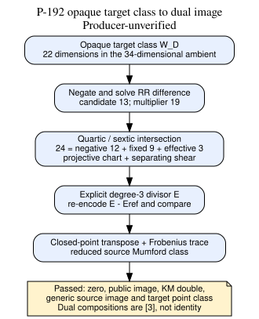

# P-192: evaluating the dual from an opaque target Jacobian space

2026-11-17. The dual map now accepts an actual target KM class space,extracts
an effective degree3 divisor,and returns a reduced source Mumford class.
Every extracted divisor is re-encoded and compared with its original input
before the dual result is accepted. The primary case and five-case panel
pass as native producer checks,PCC-20261117-ef5e0c and
PCC-20261117-a5c634. They are not independent verification. [pcc:unverified]

This is the successor to [MAPS_STATUS](MAPS_STATUS.md),whose report recorded
opaque-space decoding as open. Its pinned bytes remain unchanged.
The maps are the existing degree27 polarized isogeny $\phi$ and its dual
$\psi$,with compositions $[3]$;the dual is not a unique pointwise inverse.

## Inputs,outputs and executed cases

The input is the existing $22$-dimensional space
$W_D=L(3D_0-D)$ in the actual $34$-dimensional ambient space,with
$\deg D=\deg D_0=12$. It represents $\alpha=[D-D_0]\in J(C)$.
The constructor receives this space and public curve/reference data.
It receives no source class or scalar witness.

The output is a separating-coordinate cycle for an effective divisor
$E$ of degree3 with $\alpha=[E-E_{\rm ref}]$,its re-encoded target class,
and $\psi(\alpha)$ as a reduced Mumford divisor on $H$.
The enclosing checker holds the expected source classes separately.
The finite native coverage is as follows. [pcc:unverified]

| Opaque input | Required and observed dual output |
|---|---|
| Identity |$0$|
| Existing $\phi(\pi^*G)$ space |$3\pi^*G$|
| Its KM double |$6\pi^*G$|
| Existing generic $\phi(P)$ space |$3P$|
| Actual target point class $[Q_1-Q_{\rm anchor}]$ |Direct transpose of that difference |

All five decoded/re-encoded comparisons and source equalities pass.
Each RR difference space has dimension1 on this panel.
The primary case additionally forces a bad projective chart and a colliding
projection before using the fixed schedules. Off-ambient input,changed
decoded y and altered source result controls reject. Input/output class
spaces and every intermediate support are retained in the raw JSON.
[pcc:unverified]

## The RR construction

Let $H_{\rm pole}$ be the fixed vertical hyperplane divisor on $C$,and put
$D_0=3H_{\rm pole}$. Let $E_{\rm ref}$ be the same rational degree3 reference.
The retained cubic $g_0$ has the complete intersection divisor

$$
(g_0)=3E_{\rm ref}+R,\qquad \deg R=3.
$$

Here $(g_0)$ means the zero divisor of the cubic section,not the divisor of
a rational function. The new constructor rechecks its degree12 resultant,
all reference multiplicity3 conditions,residual incidence,squarefreeness
and disjointness. These tests reuse the actual kernel witness.
[pcc:unverified]

First negate $\alpha$ with the unchanged KM arithmetic. Its space represents
$[D_- -D_0]=-\alpha$. Put $B=D_0+E_{\rm ref}$,of degree15. The relevant
spaces are

$$
L(B),\quad \dim L(B)=13;\qquad
M=L(3D_0-B)=L(2D_0-E_{\rm ref}),\quad \dim M=19.
$$

Construct $L(B)$ as the functions
$N/(\ell_{\rm pole}^3g_0)$,where $N$ is a degree6 plane section vanishing
on $2E_{\rm ref}+R$. There are22 degree6 sections and9 conditions.
Construct $M$ by the three reference vanishing conditions on the same
degree6 sections. Removable evaluations at $R$ use local curve jets.
The constructor checks dimensions,evaluation ranks and that their product
spans the actual34-dimensional ambient space. [pcc:unverified]

The base-point-free division lemma gives

$$
L(B-D_-)=\{f\in L(B): fM\subseteq W_{D_-}\}.
$$

Indeed,away from $D_-$ every product has the allowed poles;at a point of
$D_-$ choose a multiplier section with the minimum allowed vanishing.
Its existence follows from base-point-freeness of the degree21 bundle $M$.
The product membership then forces the required order of $f$.
This is Khuri-Makdisi's Lemma/Algorithm2.3,with its hypotheses exposed.
The native code uses the existing multiplication/preimage linear algebra.
[pcc:unverified]

Riemann--Roch guarantees a nonzero section because $\deg(B-D_-)=3$ on
a genus3 curve. Choose one and recover its numerator $N$ from its evaluation
vector,replaying all85 values. Its zero divisor satisfies

$$
(N)=D_-+2E_{\rm ref}+R+E,\qquad \deg E=3.
$$

Consequently $[E-E_{\rm ref}]=[D_0-D_-]=\alpha$.
This argument applies to a valid KM class,including special RR spaces of
dimension greater than1;the code selects a nonzero section,without assuming
the observed dimension1 is universal. [pcc:unverified]

## Extracting the divisor with all multiplicities

The target support $D_-$ is implicit in a space,so it cannot simply be
subtracted as a known list of points. The extractor obtains it as a common
vanishing divisor.

First choose a chart $Z'=Z+aX$ in which the entire length24 divisor $(N)$ is
affine. The original point $(0:1:0)$ is outside the actual curve;hence
each support point excludes at most one $a$. The schedule $a=0,\ldots,24$
therefore suffices. Next shear $X''=X+\lambda Y$ in that chart.
There are at most276 collision directions,24 tangent directions and4
forbidden centers. The schedule $\lambda=0,\ldots,308$ exceeds that bound.
The field characteristic exceeds all these indices. [pcc:unverified]

The complete quartic/sextic resultant must have degree24. Recover y on
its squarefree support by residue gcd and coprime CRT,then Hensel-lift to
the full support. Both transformed equations must vanish modulo the full
polynomial. This retains repeated points and intersections that the ordinary
x-coordinate fails to separate. The deliberately bad chart/projection in
the primary case checks that the fallback is actually reached.
[pcc:unverified]

Recover the degree9 numerator sections of all22 rows of $W_{D_-}$,again
replaying every evaluation. Restrict them to the length24 intersection and
take their common gcd with its support polynomial. The result must have
degree12. It is exactly $D_-$:the residual bundle
$L(3D_0-D_-)$ has degree24 and no base points,so the minimum vanishing
order of all its sections is the multiplicity of $D_-$.
This is the divisor-recovery statement of Khuri-Makdisi's Lemma2.1.
[pcc:unverified]

Divide by this degree12 support and the complete projected
$2E_{\rm ref}+R$ support of degree9. The quotient must have degree3.
Products of support polynomials add multiplicities even when the divisors
overlap. Invert the projective coordinate change and check the original
quartic. The actual infinity polynomial is rechecked irreducible of degree4;
thus a rational effective degree3 divisor cannot contain an infinity point.
The resulting $E$ is affine and is normalized into the existing cycle
representation $z=x+\mu y$. [pcc:unverified]

## Closing the map interface

The completed forward RR adapter re-encodes $E-E_{\rm ref}$.
The decoder requires equality with the original opaque class in the actual
target Jacobian. Only then does the existing line-moving,closed-point
transpose evaluate $\psi(E-E_{\rm ref})$. This gives an executable route
from the target arithmetic representation to the source arithmetic
representation. The target-point case exercises a target class supplied
without a source-image witness. [pcc:unverified]

The mathematical correctness argument uses standard RR and base-point-free
division,with generic hypotheses rather than a dimension1 shortcut.
Its native evidence is finite:one primary case and the fixed five-case panel.
The existing transpose's declared factor/search/resource limits remain.
Independent signed verification,faithful compiled geometric formalization
and universal certification of that reverse-search bound remain open.
No scalar recovery or timing result is asserted.

## Reproduce,provenance and proof map

Run check-opaque-km.sh with the original kernel3 study,global-correspondence-v2,
generic-bridge-v1,formal-series-v1,actual-kernel-v1 result,and mode primary
or panel,followed by a fresh evidence directory. Each native call has a
600second/1GiB limit;copied guarded headers,protocol/source/input/binary
pre-call hashes,exit and post-call hashes are retained.

The compile-only primary-v1 failed before arithmetic because combined
generated headers needed guards and a matrix allocation was ambiguous.
It remains unchanged. Its raw compiler diagnostics are in the deterministic
build-diagnostics.tar.xz with a SHA256 receipt;named code subjects stay loose.
Primary-v2 and panel-v1 use the same pinned arithmetic source.
Their raw JSON sizes are156959 and803797bytes,respectively.
[pcc:unverified]

| Proof obligation | Source or evidence | Standing |
|---|---|---|
| RR representation/division |Khuri-Makdisi,math/0105182v3,Lemmas2.1/2.3,Algorithm5.5 |Reviewed primary source |
| Complete reference base |Actual kernel cubic/residual and decoder recheck |Native producer |
| Deterministic extraction and class equality |opaque_km.cpp,primary-v2,panel-v1 |PCC-ef5e0c/a5c634;producer |
| Original polarized quotient |POLARIZED_QUOTIENT.md and prior claims |Readable producer proof |
| Independent/compiled verification |No signed covering verifier or Lean toolchain |Open |

The detailed protocol is OPAQUE_KM_PROTOCOL.md. Build this report using
build-opaque-km-report.sh. KB is unavailable in this runtime;the actual primary
paper was downloaded and its relevant statements read. No new algorithm or
novelty claim is made. Reports and code subjects carry producer-unverified
standing,not a signed mathematical verdict. [pcc:unverified]
