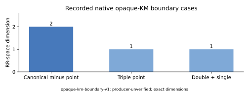

# Special RR spaces and repeated output divisors

2026-11-17. The opaque target-class decoder also passes the dimension2 RR
case and the two nonreduced degree3 output patterns. This supplements the
unchanged [opaque decoder report](OPAQUE_KM.md) and its five-case panel.
All three extra inputs re-encode correctly,and their dual answers equal the
direct rational point-divisor answers. PCC-20261117-b9e8ca records the
native producer result;it is not independent verification. [pcc:unverified]

| Fixed effective divisor $E$ for the opaque input $[E-E_{\rm ref}]$ | RR dimension | Required and observed check |
|---|---:|---|
| First three points of the fixed vertical fiber |2|Re-encoding and dual equality;the extracted representative may differ |
| $3Q$,first reference point |1|Exact decoded support multiplicity3 |
| $2Q+Q'$,first two reference points |1|Exact decoded multiplicities2 and1 |

The source file is opaque_km_boundary.cpp;the frozen protocol is
OPAQUE_KM_BOUNDARY_PROTOCOL.md. Full input cycles,class spaces,extraction
supports and source answers are in evidence/opaque-km-boundary-v1/result.json.
All native values and equalities above have producer standing.
[pcc:unverified]

## Why dimension2 is a real boundary

For an effective degree3 divisor $E$ on this genus3 curve,Riemann--Roch gives

$$
h^0(E)=1+h^0(K-E),\qquad \deg(K-E)=1.
$$

A degree1 line bundle on a positive-genus curve has at most one section.
Two independent sections would,after removal of any base divisor,give a
degree1 map to the projective line;the degree0 alternative has only constant
sections. A degree1 map between smooth complete curves would make the curve
rational,contrary to genus3. Thus the only possible RR dimensions are1 and2.
This is a readable standard RR argument,not a compiled proof.
[pcc:unverified]

A smooth plane quartic has canonical hyperplane sections. The fixed vertical
fiber is four distinct rational points. Removing its fourth point gives the
first test's degree3 divisor,with $h^0(K-Q)=2$:linear forms vanishing at a
point form a two-dimensional space. Its opaque class therefore has a genuine
pencil of effective representatives. Correct extraction must return a
representative of the class;it must not assume the input's original support
can be uniquely recovered. The unchanged decoder observes dimension2 and
passes re-encoding and dual checks. [pcc:unverified]

## Repeated support is checked as a divisor

The other two cases use the first two fixed reference points,without a
point search. The qualifier checks that the tangent at $Q$ has exact order2,
so $Q$ is not a flex. It checks that the line $Q,Q'$ is not tangent at $Q$.
These premises exclude a canonical hyperplane containing $3Q$ or $2Q+Q'$
respectively,and give RR dimension1. [pcc:unverified]

When $h^0(E)=1$,the effective representative is unique. The test therefore
requires the extracted cycle's full polynomial to be

$$
(z-z_Q)^3
\quad\hbox{or}\quad
(z-z_Q)^2(z-z_{Q'}),
$$

and checks its original x,y coordinates at each support point. It also
checks the full curve equation with those multiplicities. This exercises
Hensel lifting and multiplicity subtraction when the extracted divisor
overlaps the fixed reference support. The core decoder is byte-identical
to the one in the prior primary/panel claims. [pcc:unverified]

These are the nonreduced geometric multiplicity patterns of an effective
degree3 divisor. Over the base field,a repeated point in such a rational
divisor must itself be rational:an orbit of degree2 repeated twice already
has degree4. Simple closed points and Frobenius trace retain the separate
coverage of the preceding map qualifiers. This explains the case selection;
it does not assert that every divisor class was executed. [pcc:unverified]

## Exact scope and reproduction

The expected dual answer is the sum of the original rational point
transpose classes,with their multiplicities,minus the three reference
classes. The decoder receives only the constructed KM space and public
setup. Source witnesses are used afterward by the enclosing checker.
Changed target-y and changed source-result controls reject.
[pcc:unverified]

Run check-opaque-km-boundary.sh with the same study/global/bridge/formal/
actual-kernel inputs as check-opaque-km.sh,followed by a fresh evidence
directory. Its native call has a600second/1GiB limit. The result is471205bytes;
copied source,pre/post-call hashes and exit0 are retained. Plotting reads the
recorded RR dimensions only and performs no curve arithmetic.
[pcc:unverified]

The combined producer implementation covers forward target-KM encoding,
closed/projective dual evaluation,and opaque-KM decoding,with explicit
coordinate/reference/multiplicity controls. Independent signed verification,
compiled geometric formalization and universal certification of the existing
reverse-search bound remain open. No scalar recovery or performance
measurement is claimed.
