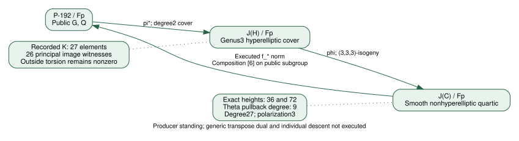

# An explicit same-field polarized 3-quotient for the P-192 cover

2026-11-16. The recorded kernel3 now has a global correspondence, executable source-class evaluator, and a written degree/polarization argument identifying its quotient with the reconstructed nonhyperelliptic Jacobian over the original P-192 field. All 26 nonzero kernel members have explicit principal-function witnesses. Two exact height algorithms give the degrees needed for the argument. The results and proof have unsigned producer standing; they are not independently verified or compiled geometric theorems. [pcc:unverified]

## Objects and conclusion

Let $E/\mathbb F_p$ be P-192, let $\pi:H\to E$ be the retained degree2 cover with parameter $d=7$, and use its exact monic degree7 model $Y^2=h(X)$. Let $K$ be the 27-element recorded kernel3 subgroup of $J(H)[3]$. Its full nonzero coordinate list is retained in [actual-kernel-v1/result.json](evidence/actual-kernel-v1/result.json). Let $C$ be the [exact kernel3 plane quartic](evidence/p192-d7-kernel3-plane-quartic.json).

The global equations in [global-correspondence-v2/result.json](evidence/global-correspondence-v2/result.json) have the form

$$U(T)=0,\qquad W=V(T),\qquad U\text{ monic of degree }3,\quad\deg_T V\le2,$$

with coefficients $(a(X)+b(X)Y)/c(X)$ over $\mathbb F_p$. They assign an effective degree3 divisor $E(P)$ on $C$ to a generic source point $P$. The reference divisor $E_{\rm ref}=E(\infty)$ consists of the retained rational points with indices225,224,223. The induced source-class map is

$$\phi\left([P_1+\cdots+P_d-d\infty]\right)
=\left[\sum_{j=1}^{d}E(P_j)-dE_{\rm ref}\right].$$

The conclusion of the proof below is

$$\deg\phi=27,\qquad\ker\phi=K,\qquad
\phi^\vee\lambda_C\phi=3\lambda_H.$$

Thus the tested quotient is a $(3,3,3)$-isogeny, and the principally polarized quotient $J(H)/K$ is $J(C)$ over the original field. Its target is a smooth plane quartic, hence a nonhyperelliptic genus3 curve. The explicit same-field map and polarization identity settle the twist/descent question for this recorded kernel. This conclusion uses the stated standard geometric theorems as well as the retained native computations. [pcc:unverified]

## Actual kernel witnesses

The extension-field evaluator uses the archived degree8 field and the actual source divisors, not abstract module vectors. For a source divisor $(u,v)$ of degree $d$, it evaluates the global functions in $\mathbb F_{p^8}[S]/u$, with $Y=v(S)$, and obtains a closed target divisor of degree $3d$ by an exact power-basis calculation.

Let $B=3E_{\rm ref}$. The ten cubic plane monomials have nine independent jet conditions at $B$, leaving one cubic $g_0$ up to scale. Its complete affine intersection with the quartic has degree12. Removing the reference factors with multiplicity3 gives a disjoint squarefree residual divisor $R$ of degree3. The native calculation checks both equations at this residual divisor.

For each recorded nonzero kernel element, its target positive divisor $D$ has degree9. The twelve conditions at $D+R$ have rank9 on the ten cubic monomials. They give a nonzero cubic $g_D$. Both complete intersection divisors have degree12, so

$$\operatorname{div}_C(g_D/g_0)=D-B.$$

This is an explicit principal-function witness for the target zero class. The outside torsion control instead gives rank10 and no such section. The zero-class reference and the known nonzero public image supply additional controls. [pcc:unverified]

| Native kernel control | Outcome |
|---|---:|
| Distinct recorded source classes |27|
| Nonzero exact order3 checks |26|
| Source closure sums |729|
| Nonzero members with principal witnesses |26 /26|
| Outside actual torsion generator |Rank10, nonzero|
| Actual target-image Frobenius coefficient checks |494|

The full field coefficients, source and target divisors, residual divisor, cubic witnesses and ranks are retained under unsigned PCC-20261116-3f440b. This establishes containment; the next degree argument is needed to identify the complete kernel. [pcc:unverified]

## Smoothness and global homomorphism

The native degree unit checks the exact affine Jacobian equations using resultants. Their common x-support has degree0, so there is no affine singular point. Since $F(0,1,0)\ne0$, every infinity point lies in the chart $X=1$. The gcd of the binary quartic at infinity, its derivative, and the degree3 homogeneous part is1, excluding infinity singularities. The source odd polynomial is squarefree. Thus the target is a smooth projective plane quartic and the source is the smooth genus3 hyperelliptic curve used in the construction. [pcc:unverified]

The rational map $H\dashrightarrow\operatorname{Sym}^3C$ extends across missing source points because the source is a smooth complete curve and the target is proper. Subtracting $E_{\rm ref}$ gives a map $H\to J(C)$ sending infinity to zero. The Jacobian Albanese property extends it uniquely to a homomorphism $\phi:J(H)\to J(C)$. The exact global differential traces give its nonsingular derivative $D$, so its image has dimension3 and it is a separable isogeny. These are standard geometric implications; the native evaluator retains explicit chart-unit checks and rejects unsupported evaluation charts.

## Computing the two heights

Write $\Gamma$ for the effective degree3 correspondence over $H$, and let $d_\Gamma$ be its degree over a generic target point of $C$.

First consider $\operatorname{Norm}_\Gamma(x+c)$ with $c$ transcendental. Its coefficients are the three elementary x-functions. The pole divisor of $x$ on $C$ has degree4. The transcendental $c$ prevents cancellation at a pole, so the common polar degree of these coefficients, including constant1, is $4d_\Gamma$. The computed degree is36. Therefore $d_\Gamma=9$. [pcc:unverified]

Next evaluate all ten cubic monomials on the generic degree3 divisor. Their coefficient columns in the basis $1,T,T^2$ give a $3\times10$ matrix. All120 maximal minors are the Plucker coordinates of the quotient bundle

$$\mathcal V_{12}=p_{H*}\bigl(\mathcal O_C(3)|_\Gamma\bigr).$$

Evaluation is surjective at every degree3 divisor: $\mathcal O_C(3)$ has degree12 and its residual bundle has degree9, whose first cohomology is zero. Thus the minors describe a genuine Grassmannian map, including special fibers. Its determinant degree $\mu$ is the projective height of these coordinates. The computed value is $\mu=72$. [pcc:unverified]

Both heights are computed over the exact source function field. If $C_0(X)$ is the common denominator of functions $(A_i+B_iY)/C_0$ regular at infinity, their polar degree is

$$2\deg C_0-\operatorname{length}\mathcal O_H/(C_0,A_i+B_iY).$$

One algorithm evaluates this length using a primitive quadratic-module anchor and polynomial gcds. A second constructs multiplication images directly in $\mathbb F_p[X,Y]/(C_0,Y^2-h)$. Every original generator belongs to that image, and stability under $X,Y$ is checked. It gives ranks36 and72 in dimensions72 and144. The common denominators and base-ideal determinants have degrees36/36 and72/72. Controls also include conjugate-branch cancellation and a nonreduced denominator. [pcc:unverified]

The complete gcd receipts are [degree-polarization-v1/result.json](evidence/degree-polarization-v1/result.json),PCC-20261116-ce4a7b. The complete direct-algebra echelon bases are [height-rank-v1/result.json](evidence/height-rank-v1/result.json),PCC-20261116-8559fc. This is agreement between two algorithms from the same producer, not independent verification.

## From the determinant height to theta degree

Choose a generic line bundle $M$ of degree5 on $C$. Riemann--Roch gives $h^0(M)=3$ and $h^1(M)=0$. The determinant of its evaluation at a degree3 divisor $E'$ vanishes precisely when $h^0(M(-E'))>0$. The determinant-of-cohomology construction identifies this divisor with a translate of theta in $\operatorname{Pic}^3(C)$, with its scheme multiplicities.

The bundle $\mathcal O_C(3)\otimes M^{-1}$ has degree7. The quotient of the two determinant bundles on the source is its norm along $\Gamma$, hence has degree $7d_\Gamma$. Consequently

$$\deg_H\phi^*\Theta_C=\mu-7d_\Gamma=72-63=9.$$

This determinant correction is essential: incidence degree by itself need not equal theta pullback degree at special degree3 divisors. The norm statement follows directly from determinants of transition multiplication maps for a finite flat divisor family. All degrees can be computed over the algebraic closure without changing their values over the original finite field.

## Degree bound, equality and polarization

Put $L=\phi^*\Theta_C$ on $J(H)$. It is ample because $\phi$ is an isogeny. The Abel-curve Poincare formula gives

$$\frac{L\Theta_H^2}{2}=9.$$

Let $\alpha=\lambda_H^{-1}\phi^\vee\lambda_C\phi$. It is Rosati-symmetric. The positive Rosati trace form makes left multiplication by $\alpha$ self-adjoint, so its minimal polynomial is semisimple with real roots. The characteristic polynomial is the square of the degree3 Riemann--Roch polynomial

$$\chi(m\Theta_H-L)=m^3-9m^2+s m-\deg\phi,
\qquad s=L^2\Theta_H/2>0.$$

Here $\deg(m-\alpha)=\chi(m\Theta_H-L)^2$ follows from the degree/polarization and Riemann--Roch formulas. Faithfulness of the Tate-module representation puts its roots among the real roots just described. Their sum is9 and their product is $\deg\phi>0$. They are all positive: two negative roots $-b,-c$ and a positive root $a$ would require $a>b+c$ from the positive sum, but then their pairwise sum $bc-a(b+c)$ would be negative, contradicting $s>0$.

AM-GM now gives

$$\deg\phi\le(9/3)^3=27.$$

The actual27-element subgroup is contained in the separable kernel, so equality holds and the kernel is exactly $K$. Equality also forces all three roots to be3. Semisimplicity then gives $\alpha=[3]$, which is precisely

$$\phi^\vee\lambda_C\phi=3\lambda_H.$$

Since the map and kernel are defined over $\mathbb F_p$, the resulting polarized isomorphism $J(H)/K\simeq J(C)$ is over that field as well. No additional quadratic twist is needed for this explicit target. The argument uses the standard Albanese, Poincare, determinant-theta, Riemann--Roch and positive-Rosati theorems; it has readable producer-proof standing rather than compiled or independent verification. [pcc:unverified]

## Public DLP and restricted relations

The transfer is $F=\phi\pi^*$. On the standard subgroup of order $r$,coprime to6, it is injective: $\pi_*\pi^*=[2]$ and $\ker\phi$ is3-primary. Its public $G,Q$ images were computed as actual target classes. They agree with the separate pullback $f^*$ of the explicit degree6 map $f:C\to E$. Equality on the generator extends to its entire cyclic subgroup, so the existing native norm gives $f_*F=[6]$ there. The public known-answer scalar is confined to its checker; it was not recovered by this map. [pcc:unverified]

The retained target pool has226 rational points and seven fully split vertical fibers. Ratios of the vertical functions give six principal-divisor relations. Their actual elliptic norms have rank6 modulo $r$ on225 nonzero projected points. This supplies a restricted geometric setup relation set; it does not determine all base logarithms or provide an individual-descent scalar solver. Exact points and rows are in [backmap-relations-v2/result.json](evidence/backmap-relations-v2/result.json),PCC-20261116-e2980e. [pcc:unverified]

## Proof map, reproduction and remaining implementation

| Obligation | Retained support | Status |
|---|---|---|
| Global map and differential |PCC-20261116-fe2b13|Native producer checks|
| Actual kernel containment |PCC-20261116-3f440b|All26 witnesses retained|
| Smoothness and both heights |PCC-20261116-ce4a7b|Native producer checks|
| Second height algorithm |PCC-20261116-8559fc|Same-producer redundancy|
| Geometric degree/polarization bridge |Proof above;standard theorems|Readable,not compiled|
| Public source-class bridge |PCC-20261116-b54698|Six native class fixtures|
| Generic transpose-dual evaluator |Not executed|Open|
| Restricted-base individual descent |Not implemented|Open|

The mathematical dual $\psi=\lambda_H^{-1}\phi^\vee\lambda_C$ satisfies $\psi\phi=[3]$ and $\phi\psi=[3]$ by the polarization identity. A generic transpose-correspondence implementation has not been executed. The existing elliptic norm is a separate executed component.

Use [check-actual-kernel.sh](check-actual-kernel.sh),[check-degree-polarization.sh](check-degree-polarization.sh) and [check-height-rank.sh](check-height-rank.sh) with the exact inputs in their frozen protocols and fresh output directories. The evaluator APIs cover the checked regular charts and explicitly reject nonunits or deficient power bases;a complete exceptional-chart interface remains separate from the global geometric extension argument.

Primary sources checked:Song Tian,arXiv:2007.03172,section4.3;J.S.Milne,[Abelian Varieties](https://www.jmilne.org/math/CourseNotes/AV.pdf),I10,I11.1,I14.2/14.3 and II6.1/6.3. The Poincare and determinant-theta formulas are named standard geometric inputs to the proof. KB tools/wrapper and Lean/lake were unavailable. No compiled formalization is supplied. Structural identity records only cover their stated generic polynomial formulas over $2^{61}-1$;they do not verify the P-192 computations or this geometric theorem. The frozen kernel protocol's isolated prose-lint wording is clarified in [its companion erratum](KERNEL_PROTOCOL_ERRATA.md).

The new structural records are `IDC1he1df3cc59b22101e` for quadratic norm multiplicativity and `IDC1hbd7884154ab5b718` for the cubic equality used with positive real roots,PCC-20261116-b5b5f6. Each has32 derived-point checks and an added-one control. The latter is a polynomial identity only;no inequality over a finite field is asserted. [pcc:unverified]
