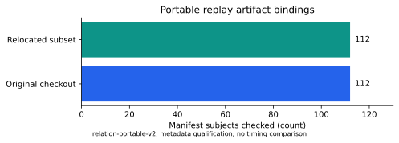

# Portable independent-runner handoff for P-192

2026-11-17. The saved relation/transfer outputs can now be compared from a
relocated checkout subset without relying on the original workspace paths.
The native reviewer checks112 relative artifact hashes and all four result
trees. Both the original and relocated checks exit0,with six corruption
controls rejected. PCC-20261117-dfcc55 records this producer comparison;
it does not establish independent replay or execution verification.
[pcc:unverified]



## Exact comparison boundary

The original [pipeline report](RELATION_PIPELINE.md) and its PDF remain
unchanged. The portable manifest is
evidence/relation-portable-inputs-v1.sha256. Its112 subjects include the
integrated sources,inputs,results and correspondence/bridge/formal input
records. Paths are relative to the checkout. The reviewer rejects absolute
subject paths,parent traversal and symlinks escaping that checkout.

review_relation_replay.cpp uses a typed JSON reader. Object keys,array order,
scalar values and JSON types must match. Empty arrays,objects and strings
are distinct. It compares the full relation producer/checker and fresh
transfer producer/checker result files. Only nonnegative wall_us/cpu_us
fields in root checker objects or root stage entries are excluded. The33
excluded fields are counted. OpenSSL versions are reported separately,
including their equality;they are not silently treated as scientific data.
[pcc:unverified]

The controls change a point-image coordinate,a rank,a stage name,an empty
container's type,a manifest digest and a manifest path. All six reject.
A timing-only change is accepted. Input size is capped at1MiB per JSON,
nesting at128 levels,and the native call at60seconds/1GiB. [pcc:unverified]

The initial v1 wrapper omitted explicit hashes of its four observed standalone
JSONs. Their older PCC pins remain,but do not replace new call-input custody.
V2 adds those hashes. It also copies only the named manifest subjects into
a temporary checkout, copies the observed outputs,and repeats the review
there. The temporary copies are byte duplicates,not a separate execution of
the curve pipeline. Both attempts and the v1 qualification are retained.

## Commands for a separate runner

Check out this PR's exact published source revision. From this study,run the
existing native entrypoint into a new directory:

```sh
./check-relation-e2e.sh /absolute/new/replay
c++ -std=c++17 -O2 -Wall -Wextra -Werror -pedantic \
    review_relation_replay.cpp -lcrypto -o /tmp/p192-replay-reviewer
```

Then,from the repository root,compare the newly produced outputs:

```sh
/tmp/p192-replay-reviewer "$PWD" \
  "$PWD/research/nist_cover_three_tests_20261116/evidence/relation-e2e-v1" \
  /absolute/new/replay \
  research/nist_cover_three_tests_20261116/evidence/relation-portable-inputs-v1.sha256
```

Retain the runner identity,source revision,environment/library versions,
binary hashes,all fresh raw results,exits,cost diagnostics and comparison
receipt. The supplied comparator is producer code;an independent reviewer
must assess its scope rather than treating its own output as a trusted verdict.

The historical pre-call manifests remain exact,including old absolute paths
and binary digests. Native binaries are local build products and are not
included in the portable Git manifest. This package claims neither remote
binary custody nor proof that the original processes executed.

## External dependencies,checked directly

Current main and this branch both have empty keys and trusted_verifiers in
pcc/keyring.json. The existing PCC verifier always returns not_covered for
statement claims,even with an attestation. Re-running the supplied comparator
cannot promote those old records. A separately authorized runner can supply
signed replay/recompute reports under an appropriately scoped non-statement
claim,using a key trusted through the owner's process. Scoped independent
replay does not require inventing a new execution-proof backend.

This runtime has no configured AWS identity/profile or pod token. Managed
environment status lists no secret/runtime-variable/outbound identity binding.
GitHub Actions variable and secret-name metadata reads both return HTTP403.
The published standing allowance is not a live budget/capacity readback.
No paid job was launched and no trust key or cloud permission was changed.

The existing main-only nist-admission workflow was then tried once through
the documented OIDC alternative. [Run44035933968](https://github.com/isogeny-labs/crypto/actions/runs/44035933968)
passes its synthetic controls but fails before account/budget reads:
"Could not assume role with OIDC: Not authorized to perform
sts:AssumeRoleWithWebIdentity". It produces no admission-report artifact.
This workflow only observes fixed metadata;it does not launch a scientific
experiment. No duplicate dispatch or permission change followed the failure.

The [isolab-eks skill](../../.agents/skills/isolab-eks/SKILL.md) requires:
"Stop new launches when the budget is exhausted or its remaining balance is
unknown." The current balance is inaccessible. To finish the cost stage,
provide an existing authorized budget/capacity readback and execution route;
no larger allowance is requested. The original report lists the local timing
exclusions that the admitted accounting run must close.

The goal therefore remains active for external independent verification and
admitted accounting. This appendix closes the portable handoff gap. Prior
native curve results,protocols,PDF and claims remain unchanged.

Sources read:PCC verify_claim and docs/SABOTAGE_RESISTANCE.md sections4/5;
the maintained IsoLab ACCESS/COST_CONTROLS guides;the actual four native
result schemas and manifests;main's nist-admission workflow and read-only
check.sh/README. KB MCP and wrapper remain unavailable.
