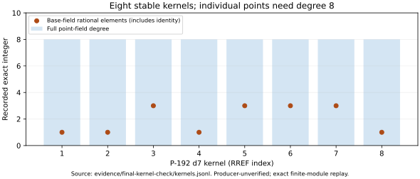
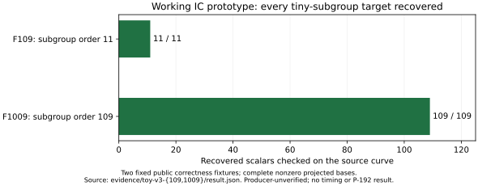
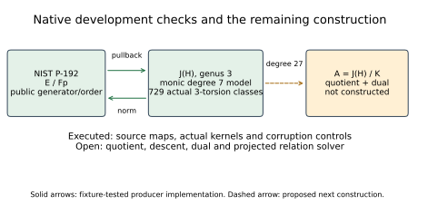

# P-192 genus3 transfers: an explicit polarized 3-quotient

2026-11-16. Builds on [PR4348](https://github.com/isogeny-labs/crypto/pull/4348) and the construction in [PR4403](https://github.com/isogeny-labs/crypto/pull/4403). **The recorded kernel3 now has an explicit same-field nonhyperelliptic target and a degree27 polarized3-quotient argument.** All26 nonzero actual kernel members have principal-function witnesses;two height algorithms give projection/theta degrees9/9(PCC-20261116-3f440b,PCC-20261116-ce4a7b,PCC-20261116-8559fc). The [quotient proof and report](POLARIZED_QUOTIENT.md) identifies the kernel and polarization using stated standard geometric theorems. The executable source evaluator,public G/Q bridge,degree6 elliptic norm and six restricted setup relations are retained. All results have unsigned producer standing;generic transpose-dual execution,exceptional-chart interfaces and individual descent remain separate implementation work. [pcc:unverified]

## Findings

The P-192 d7 cover now has executable native pullback and norm, six explicit genus3 order3 generators spanning729 distinct classes, and actual divisor realizations of its eight reported Frobenius-stable maximal isotropic kernels. The archived product factors' primitive cube roots are opposite: an elliptic-basis Frobenius change is required before reusing the abstract kernel coordinates. Isotropy is transported through the two degree2 quotient maps; it was not independently computed with a genus3 Weil-pairing implementation. [pcc:unverified]



All eight P-192 kernels have executable kernel-coset quotient image arithmetic and a dual candidate, with TF=[6] and inverse6 source-point roundtrips. A distinct OpenSSL backend checks40 public elliptic endpoint receipts. The coset model covers the declared image; a separate geometric construction now reconstructs a candidate curve for kernel1. Neither a P-192 DLP speedup nor a general obstruction is established. [pcc:unverified]

## Actual P-192 candidate curve

Starting from the emitted actual kernel1, native code constructs normalized level3 Weil functions, checks their multiplication and special charts, computes the quotient's64 theta-square values, and reconstructs a smooth Riemann quartic. All28 odd values vanish and all36 even values are nonzero. The curve is explicitly descended from the auxiliary Fp24 tower to Fp using28 labelled bitangents, Frobenius and matrix Hilbert90. The full [geometric report](GEOMETRY.md), [PDF](GEOMETRY.pdf) and [exact15-term model](evidence/p192-d7-kernel1-plane-quartic.json) retain the construction and checks. PCC-20261116-901321 has unsigned producer standing. [pcc:unverified]

For this first kernel1 candidate,the polarized Jacobian identification and possible Serre twist remain open. Its fixed coordinate-window factor base contains234 points and five principal vertical-line relations of coefficient rank5. Native target Jacobian arithmetic checks rational point classes,addition,cancellation and one principal relation using85 evaluations. These first-kernel fixtures have no source-image binding or base logarithms;see PCC-20261116-d2bdb3 and PCC-20261116-94a153. The next paragraph records the later kernel3 construction. [pcc:unverified]

The reconstructed kernel1/2 candidates have conditional differential character-1. Kernel3 gives character+1 under that earlier marked-polarization argument;its coordinate components are in [KUMMER.md](KUMMER.md). Its original-field degree6 backmap gives225 nonzero projected points,six rank6 setup relations and actual public classes. The global source evaluator agrees on public G/Q. The later [quotient proof](POLARIZED_QUOTIENT.md) identifies the actual27-element kernel and polarization3 using all26 principal witnesses and two exact height algorithms. Generic transpose-dual execution,exceptional-chart handling and projected individual descent remain separate implementation tasks. [pcc:unverified]

## End-to-end scalar recovery on public controls

The implemented solver constructs actual auxiliary torsion, transfers through a mixed kernel, generates principal-function relations, merges projected duplicates, solves a modular relation matrix, performs individual descent from a public quotient target, and verifies the recovered scalar on E. Both fixed correctness cases complete. [pcc:unverified]

| Base field | Elliptic model | Source order | Prime subgroup r | Quotient working field | Distinct projected base | Relations / rank | Source-checked targets |
|---|---|---:|---:|---|---:|---|---:|
| F109 | y²=x³+8x+52 | 99 | 11 | F109^6 | 10 | 10 / 10 | 11 |
| F1009 | y²=x³+145x+438 | 981 | 109 | F1009^9 | 108 | 144 / 108 | 109 |

Each source cofactor is9. The recovered logarithms are in prime subgroups of orders11 and109; the auxiliary3-primary groups are used for construction. Unlike the NIST prime-order sources, these Hesse controls have rational elliptic3-torsion. They are functional controls, not matched NIST-family samples. The extension fields do not make these large-DLP tests. The complete projected bases contain every nonzero point of these tiny subgroups. This establishes functional recovery, not a useful P-192 complexity bound. [pcc:unverified]



The source curves come from fixed Hesse parameter2: a=-864 mod p, b=-5616 mod p, with the same d7 cover construction generalized to that coefficient a. Source point counts and genus2 Fp/Fp² counts determine exact construction inputs. A native3-primary group constructor builds full Prym3-torsion in a declared extension; the mixed kernel is realized in the genus3 Jacobian. The toy quotient's working field is explicitly larger than the source field, unlike the Fp-stable P-192 kernels.

For each cubic L, the collector seeks seven distinct rational roots of f_H(X)-L(X)². Their curve points define a principal divisor of Y-L(X), hence a genuine relation. Each accepted divisor is checked with genus3 arithmetic and its projected elliptic row is checked before linear algebra. The generator row fixes log(P)=1. Only after setup are the exhaustive public correctness targets formed and reordered; solve() receives a quotient target and no scalar-witness argument. The enclosing test retains witnesses for final checking. This is principal-function hyperelliptic index calculus carried through a quotient-group image, not Diem on a reconstructed nonhyperelliptic curve.

For individual descent, the solver forms aF(P)+bF(Q), with b nonzero modulo r, and computes

$$R=[6^{-1}]T\big(aF(P)+bF(Q)\big).$$

When R equals a base point B_i whose logarithm l_i was obtained from the relation matrix, it returns $k=(l_i-a)b^{-1}\pmod r$. It verifies $[k]F(P)=F(Q)$ and the enclosing test verifies $[k]P=Q$. Thus scalar recovery uses solved relation data; applying the transfer inverse alone only recovers a point. [pcc:unverified]

The [F109 witness](evidence/toy-v3-109/public-witness.json) and [F1009 witness](evidence/toy-v3-1009/public-witness.json) contain exact source parameters, field modulus, kernel coordinates, base points/logs, all accepted functions/support/rows and recovered target answers. The separate OpenSSL checker recomputes source counts, base logarithms, principal support and projected coefficients, matrix rank and every answer. Its [F109 output](evidence/toy-v3-109/openssl-check.txt) and [F1009 output](evidence/toy-v3-1009/openssl-check.txt) pass; changed-row canaries reject. It does not independently check the auxiliary Jacobian/kernel construction or provide signed PCC verification. [pcc:unverified]

The implementation now uses the exact identity $T(\phi(D))=[3]\pi_*(D)$ to build the projected base without enumerating a coset for every point; eight explicit quotient evaluations audit that identity in each toy case. The relation scan precomputes curve values and evaluates cubics by finite differences, with Horner cross-checks. Results and complete public witnesses are byte-identical to retained v2 outputs. No runtime ratio was measured. [pcc:unverified]

The active solver is `toy_ic_v4.cpp`; the pinned `toy_ic.cpp` retains v3. V4 checks target order and requires the actual zero coset before returning zero for a zero projection. A nonzero auxiliary3-coset with zero projection is a separate rejection case. Both v4 cases pass with four rejection controls each, and their complete public witnesses remain byte-identical to v3. This closes an out-of-domain shortcut in the earlier toy interface; it does not change the valid-target problem. [pcc:unverified]

## Request-to-evidence status

| Requested component | Actual status and evidence |
|---|---|
| Existing NIST/ANSI torsion findings, including omitted controls | Native exact finite-module replay on all306 archived rows from six prime-field streams; all dimension1/2/3 isotropic counts and full Frobenius orders match. This does not independently recompute curve torsion for every row. |
| P-192 d7 actual torsion | Native GMP replay: irreducible degree8 extension; smooth normalized genus2 model; four independent order3 Prym divisors and81 classes; actual Frobenius; four tangent identities and six Weil pairings; elliptic basis/order/Frobenius/pairing. |
| Source elliptic-to-cover transfer | Implemented and fixture-tested pullback and arbitrary rational-coefficient reduced-divisor norm on this monic genus3 model. Thirty-three scalar/composition cases,169 addition pairs, eight further point norms,64 degree2 and64 degree3 norm-additivity fixtures; source/image order-r screens. |
| Actual mixed3 kernels on the genus3 Jacobian | Six generators span729 distinct classes. Eight subgroups of27 elements are explicitly realized and Frobenius-stable. Pairing transport uses aligned roots and the standard polarized degree2 pullback identities. |
| Boundary inputs | Origin, second branch class, and both ramified fibers at elliptic x=1 over a quadratic extension. The latter tests execute pullback fiber/additivity; the norm backend is restricted to rational-coefficient divisors over the base prime field. |
| Corruption controls | Nine rejected cases: count, Frobenius, form, missing modules, duplicate module, torsion point, cube-root/pairing witness, curve coefficient and non-isotropic kernel. |
| Explicit quotient, nonhyperelliptic target and descent | Kernel3 has a same-field smooth quartic,global correspondence and source evaluator. All26 actual kernel witnesses and exact heights support the written degree27/polarization3 proof. Public G/Q bridge passes. Generic transpose-dual execution remains open. |
| Executed dual composition TF=[6] | Executed for all8 P-192 kernels with source-point recovery and separate OpenSSL endpoint checks; not a target-curve-coordinate implementation. |
| Candidate projected relation solver | Full-base small controls recover scalars. The actual P-192 candidate has234 coordinate-window points and five principal relations; source-image binding and a useful restricted-base solver remain open. |
| Complete cost / rho / scaling panel | Not attempted. Small correctness fixtures are not performance trials. No P-192 advantage or scientific measurement is claimed. |

All executed rows above have unsigned producer standing; see the linked raw outputs and PCC records. [pcc:unverified]

## Exact curve and models

The source is the standard NIST P-192 / ANSI prime192v1 model

$$E: y^2=x^3-3x+b,$$

with

```text
p=6277101735386680763835789423207666416083908700390324961279
b=2455155546008943817740293915197451784769108058161191238065
r=6277101735386680763835789423176059013767194773182842284081
Gx=0x188DA80EB03090F67CBF20EB43A18800F4FF0AFD82FF1012
Gy=0x07192B95FFC8DA78631011ED6B24CDD573F977A11E794811
```

P-192 is deliberately outside the small standard performance panel: this is the user's named structural construction input, with its actual192-bit prime, rather than a timing measurement or substituted small curve. The preceding [models export](../nist_cover_separator_20261115/data/models.json) includes all21 curves and their published/eligible-omitted labels. ANSI binary curves are outside this odd-characteristic construction.

For d=7, write

$$h(t)=(t^2-1)\big((t^2+7)^3-3(t^2+7)(t^2-1)^2+b(t^2-1)^3\big),\qquad H:v^2=h(t).$$

The two degree2 maps are

$$\pi(t,v)=\left(\frac{t^2+7}{t^2-1},\frac{v}{(t^2-1)^2}\right),\qquad
\rho(t,v)=(u,w)=(t^2,tv).$$

The second target is the genus2 curve

$$D:w^2=u(u-1)\big((u+7)^3-3(u+7)(u-1)^2+b(u-1)^3\big).$$

The archived Prym coordinates use its monic normalization $X_D=(b-2)u$, $Y_D=(b-2)^2w$. The first attempted native replay missed this normalization and rejected the Mumford equation. Its failed output is retained; changing the adapter, rather than changing the frozen coordinates, produced the accepted replay. [pcc:unverified]

Since $h(1)=0$ and $h'(1)=1024$, set

$$X=\frac1{1024(t-1)},\qquad Y=X^4v.$$

Then $Y^2=X^8h(1+1/(1024X))$ is monic of degree7. The branch t=1 becomes the unique infinity; t=-1 becomes $(X,Y)=(-1/2048,0)$. This supplies the one-infinity divisor model used by the native implementation.

With c=1024, the fiber above a finite elliptic point $(x,y)$ has

$$U(X)=X^2-\frac{2(x-1)}{8c}X-\frac{x-1}{8c^2},\qquad
V(X)=\frac{y(1+2cX)^2}{c^4}\pmod U.$$

Its pullback class is the fiber class minus the second branch class. The formula includes x=1 as the repeated fiber U=X². For P-192 these fibers are not rational point pairs over the base field; both were checked over its quadratic extension. [pcc:unverified]

The norm factors a rational-coefficient Mumford U into irreducibles of degrees at most3, evaluates the map over each residue field, takes its Frobenius trace on E, and respects repeated factors. It does not find an elliptic scalar. Its tested domain is this declared prime-field monic model; it is not a general extension-field norm API.

## The eight kernels

Basis order is two aligned elliptic pullbacks followed by four Prym pullbacks. The exact six Mumford generators are in [actual-cover-torsion.json](evidence/final-kernel-check/actual-cover-torsion.json); coefficient arrays are in ascending order and use the extension modulus in [the input witness](inputs/p192-d7-prym.json). The [eight RREF coordinate bases](evidence/final-kernel-check/kernels.jsonl) reconstruct all kernel generators with the native code.

Every kernel has full point-field degree8, trivial intersection with the elliptic factor and intersection of size3 with the Prym factor. Kernels1,2,4,8 have only the identity rational; kernels3,5,6,7 have three rational elements. This separates subgroup descent from point rationality. [pcc:unverified]

The two nonzero rational Prym 3-torsion classes were lifted into J(H), checked fixed by Frobenius and checked to have zero elliptic norm. Their translations therefore do not create distinct projected elliptic factor-base elements. This is a checked constraint on that mechanism, not a rejection of all torsion-assisted coordinate methods. [pcc:unverified]

## Executed quotient/dual on the P-192 image

For each actual $K$, represent a point by the coset $D+K$, with its least full Mumford encoding as a deterministic label. Addition and negation act on representatives. The map $\psi([D])=[3]D$ is independent of representative because $3K=0$. On this implemented image, $\psi(\phi(D))=[3]D$ and $\phi(\psi(A))=[3]A$. The source transfer $F=\phi\circ\pi^*$ and projection $T=\pi_*\circ\psi$ consequently admit an executed $T\circ F=[6]$ check.

The native [quotient replay](evidence/quotient-v1/rows.jsonl) partitions the729 source3-torsion classes into27 cosets of27 for each kernel, checks135 representative choices and five source scalar fixtures per kernel (including a hash-derived full-width known-answer scalar), and checks inverse6 source-point recovery. [OpenSSL](evidence/quotient-openssl-v1/checker.txt) verifies all40 recorded elliptic endpoints and rejects a corrupted recovery point. No logarithm is recovered by applying inverse6: it recovers the original source point. [pcc:unverified]

This models the image of $J(H)(\mathbf F_{p^8})$ in its quotient, not all $A(\mathbf F_{p^8})$ or $A(\mathbf F_p)$. In particular the 27 cosets from source 3-torsion are not the full geometric $A[3]$, which still has 729 points. The cryptographic order-$r$ subgroup is preserved. A separate kernel1 construction now supplies a base-field candidate curve; polarized Jacobian identification, the possible twist and full target divisor/map arithmetic remain distinct obligations.

For a transported source base $D_i$, the projected row identity is exactly

$$T\left(\sum_i n_i\phi(D_i)\right)=[3]\pi_*\left(\sum_i n_iD_i\right).$$

Since3 is invertible modulo the source prime order, merely transporting that base scales its projected equations. The replay checks16 divisor differences per kernel. This constrains that base choice; it does not assess a new base arising from reconstructed target-curve geometry. [pcc:unverified]



## Reproduce and audit

Requirements: C++17 compiler, GMP C++/C libraries, OpenSSL libcrypto, ripgrep and POSIX shell. No Python arithmetic, curve search, solver or replay is used. The Python figure script only lays out recorded observations.

```sh
research/nist_cover_three_tests_20261116/check-e2e.sh /tmp/nist-three-new-output
```

The output directory must not already exist. The active v4 combined command has completed. Its [completion receipt](evidence/e2e-v2/COMPLETE.txt), [payload manifest](evidence/e2e-v2/MANIFEST.sha256) and [complete raw archive](evidence/e2e-v2.tar.gz) retain every stage, including canaries. Extract with `tar -xzf evidence/e2e-v2.tar.gz -C /tmp`, then run `sha256sum -c MANIFEST.sha256` inside the extracted e2e-v2 directory. The previous [v3 combined run](evidence/e2e-v1.tar.gz) is retained. Individually named PCC/report evidence remains loose; combined-run records are archived together. [pcc:unverified]

The harness compiles separate executables, records hashes before calls, sets executable files read-only and retains distinct post-call source hashes. Generated arithmetic headers remove CLI main functions from the unchanged source files. Toy builds make exactly one guarded source-derivative substitution and one guarded working-field Frobenius substitution; hashes pin the adapted headers. The P-192 builds do not use those substitutions. This reuses one Jacobian implementation; the OpenSSL checks cover the elliptic endpoints/relations and do not constitute a signed independent Jacobian verifier.

Canonical development evidence is [final-kernel-check](evidence/final-kernel-check/): [module summary](evidence/final-kernel-check/module-summary.txt), [actual source torsion](evidence/final-kernel-check/point-replay.txt), [cover maps](evidence/final-kernel-check/cover-replay.txt), [kernel realization](evidence/final-kernel-check/actual-cover-torsion-summary.txt), [controls](evidence/final-kernel-check/controls.txt), hashes and raw module rows. Earlier pre-call manifests and failed normalization/global-initialization attempts remain under evidence/. No elapsed time or host-performance ratio is reported.

Evaluated polynomial certificates: `IDC1h2fca4883893cfdf8` (cleared cover equation), `IDC1h27026700af8d9bbf` (normalized quadratic fiber). Each records32 deterministic evaluations modulo2^61-1 and rejects an added-one corruption. These are producer-issued evaluations, with no Lean proof or independent signature. [pcc:unverified]

PCC statements: `PCC-20261116-b0b9e9` (finite modules), `PCC-20261116-4a86ed` (source points/pairings), `PCC-20261116-e627e5` (cover fixtures and original eight controls), `PCC-20261116-e4ac3b` (actual kernels), `PCC-20261116-192f99` (coset quotient/dual), `PCC-20261116-68ee38` (OpenSSL P-192 endpoints), `PCC-20261116-5c37d1` (first full small recovery), `PCC-20261116-61549b` (both public recoveries and OpenSSL receipts), `PCC-20261116-0b194b` (optimized exact-output qualification), `PCC-20261116-f4dd12` (previous combined command), `PCC-20261116-ab0c8b` (active v4 and complete e2e-v2 command). All have unsigned producer standing. [pcc:unverified]

## Full test still required

The coset-image implementation checks its transfer and dual compositions. Kernel3 now has a global correspondence,executable regular-chart source evaluator,and a written exact-kernel/degree/polarization proof over Fp. Generic transpose-dual execution,exceptional-chart handling and a useful P-192 restricted-base solver remain implementation tasks. The relation problem is

$$T\left(\sum n_iD_i\right)=aP+bQ,$$

allowing a free residual in ker(T). The small full-base control solves a version of this problem; it does not supply a scalable prime-field factor base or favourable cost bound. The original P-192 evaluation still needs the checked target-map/twist identification, an appropriate solver, independent replay and all cold costs against direct elliptic equations and matched rho. Merely applying Diem's ambient genus3 solver does not provide the hypothesized elliptic-subgroup advantage. [pcc:unverified]

The [named obstruction](../../problems/nist-mixed-three-quotient-and-relation-solver.md), [blocked backlog card](../../backlog/XP-20261116-nist-mixed-three-quotient/README.md) and [protocol](PROTOCOL.md) preserve the original requirements. The current main journal reports monthly lab spend USD1982.224 againstUSD1300; this executor has no live AWS readback. No paid experiment/build was submitted, and no alternative backend was used to bypass that admission limit. Restored budget alone would not supply the missing quotient and solver.

The [Iso Lab skill](../../.agents/skills/isolab-eks/SKILL.md) requires: “Stop new launches when the budget is exhausted or its remaining balance is unknown.” That rule applies to the unperformed paid performance trials; the native runs above are functional development tests.

## Sources checked and novelty boundary

KB unavailable: no loaded KB tools; repository wrapper exits127. Used the prior module/source exports, local transfer skill/API, existing [odd-isogeny problem](../../problems/odd-isogeny-quartic-transfer-execution.md), [projected-relation problem](../../problems/prime-cover-projected-relation-cost-missing.md), and these primary sources:

- Song Tian, [arXiv:2007.03172](https://arxiv.org/html/2007.03172), sections1,4,6: known odd-degree genus3 quotient/map construction, rational descent considerations and the F257 example.
- Enea Milio, [arXiv:1709.06063](https://arxiv.org/html/1709.06063), introduction and section7: quotient/theta methods and implementation scope.
- Joux--Vitse, [Cover and Decomposition](https://www-fourier.univ-grenoble-alpes.fr/~viva/research/articles/CoverDecomp.pdf), sections1--3: prior cover/decomposition mechanism over composite-degree extension fields; no automatic prime-field implementation follows.
- Faugere et al., [Symmetrized Summation Polynomials](https://doi.org/10.1007/978-3-642-55220-5_3): prior torsion-assisted coordinate compression. Publisher/HAL full text was inaccessible in this executor; author bibliography and indexed author text were inspected, so no detailed priority or formula claim rests on that inaccessible text.
- OpenSSL `ecparam -name prime192v1 -param_enc explicit -text -noout`: source-generator/public-order cross-check.

This work implements/replays prerequisites for the proposed combination. It makes no priority claim for isogenies, norm projection or torsion-assisted index calculus. Earlier ranking graphs and the IC leaderboard stay unchanged because no new ranking analysis or admitted performance result was produced.
