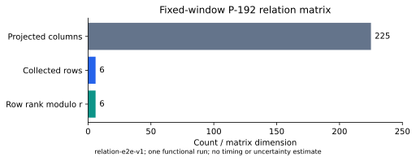

# P-192: executable quartic relations and complete transfer

2026-11-17. The functional pipeline recomputes the original kernel3 quartic
point window, checks six principal relations in its actual Jacobian, and
transports every row to P-192. A separate OpenSSL executable agrees with all
226 point images, all six elliptic sums and four retained public composition
companions. A second native unit executes the complete cover/isogeny/dual/norm
transfer on six public inputs, including the exceptional old-shift input.
These are producer-unverified computations, not signed independent geometric
verification. Component records: PCC-20261117-36d3c9 and12c12a; the integrated
entrypoint is PCC-20261117-87d5fd. All four integrated native workers exit0.
[pcc:unverified]



## What the relation collector does

The input is the actual same-field kernel3 plane quartic, not the older
kernel1 candidate. Every rational point with affine x in0..255 is retained.
For each vertical polynomial, the native collector computes its rational
linear-factor part by gcd with $Y^p-Y$, then uses the original64-shift
factor-splitting limit. It checks the ordered point/fiber lists against the
archived predecessor; the point window is not expanded after the outcome.

There are226 points and seven complete simple split fibers $H_a$. Fix the
first as $H_b$. Each later fiber gives the actual principal divisor

$$H_a-H_b=\operatorname{div}\left(\frac{X-aZ}{X-bZ}\right).$$

All four roots of each accepted fiber reproduce its exact polynomial. The
target Khuri-Makdisi backend encodes the effective degree12 divisor
$H_a+2H_b$ relative to $D_0=3H_b$ and checks the resulting class is zero.
All six such checks pass. This is a vertical-line subcollector, not the
full Diem algorithm. [pcc:unverified]

The explicit degree6 morphism $f:C\to E$ sends the pool to elliptic points.
The producer checks the original P-192 equation and order-r membership for
every finite image. It retains the one exceptional local chart and its
infinity image. Sign canonicalization and duplicate merging leave225 nonzero
projected points. Every original index/sign is retained; no nonempty or
duplicate projected row is silently replaced. [pcc:unverified]

The six projected rows have rank6 modulo r and no zero rows. The recorded
column count minus rank is219. This is an explicit matrix-dimension finding;
the six setup relations do not establish enough rank for a later logarithm
system. The report makes no scalar-recovery claim. [pcc:unverified]

## Fresh transfer, rather than retained outputs alone

The fixed public panel is $O,G,-G,2G,Q,-2G$. The constructor consumes public
coordinates. It computes

$$F(P)=\phi(\pi^*P),\qquad B=\pi_*\psi.$$

For each nonzero input it executes the complete forward correspondence and
target KM encoding. It factors and transposes the complete image cycle,
including multiplicities, subtracts the reference with the actual source
degree, and requires $\psi\phi(D)=3D$ in source Mumford coordinates before
applying the cover norm. Every final result equals $6P$. The zero input uses
the identity class. Generator and Q classes agree with their pinned bridge;
target negatives and doubling agree. [pcc:unverified]

The input $P=-2G$ has $P+2G=O$. It therefore covers a point for which the
earlier fixed-shift elliptic-fiber shortcut would require its infinity fiber.
This qualifier uses the direct isogeny, not a changed shift or skipped input.
It is a concrete exceptional-input check, not a universal search-bound proof.
[pcc:unverified]

## Separate arithmetic checks and their limits

relation_openssl_check.cpp includes only the JSON syntax parser from the
producer. It implements its own GMP polynomial/fraction evaluation and a
coefficient-by-coefficient16-term local curve lift. It includes no producer
field, group, polynomial or KM implementation. OpenSSL3.5.7 supplies the
elliptic group operations; the checker compares its named curve parameters
and subgroup order with the exact P-192 values.

It checks all226 map images, seven exact fiber products, the full signed
projection mapping, six transported rows, their rank, and four retained
composition companions. A second executable checks the six freshly computed
complete-transfer outputs. Changes to a coordinate, finite map image,
nonempty row coefficient and valid norm point are rejected by their actual
equations. [pcc:unverified]

This is a distinct arithmetic implementation under the same producer. It
does not independently construct the quotient or establish a signed PCC
verdict. The readable quotient proof and prior map qualifications retain
their stated standing. The global rational-map identity was not recomputed
by the separate checker; its independent fraction checks concern the fixed
point pool. All broader geometric obligations remain explicit.

## Reproduction, accounting and failed attempts

Run from this study:

```sh
./check-relation-e2e.sh /absolute/path/to/a-new-output-directory
```

The entrypoint builds and runs the relation producer/checker, then the fresh
transfer producer/checker using the first stage's fresh pool. Named inputs
are extracted from the SHA-checked kernel3 archive. Sources, protocols and
build/run inputs are copied and hashed before calls. Every worker has a
600second/1GiB cap. Raw rows, point images, forward cycles, source duals,
per-stage wall/CPU diagnostics, exits and corruption controls are retained.

The first wrapper attempt stopped before compilation because /usr/bin/time
was absent. The second failed -Werror on one ambiguous output loop. Bash's
existing timing keyword and explicit braces corrected those implementation
issues. Warning flags and mathematical criteria were unchanged. Both failed
source/input/log directories remain alongside the successful units.

Local timing diagnostics are not isolated EKS measurements or performance
comparisons. Input extraction, manifest generation and original construction
of the pinned maps are not included in worker stage timings; build costs
are recorded separately. All standalone and integrated attempts count as
work performed. No paid cloud run or leaderboard change is claimed.

| Integrated local process | Wall seconds | User CPU seconds | System CPU seconds |
|---|---:|---:|---:|
| Relation producer build |12.313|10.987|1.307|
| Relation checker build |2.316|2.191|0.116|
| Relation producer |5.491|5.440|0.040|
| Relation checker |0.392|0.374|0.014|
| Transfer producer build |13.173|12.294|0.861|
| Transfer checker build |1.580|1.531|0.039|
| Fresh transfer producer |31.710|31.548|0.049|
| Fresh transfer checker |0.009|0.002|0.007|

These are the raw Bash process diagnostics in relation-e2e-v1,one execution
each,with no uncertainty estimate or isolation admission. Native stages have
their separate microsecond wall/CPU fields. The four result files contain
96305,386,10551 and227bytes respectively. Repeating the fixed rows for the
entrypoint check does not produce twelve independent relations.
[pcc:unverified]

| Retained attempt | Outcome |
|---|---|
| relation-pipeline-v1 | Wrapper exit127 before compilation |
| relation-pipeline-v2 | Producer compile exit1; no arithmetic |
| relation-pipeline-v3 | Relation producer/checker exit0 |
| relation-transfer-v1 | Fresh transfer producer/checker exit0 |
| relation-e2e-v1 | Both components and all four workers exit0 |

## Remaining goal obligations

| Requested obligation | Current scope |
|---|---|
| Complete transfer and exceptional cases | Six fresh producer cases with OpenSSL elliptic cross-check |
| Generate and check quartic relations | All six fixed-window principal relations; actual target KM |
| Transport and inspect independence | Every row checked on P-192; rank6 on225 columns |
| Independently checked geometry/relations | Separate arithmetic implemented; signed independent verification open |
| Complete admitted cost accounting | Local stage diagnostics retained; authorized EKS run and setup accounting open |

The standing IsoLab allowance is200USD/day and1000USD/month, shared across
work. The current balance/capacity is unavailable in this runtime; AWS CLI
and EKS MCP are absent. The GitHub submission workflow exists, but the
isolab-eks skill forbids a new build/job while remaining budget is unknown.
No alternate provider or gate bypass was attempted. This leaves the full
goal active rather than declaring independent/full-cost acceptance complete.

Sources checked: preceding BACKMAP/POLARIZED_QUOTIENT/MAPS_STATUS and
OPAQUE_KM reports; Khuri-Makdisi, arXiv:math/0105182v3, representation,
division Lemma/Algorithm2.3 and equality constructions;
[OpenSSL3.5 EC_POINT arithmetic documentation](https://docs.openssl.org/3.5/man3/EC_POINT_add/).
The primary OpenSSL page was retrieved and read. KB unavailable: the MCP
server is absent and scripts/research-kb reports no executable. These are
established methods; no novelty or speedup claim follows. [pcc:unverified]
