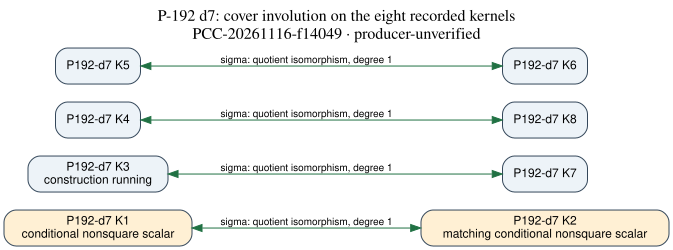

# P-192 cover involution: four pairs among the eight recorded kernels

2026-11-16. The native fixed-input check on the actual P-192 d7 cover and all eight recorded kernels gives the pairs below. PCC-20261116-f14049 pins the exact source, protocol and receipts; this is producer-unverified. No result for another cover or family is inferred. [pcc:unverified]

| Original RREF kernel | Image under the cover involution |
|---|---|
| 1 | 2 |
| 3 | 7 |
| 4 | 8 |
| 5 | 6 |

Each row is a two-element orbit. IDs refer to the complete original RREF witnesses in evidence/final-kernel-check/kernels.jsonl, with source curve NIST P-192 and cover parameter d7. The full permutation, all216 vector checks and the exact normalized-cover identity are retained in evidence/kernel-symmetry-v1/result.json. [pcc:unverified]

## Why the symmetry acts on the quotients

The cover equation is even in t, so sigma(t,v)=(-t,v) is an Fp curve automorphism. The elliptic quotient map pi depends on t squared and v, hence pi*sigma=pi. The genus2 quotient rho(t,v)=(t squared,t*v) instead satisfies rho*sigma=hyperelliptic-involution*rho. Sigma therefore fixes the elliptic pullback and negates the Prym pullback. Their3-torsion images span J(H)[3], since the splitting isogeny's degree is a power of2.

In the archived six-generator basis this is diag(1,1,-1,-1,-1,-1). Applying it to every vector of every kernel produces the permutation above. A curve automorphism preserves the canonical principal polarization, so kernels exchanged by sigma have isomorphic polarized quotients over Fp. This uses the cover argument as well as the finite-module computation; the unsigned native replay is not an independent proof. [pcc:unverified]

The generic cleared even-cover identity has evaluated certificate IDC1h934c14607b52dba9 (unsigned PCC-20261116-eeaf79). Its fixed identity/v1 field is2^61-1. This structural certificate is separate from the actual P-192 coefficient identity checked by the native symmetry replay; it provides no independent signature for that geometry. [pcc:unverified]

## Consequence for the current construction

Kernel1's conditional differential comparison has a nonsquare scalar (PCC-20261116-08b9be). Kernel2's complete fresh chain gives the same character-1, agreeing with the involution prediction; its complete archive is kernel2-v1.tar.gz (PCC-20261116-0d2e60). Kernel3's resumed unchanged suffix now completes with character+1 (PCC-20261116-ba8a27), and its target/source Kummer-coordinate components are qualified in [KUMMER.md](KUMMER.md). These producer controls do not independently verify the normalization argument or provide the remaining divisor-class lift. [pcc:unverified]

The separate curve-level check emits an explicit projective isomorphism and inverse over Fp between the two reconstructed candidates. It derives all64 source2-torsion actions, matches all28 labelled bitangents and checks the entire quartic equation identity, with an altered-matrix rejection control. Exact matrices and labels are in evidence/paired-curve-v2/result.json, pinned by unsigned PCC-20261116-f8faa8. Its first invocation refused the still-incomplete kernel2 descent receipt; no curve mismatch resulted from that early dependency guard. [pcc:unverified]

The original goal remains an appropriate same-field Jacobian, an executable divisor-class map from J(H), a public source DLP transfer and restricted-base relation recovery. The pairing result organizes that construction and supplies controls. It does not supply the missing map.

Reproduce the completed symmetry unit with check-kernel-symmetry.sh and a fresh output directory. Sources: the original cover quotient formulas; native module/actual-kernel witnesses; Tian arXiv:2007.03172 for the separate quotient and map framework. KB remains unavailable; this is a repository/primary-source fallback. No novelty claim.

A local algebra-backend capability check is retained separately: the installed Giac modular mode passes both known roots of the small-prime control but fails both at the P-192 prime. That tested mode is excluded from the divisor-lift solver; this is no mathematical obstruction or general backend-absence claim. Exact input and runtime hashes/logs are pinned by unsigned PCC-20261116-d93b73. No CLI timing is used as a performance result. [pcc:unverified]
