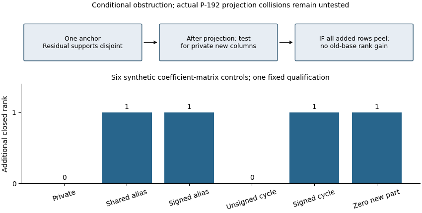

The proposed one-anchor pencil has a necessary closure condition: rows with
private new projected columns cannot contribute extra relations supported
only on the original base. A bounded native audit checks this condition and
coefficient-aware countercontrols on six synthetic matrices. Separately, the
deployed read-only telemetry fix reaches AWS authentication, which is denied.
No new P-192 line collection or paid compute ran. [pcc:unverified]

## Why split count is insufficient

The [proposal](../hypothesis_20261123/REPORT.md) separates H1 (collector
throughput) from H2 (additional independent relations on the original225-point
projected base). Distinct lines in one pencil intersect only at their common
anchor R. For the simple complete intersections admitted by the proposal,
their residual supports away from R are disjoint on the quartic. The fixed
reference's residual points are already in the original base.

After projection, different quartic points can have the same elliptic image
or opposite images, or map into the original base. Geometric disjointness
therefore does not prove projected disjointness. But if each added row has
a nonzero new column occurring in that row alone, the coefficient of that
row must vanish in any combination eliminating all new columns. If all
added rows peel this way, H2 has zero gain for that batch. This conditional
obstruction does not reject H1 or establish which collisions occur on the
actual P-192 quartic. [pcc:unverified]

The elementary singleton argument is: a private column gives $\lambda w=0$;
with $w$ nonzero in the prime-order coefficient field, $\lambda=0$. Evaluated
record IDC1h8e78cc552dcce5cc certifies the cleared polynomial step
$\lambda(wv-1)=\lambda wv-\lambda$ over $2^{61}-1$. It does not formally prove the
geometric assertion or supply an independently signed P-192 result.
[pcc:unverified]

{width=95%}

## Native correctness qualification

The [protocol](PROTOCOL.md) froze six controls before execution. Native GMP
elimination reconstructs each full matrix and its new-column restriction.
If M contains the original and added rows, projection of its row space onto
the new columns has image of dimension rank(M_new). Its kernel is exactly
the combinations supported on original columns. Thus its dimension is
rank(M)-rank(M_new); subtract the original rank to measure additional closure.
This is standard row-space projection, not a new graph algorithm.
[pcc:unverified]

| Synthetic control | Full rank | New-part rank | Additional closed rank |
|---|---:|---:|---:|
| Private columns | 3 | 2 | 0 |
| Shared alias | 3 | 1 | 1 |
| Opposite signed alias | 3 | 1 | 1 |
| Unsigned three-cycle | 4 | 3 | 0 |
| Signed three-cycle | 4 | 2 | 1 |
| Canceled new part | 2 | 0 | 1 |

All controls have original rank1 on three original columns. They are
explicit algebra fixtures, not principal-divisor relations on a curve.
The signed and unsigned triangles have the same incidence pattern but
different coefficient ranks: a graph cycle alone cannot certify useful
closure. Raw matrices and valid singleton witnesses are retained in
evidence/local-v1/result.json. Four invalid witness variants reject: wrong
owner, shared column, original column and repeated deleted owner.
[pcc:unverified]

The same program reads only the frozen previous225-column actual relation
matrix and reproduces rank6. Synthetic rows are never appended to it. This
confirms the auditor's baseline binding, not a new curve observation or a
second producer-independent verification. Native source, copied inputs,
source/binary manifests, compiler diagnostics and exit0 are retained.
The call is a30second/1GiB-capped development qualification; no timing ratio
or admitted benchmark is reported. [pcc:unverified]

## Changed main telemetry: a current authentication blocker

PR4983 merged as dce3fa5c99. The script-only read-only telemetry workflow is
now deployed. One new probe ran at immutable source5ca465dd7b:
[Actions45219644370](https://github.com/isogeny-labs/crypto/actions/runs/45219644370),
job137850127626. Checkout and role configuration succeed, so the earlier
unrelated archive-hydration failure no longer blocks this path.
[pcc:unverified]

AWS rejects the existing role with
`Not authorized to perform sts:AssumeRoleWithWebIdentity`. The credential
step's conclusion says success because of continue-on-error, while its
actual outcome is failure. The budget read is skipped and the final workflow
gate fails. No budget amount or capacity was observed; no EKS launch was
admitted or started. The [bounded receipt](evidence/budget-recheck.json)
retains only the immutable identities, error and non-secret outcomes.
No role, trust policy, permission or budget was changed. [pcc:unverified]

## Consequence and next technical step

Preserve the original pencil protocol and conditional splitting forecast.
Before treating a higher split count as an H2 success, canonicalize actual
projected images with signs, identify outside-base columns, peel singleton
rows and compute the coefficient-aware closed rank. Retain the complete
batch: a row private in one batch can acquire an alias in a later batch.

If all new rows peel, reject H2 for that batch. If a core survives, verify
its actual principal divisors and transported relations before counting it.
Multiple anchors or adaptive incidence construction are possible successors;
neither is established by these controls. Source preparation/static checks
remain useful while the role denial prevents a budget-admitted new campaign.
Signed replay and complete map-synthesis/setup accounting remain open.

Sources checked: the frozen proposal/protocol, original relation and torsion
reports, native exact-rank contracts, and standard singleton elimination and
row-space projection. KB unavailable (configured wrapper has no executable).
No novelty claim. Old reports, protocols and canonical performance plots
remain byte-equal; this graph records only a synthetic correctness audit.
