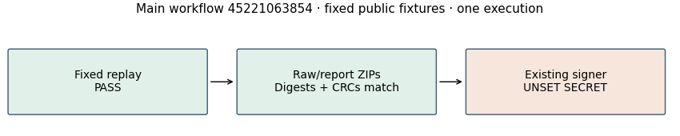

The first deployed main-only replay/signing workflow passes its fixed native
replay, then fails at signing because PCC_SIGNING_KEY is unset. The supported
artifact connector recovers both ZIPs; their API digests and member CRCs
match. Proof-schema checks report no content/hash errors but remain
`not_covered` for missing replay/recompute signatures. [pcc:unverified]

{width=95%}

Run: [45221063854](https://github.com/isogeny-labs/crypto/actions/runs/45221063854).
Immutable source: e5f6de1b6d160aba17f44b0f5cc2c6bf7e0a2ece. Native job
137855136217 succeeds;signer137857335567 fails. Its data downloads succeed,
so the failure occurs at the existing secret check, before signing, signature
verification or sidecar publication. No key, trust or permission changed.
[pcc:unverified]

The unchanged fixture again reports six public scalar bindings, six relation
rows, rank6, three rejected adapter corruptions and zero recovered scalars.
It does not add six new relations. Its outer process clock records83,766,691
wall microseconds,81,086,978 user and1,647,283 system microseconds,435,304KiB
maximum child RSS and exit0. These are one hosted-runner diagnostic interval,
with the [original exclusions](../replay_20261123/REPORT.md), not an admitted
performance comparison. [pcc:unverified]

The raw ZIP contains149 file members. Each member's digest is inventoried in
[main-signing-replay.json](evidence/main-signing-replay.json);36 selected data
files are retained at the exact report-referenced path
`replay_20261123/evidence/ci-45221063854-1/`. Both report copies match the
duplicates in the raw ZIP, and every replay/validator raw-data subject hash
matches the retained bytes. All33 bindings in five source/input/binary/record
manifests match checked ZIP members or immutable source Git blobs;the
[binding receipt](evidence/main-manifest-bindings.json) records each subject.
No downloaded binary or source was executed.
The complete ZIPs and excluded source/binary payloads were checked locally;
only selected data and the complete digest inventory are permanent Git
evidence. GitHub retention expires7December2026;rebuilding uses the immutable
source revision, not an asserted permanent binary archive.
[pcc:unverified]

The fresh unsigned preview uses an unregistered descriptor, not a registered
measurement claim. Its [verdict](evidence/main-unsigned-proof-verdict.json)
has empty content-error lists and notes the absent signatures. Claim
PCC-20261123-81d571 pins this producer observation. Completed components are
the deployed replay path, ZIP recovery and byte binding; signed independent
standing still requires the operator-configured existing signer.
[pcc:unverified]

The separate current [admission probe](evidence/budget-recheck.json) fails
AWS OIDC authentication before budget reads. No new line collection or EKS
compute launched. The next execution depends on that role configuration,
live budget/capacity admission, and full map-synthesis/setup accounting.
This report follows the frozen replay protocol;prior reports and scientific
inputs remain unchanged. The diagram source is signing.py.
