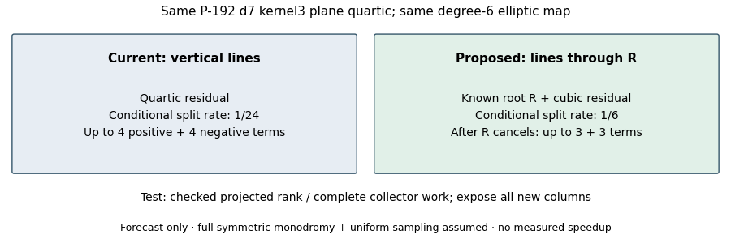

**Hypothesis:** conditioning every relation-search line to pass through one
fixed rational point of the actual P-192 kernel3 quartic will increase
checked, independent projected relations per unit of complete collector
work. The mechanism is lower residual degree and sparser rows. This is a
proposed experiment, with no new P-192 collection or speed result.

## Why this is the next discriminating test

The existing [relation pipeline](../RELATION_PIPELINE.md) scans vertical
lines and records six projected relations of rank six on225 nonzero elliptic
columns. The preceding [replay report](../replay_20261123/REPORT.md) retains
the implementation and checking scope. The task now asks for a new hypothesis;
this proposal targets relation collection rather than changing the maps.
[pcc:unverified]

The [prior torsion audit](../README.md) already records trivial intersection
of every retained kernel with the elliptic factor and zero elliptic norms
for the two rational Prym3-torsion translations. Repeating those translations
therefore does not introduce new projected factor-base points. Their recorded
negative result motivates examining the collector's geometry instead.
[pcc:unverified]

## Mechanism and conditional forecast

Let H_b be the existing first split vertical reference, and let R be its
first retained point in the original support order. Use the256 lines through
R with slopes0..255. A generic such line meets the quartic at R and three
residual points. Removing the already-known root leaves a cubic to factor.
The same R occurs in H_b, so its contribution cancels in the line-ratio
divisor. A simple split line would yield a row with at most three positive
and three negative support terms, compared with the vertical collector's
four positive and four negative terms. Complete divisor and multiplicity
checks remain obligations of the proposed implementation. [pcc:unverified]

{width=95%}

Under full symmetric monodromy and uniform unramified sampling, the
random-permutation model assigns complete splitting frequency1/24 to a
quartic and1/6 to a cubic. The ratio is4. It predicts a possible fourfold
gain in split candidates per attempted line, before mapping, checking and
linear algebra. It predicts neither fourfold total speed nor rank growth.
The actual monodromy and the distribution of this small fixed slope window
have not been checked. Failure of either assumption changes the forecast.
[pcc:unverified]

The elementary polynomial root-removal expansion has an evaluated record
IDC1hb5f68b43278ad86d, with32 issuer-derived points over2^61-1 and a
changed-constant rejection check. This record concerns the generic expansion
only. It does not check P-192 incidence, principality, monodromy or performance,
and has no independent signature or formal proof. Native source, manifests,
exit and record are retained in evidence/identity-v1. [pcc:unverified]

## What would support or reject it

The [frozen proposed protocol](PROTOCOL.md) compares the original256 vertical
lines with256 slopes through R, using the unchanged quartic, reference and
degree6 backmap. It retains every attempt, chart exception and rational point.
Each accepted row must pass exact intersection reconstruction, target-Jacobian
principality, elliptic transport/sum checks and separate-backend rank checks.

Report complete splits, independent nonzero rows, base size, sparsity, all
failure categories and total collector costs, including setup, compilation,
factorization, target arithmetic, mapping, checking and elimination. A higher
split count supports only the first part of the mechanism. H1 needs a gain
in checked independent relations per work with factor-base growth explicit.
The small screen does not establish a statistical performance conclusion.

**Strong competing explanation:** the extra rows merely introduce fresh
unknown columns. To detect this, explicitly eliminate every column outside
the original225-point projected base and count independent surviving rows.
Call the stronger claim of additional old-base relations H2. Reject H2 at
this screen if none survive, even if raw rank rises. Private new columns are
not hidden as an improvement. Projection cancellations, dependencies or full
checking costs can also reject the proposed useful gain. [pcc:unverified]

Corruption controls change a canceled-root coefficient, residual root, row
coefficient and mapped point. Tangent and vertical-reference controls retain
multiplicities. No new anchor, slope expansion or relaxed check follows a
failed outcome. An eventual larger trial requires a successor protocol.

## Prior art, sources and scope

The underlying line-through-known-points method is established in Diem's
index calculus, as explicitly described in the [official Magma handbook](https://docs.magma-maths.org/v2.30-1/AlgebraicGeometry/AlgebraicCurves/linear-equivalence.html#index-calculus).
The new hypothesis is its measured behavior on this transferred fixture,
with projected-rank and new-column elimination as acceptance checks.
It is not a claim to have invented that algorithm or a new complexity bound.

Sources checked: the study's README, SYMMETRY, RELATION_PIPELINE and replay
reports; the official Magma principal-divisor/index-calculus documentation;
and Diem's [2012 primary publication record](https://www.numdam.org/item/JTNB_2012__24_3_639_0/).
The Diem PDF routes returned403/404, so their full proofs were not reread.
A contemporary Prym-cover paper concerns number-field conductor searches
and is not used as evidence for this finite-field prediction. KB unavailable:
the repository wrapper has no executable; targeted committed-source searches
covered torsion, kernel intersections, pencils, secants and monodromy.

Only the bounded elementary identity-issuer qualification ran. Its first
wrapper call stopped before compilation because the evidence parent was
absent; that preparation failure is preserved. No new curve run or paid
compute was launched. The original signed-replay/full-cost goal remains
open. Existing canonical figures and frozen reports remain unchanged; this
new diagram describes a proposal and contributes no measured scoreboard row.
