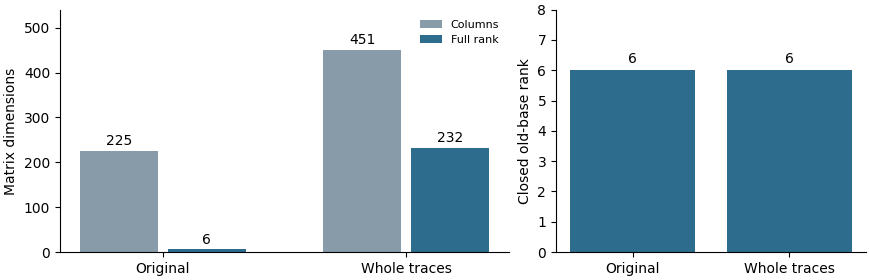

Two bounded static audits close two shortcuts on the frozen P-192 tangent
family. No residual trace decomposes into two signed old-base symbols, and
using whole residual traces as new symbols gives every added row a private
column. The original old-base rank remains six. Individual residual-image
collection and multi-row closure remain the next discriminating experiment.
No new curve point, residual root or production collection was generated.
[pcc:unverified]

## A pair decomposition is stronger than a single-symbol match

For the existing degree6 map f, tangent section $H_P=2P+D_P$ and fixed
reference $H$, the recorded residual trace is $T_P=\kappa-2f(P)$, where $\kappa$ is
the reference's aggregate image. The preceding audit tested $T_P$ against
one old signed symbol. H-G asks whether $T_P$ is the sum of two old signed
symbols, including O and repeated symbols. It uses the same 226 recorded
points/images and 225 nonzero canonical old-base points. [pcc:unverified]

The audit exhausts all 101926 unordered pairs of the 451-symbol signed
alphabet. OpenSSL and direct GMP reproduce the entire ordered fingerprint
stream, which also matches the frozen prior stream. Grouped-key lookups
and independently sorted range joins give the same complete witness sets
for all 226 traces, including the 102 split cases. There are no witnesses
or new coefficient rows. All-norm and principal ranks remain six.
[pcc:unverified]

Seven controls pass: four known-answer retrievals, changed query, missing
pair and changed coefficient. The target checker retains its six original
principal-class checks and coefficient-mutation rejection. There is no new
candidate target class to classify. Every build and worker exits zero.
Raw evidence: [qualification-v1](evidence/qualification-v1/result.json),
[target](evidence/qualification-v1/target-result.json),
[classification](evidence/qualification-v1/classification-result.json).
Record PCC-20261124-0bd716 is producer-unverified. [pcc:unverified]

A pair match would establish an elliptic norm row; target principality and
actual residual-image membership require separate checks. The prepared target
checker classifies signed old-point lifts and reports principal rank
separately. No candidate arose. [pcc:unverified]

Consequently, one split tangent row cannot already be supported entirely
on old elliptic columns. Nor can two new opposite image terms cancel inside
that row: that would make its trace O, which the pair domain includes.
At least one uncanceled new projected column must remain in each row.
This says nothing about shared new columns across several rows.
[pcc:unverified]

## Whole degree2 residuals create private columns

H-H tests a different representation: use the whole residual divisor as
one elliptic symbol with value $T_P$. This avoids splitting its support,
but the symbol's signed aliases must still be merged and eliminated.
The audit canonicalizes every already-recorded trace, preserves old
columns first and constructs the norm rows

$$2f(P)+T_P-\kappa=O.$$

All 226 trace symbols are nonzero, distinct up to sign and disjoint from
the 225 old symbols. Thus each added row has its own new column. Every
singleton owner/column witness is recorded and checked directly. Both
elliptic implementations check all 232 rows. Separate forward and full
dense elimination agree on all ranks. [pcc:unverified]

| Matrix | Columns | Full rank | New-column rank | Closed old-base rank |
|---|---:|---:|---:|---:|
| Original | 225 | 6 | 0 | 6 |
| Whole traces | 451 | 232 | 226 | 6 |

The added closed rank is zero; column count minus full rank stays 219.
Wrong witness owner, a second column occurrence and a changed aggregate
coefficient all reject. Source, full matrix, singleton witnesses and raw
[aggregate result](evidence/aggregate-v1/result.json) are retained.
Record PCC-20261124-87cc09 is producer-unverified. [pcc:unverified]

{width=94%}

The reason is elementary. If row $i$ alone has a nonzero coefficient $w_i$
in its private new column, any combination eliminating that column requires
 $\lambda_i w_i=0$ modulo the prime subgroup order, hence $\lambda_i=0$. Applying
this to every added row removes all of them. Equivalently, closed rank is
$\operatorname{rank}(M)-\operatorname{rank}(M_{\mathrm{new}})$, which here remains six. The existing evaluated
[singleton-step record](../closure_20261123/evidence/local-v1/singleton-step.identity.json)
IDC1h8e78cc552dcce5cc covers the cleared scalar polynomial bookkeeping over
2^61-1 only; it is not a formal or independently signed geometric proof.
[pcc:unverified]

The same obstruction holds for the 102-row split subset because each of
its rows retains its private aggregate column. It does not make their
individual residual images private. Those individual images could alias
between rows even though the sums $T_P$ are distinct. Fresh target
principality for all 226 aggregate sections was not recomputed here; the
rank obstruction concerns the recorded norm-row representation.
[pcc:unverified]

## What this changes in the next experiment

The prepared individual-image worker in merged PR5101 is still the relevant
next test. It reconstructs each selected residual, maps the two points,
checks actual principal classes and emits complete elimination witnesses.
Whole-divisor trace aggregation is excluded by this finite audit. Successful
old-base closure would need interactions among individual projected images
across multiple tangent rows, or another separately specified relation family.
These findings establish no new complexity bound or general absence theorem.

The frozen [pair protocol](PROTOCOL.md) and separate
[aggregate protocol](AGGREGATE_PROTOCOL.md) precede their respective calls.
All four native builds and four workers exit zero. Source/input/binary
manifests, controls, diagnostics, complete query stream and matrix are
retained. Worker caps are 120seconds/1GiB for pair/aggregate audits,
600seconds/1GiB for target checks and 30seconds/1GiB for classification;
strict native builds have 300seconds/1GiB caps. No cap is reached.
Local process clocks are diagnostics; no benchmark or admitted timing
comparison is reported. [pcc:unverified]

Sources checked: prior signed/tangent reports and exact native sources,
private-column closure argument, and the Diem/Magma references already
retained in the parent studies. KB is unavailable in this runtime. These
are standard pair-sum, divisor-norm and finite-field linear-algebra methods;
no novelty claim follows from a missing KB search.

New point collection remains subject to the existing financial admission.
The [isolab-eks skill](https://github.com/isogeny-labs/workspace/blob/main/.agents/skills/isolab-eks/SKILL.md)
requires: “Stop new launches when the budget is exhausted or its remaining
balance is unknown.” No changed budget/signing state was observed and no
unchanged denied probe was repeated. Independent signing and complete
original map-synthesis/setup cost remain open.
