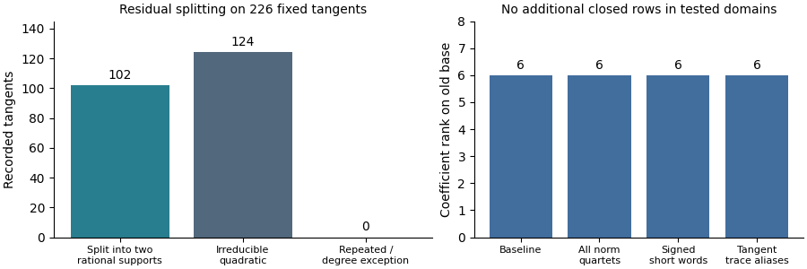

The frozen P-192 kernel3 quartic contains no additional fully supported
canonical sections or signed elliptic relations of length at most four.
A broader tangent diagnostic finds **102 split residual quadratics** among
226 fixed tangents, supplying a concrete next collection target. Their
aggregate elliptic traces give no old-base aliases. These are exact finite
producer results, with unsigned standing; they are not performance claims.
[pcc:unverified]

## Questions pursued and outcomes

All tests use the same recorded 226 quartic points, their elliptic images,
and 225 nonzero sign-canonical base points from main replay45221063854.
One recorded point maps to O. The original seven split vertical sections
supply six principal rows of rank 6. No point window, parameter, reference
or kernel was changed. No residual root was extracted or new curve point
generated. [pcc:unverified]

| Hypothesis | Frozen domain | Finding |
|---|---|---|
| H-A: missed principal line sections | All fully supported canonical divisors, including repeated support | Only the seven known sections |
| H-B: additional short norm identities | Equal positive pairs and positive quartets summing to canonical trace | No distinct equal pairs; only seven known quartets |
| H-C: signed short relations | All nonzero coefficient rows with L1 norm at most4 on the old base | None; formal cancellations removed |
| H-D: split identity-point tangent | The unique recorded identity-image point | Residual quadratic is irreducible |
| H-E: useful tangent trace alias | Residual divisor at each of 226 recorded tangents | No old signed-base/O aliases; no rank gain |

The half-trace alias test is separate from H-C's length bound. It also finds
no old-base match. These negatives close only their declared finite domains;
they do not exclude higher-degree functions, longer relations or other pools.
Records: PCC-20261123-4baa32,2f701b,cd44ee,4d17d5. [pcc:unverified]

{width=96%}

## Exhaustiveness and arithmetic checks

For H-A, every canonical section of a smooth plane quartic is a line
section. A section with two distinct recorded supports lies on a line
through a recorded pair; a one-point section is a hyperflex on its tangent.
The audit enumerates these pair lines and every recorded tangent. A line
that is not tangent needs four distinct recorded supports. The retained
25,616 distinct lines therefore reduce to 233 exact restrictions. Repeated
root division and complete quartic product replay test multiplicities;
lower affine degree would require support at infinity, outside this affine
pool. Exactly seven complete sections remain. [pcc:unverified]

For H-B, all 25,651 unordered recorded-image pairs, including diagonals and
the identity image, are fingerprinted. Grouped joins and independently sorted
joins enumerate both distinct equal-sum pair divisors and degree4 multisets
with sum equal to the reference section's trace. OpenSSL's exact named
P-192 group and separate direct GMP addition reproduce the entire ordered
fingerprint stream. The only norm quartets are the seven canonical ones;
there is no extra nonprincipal norm-kernel candidate here. Both union ranks
remain6. Five corruptions reject. [pcc:unverified]

H-C uses the 451-symbol alphabet O and both signs of every old base point.
Its 101,926 unordered pairs cover every signed word of length at most4 by
partitioning the word, negating one side and padding with O. Equalities are
converted to coefficient rows before the candidate cap is applied. All 25,425
collision aliases cancel formally; none is counted as a relation. The full
OpenSSL/GMP streams and grouped/sorted row sets agree. A separate G, 2G
control retains the nonzero coefficient row (2,-1), so an always-empty join
would fail. Five declared controls pass. [pcc:unverified]

These are separate arithmetic implementations under one producer. Their
agreement is a correctness check, not an independent signed verdict.

## Tangent residuals and the next concrete lead

Write the first reference section as H and its aggregate image as kappa.
At a recorded point P, a tangent section has the form

$$H_P=2P+D_P,\qquad \deg D_P=2.$$

Applying the established elliptic norm to the principal line-ratio divisor
H_P-H gives the residual aggregate

$$\operatorname{tr}_f(D_P)=\kappa-2f(P).$$

Here f is the existing degree6 curve map, with f(P0)=O for the recorded
identity-image point P0. The aggregate of a rational degree2 divisor lies
in E(Fp) even when its individual support points are conjugate over Fp2.
This is ordinary divisor pushforward; it does not identify the divisor's
Jacobian class with an elliptic point. [pcc:unverified]

H-D's exact residual discriminant is a nonresidue, so its support is not
two rational points. H-E then evaluates every frozen tangent: 102 have
nonzero square discriminant, 124 have nonsquare discriminant, with no
repeated-contact or affine-degree exceptions. GMP and OpenSSL agree on
every Euler criterion and aggregate trace. No residual aggregate equals O
or either sign of an old base point; no new row is supported solely on
old columns. The 226 aggregates are distinct, as also follows from distinct
recorded images and injectivity of multiplication by2 on this odd-order
group. The latter is not an independent statistical observation.
[pcc:unverified]

The 102 split quadratics are a positive construction lead, not102 checked
new transported relations. The next experiment should reconstruct those
fixed residual roots, evaluate every individual image with both backends,
check each actual target principal class, merge signed aliases, and compute
closed rank after eliminating every new column. Tangency removes a known
double root and leaves a quadratic, compared with the cubic left by an
ordinary line through one known point. There is only one tangent per point;
a lower residual degree alone establishes no throughput advantage.

A useful successor must produce shared projected columns or cancellations
that survive elimination. Raw row count or raw rank growth with new columns
is insufficient. [The successor protocol](TANGENT_COLLECTION_PROTOCOL.md)
freezes this next collection test without executing it. It does not expand
the failed domains or change the existing pencil proposal.

## Actual target classes, including a closed-point divisor

The generalized effective-divisor encoder supports degree 12 divisors with
multiplicity up to12 in either smooth local chart. It reproduces the old
encoder on all seven simple fibers, checks the seven canonical zero classes,
and rejects a changed reference. A signed-divisor version checks all six
baseline rows and rejects a coefficient mutation. [pcc:unverified]

The closed-section encoder requires no residual roots. It removes reference
support multiplicities from the exact line restriction, encodes those
supports with complete curve Newton jets, and encodes the remaining
intersection in Fp[t]/(restriction). It requires the curve equation to vanish
in that quotient, degree 12 and both Riemann--Roch/evaluation dimension 22.
The identity tangent plus twice H gives zero in the actual target Jacobian;
the reference encoder agrees with the old encoder. Adding1 to the remainder
is rejected by the curve equation. This qualifies a closed-divisor case
that the original rational-point-only interface could not express.
[pcc:unverified]

## Structured filter for bitangent ideas

For a rational whole bitangent contact divisor D,2D is linearly equivalent
to the canonical section. Its normalized elliptic aggregate T must satisfy
2T=kappa. Since the standard P-192 group has odd order, T is unique:
T=[(n+1)/2]kappa. Both arithmetic backends compute the same value and verify
its double; neither T nor -T occurs in the old base. [pcc:unverified]

Thus whole rational bitangent contact divisors collapse to the same
aggregate norm. They cannot supply distinct elliptic symbols merely because
their contact divisors differ. Individual contacts or mixed incidences could
still matter; no contact lines or splitting data are asserted here. This
filter and the tangent trace test concern this explicit special cover. They
do not assign Smith's 18.57% random hyperelliptic estimate to an elliptic-cover
family, and establish no new complexity bound. [pcc:unverified]

## Evidence, reproduction and limits

Frozen protocols: [initial](PROTOCOL.md), [signed](SIGNED_WORD_PROTOCOL.md),
[identity tangent](IDENTITY_TANGENT_PROTOCOL.md),
[all tangent traces](TANGENT_TRACE_PROTOCOL.md). Native sources and matching
check scripts are adjacent. Run each script with a new evidence path;
existing directories deliberately fail rather than overwrite evidence.

Successful directories are qualification-v2,signed-v2,tangent-v1,traces-v1.
All builds and workers exit0. Each retains source/input/binary manifests,
raw candidates, exits, compiler diagnostics and process costs. The first
qualification and first signed build failed before workers ran; both source
snapshots and diagnostics remain. Fixes concerned indentation, OpenSSL status
types, temporary-container lifetime and explicit namespace qualification.
No mathematical criterion, cap or warning flag was relaxed. [pcc:unverified]

The arithmetic cap is 120seconds/1GiB; target checks 600seconds/1GiB and each
strict native build 300seconds/1GiB. Candidate caps are 4096 and target caps 256;
no cap was reached. Recorded local costs are diagnostics, not isolated EKS
measurements. The generic quartic expansion record IDC1h410d94bb5fe960a4,
with 32 issuer evaluations over2^61-1, supports the root-product bookkeeping
only; it is not a formal or independently signed geometric proof.
[pcc:unverified]

Sources checked: the study's RELATION_PIPELINE, prior torsion/quotient/map
reports, fixed replay and previous pencil/closure reports; the Diem and
Magma references already recorded there. These use established incidence,
pair sums, discriminants and quotient-ring arithmetic. KB unavailable: the
repository wrapper has no executable and the MCP is not loaded. No novelty
claim follows from that gap.

The newly prepared point collection remains unexecuted. Existing read-only
budget telemetry reaches an AWS role denial; it observes no remaining
balance, so a new campaign is not admitted. Independent signing is also
unavailable because the deployed signer reports PCC_SIGNING_KEY unset.
The [isolab-eks skill](https://github.com/isogeny-labs/workspace/blob/main/.agents/skills/isolab-eks/SKILL.md) requires: “Stop new launches when the budget is exhausted or its remaining balance is unknown.” That rule pauses the proposed new collection. Neither unchanged failing path was retried. These do not invalidate the
finite static audits; the original independent-signature and complete
map-synthesis/setup cost obligations remain open.
