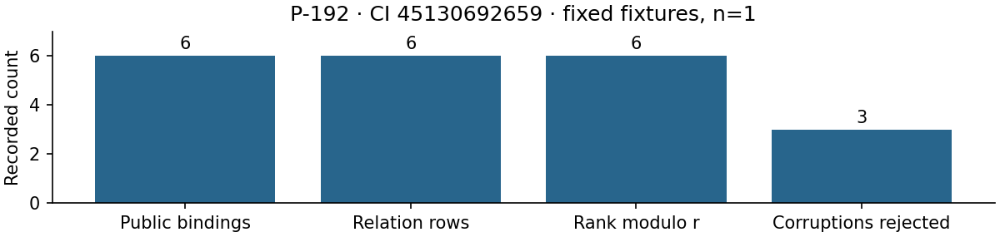

CI run 45130692659 passes the fixed P-192 transfer/relation replay at source
a419ff7cdbecd8a1b404dad29233a46684eca7bc. The corrected workflow writes to
`evidence/ci-45130692659-1`, preserving the earlier committed records. Public
fixtures, native algorithms, acceptance criteria and the six independent
rows are unchanged. The broader signed-verification/full-cost goal remains
open. [pcc:unverified]

{width=80%}

The initial [REPORT](REPORT.md) and inspected three-page PDF remain frozen.
This successor records two preparation failures and the focused repair:

| Run | Source prefix | Observed outcome |
|---|---|---|
| 45130498900 | 85bd7e6e1cc7 | Existing output directory; no arithmetic ran |
| 45130664027 | a3e5c7c573af | Same collision; workflow edit not staged |
| 45130692659 | a419ff7cdbec | Fresh-directory replay passes; signing skipped |

Publishing historical evidence made the fixed CI destination exist. Its
write-once guard correctly rejected reuse. The always-upload artifact from
the failed run contains historical data and is not a fresh success. The
intervening commit omitted the workflow edit because it was outside the
sparse-checkout index selection. The successor explicitly stages it with
`git add --sparse`. The workflow now carries one run/attempt-specific path
through execution, log export, artifacts and isolated signing.

Four JSONs were recovered through the authenticated public job log and each
SHA-256 checked: fixture summary, comparison, pipeline clock and adapter
clock. Thirteen additional export digests are recorded without a recovered
payload claim. All four original workers and the report adapter succeed.
The original six comparison corruptions and three adapter corruptions reject;
the declared semantic comparison passes with OpenSSL 3.0.13 against 3.5.7.
There are six public scalar bindings and rank six on the same 225-column
base. No new relation or unknown scalar is added. [pcc:unverified]

The recorded outer wall interval is 48,408,264 microseconds, user CPU
46,604,023 microseconds, system CPU 1,079,259 microseconds, and maximum child
RSS 435,748 KiB, exit zero (one hosted-runner execution). These are diagnostic
readings with the same exclusions as REPORT.md. No comparison of host speeds,
admitted benchmark or uncertainty estimate follows. [pcc:unverified]

Records: [ci-unique-path](evidence/ci-unique-path/observation.json) and
[failure receipt](evidence/ci-publication-collision.json). Editable figure:
recheck.py. Prior reports and canonical graphs remain unchanged. The earlier
remote publication receipt is retained.
