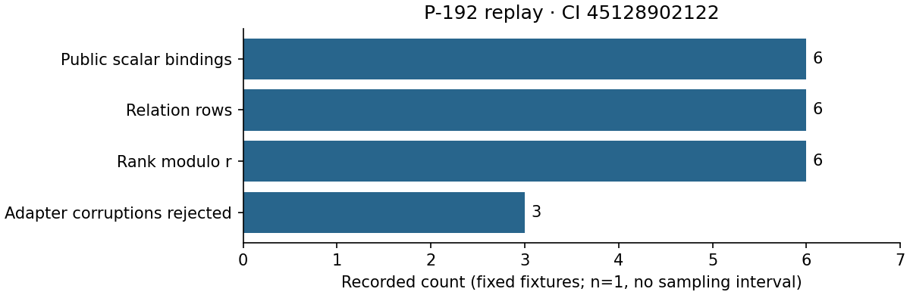

The fixed P-192 transfer and relation pipeline ran successfully on a fresh
GitHub runner. A new OpenSSL/GMP adapter binds all six public fixture scalars,
checks their sixfold norms, and reconstructs six elliptic relation rows of
rank six. These are producer observations with unsigned reports, recorded in
PCC-20261123-8919bd (local) and PCC-20261123-fbbe76 (CI). [pcc:unverified]

## Construction and scope

This continuation preserves the genus-3 hyperelliptic cover, its actual
degree-27 polarized kernel3 quotient to a smooth plane quartic, and the
forward/dual routines from the merged study. It reuses the maps indexed in
[MAPS_INDEX](../MAPS_INDEX.md) and the mathematical discussion in
[RELATION_PIPELINE](../RELATION_PIPELINE.md). It adds execution and checking
infrastructure; it makes no new general algebraic-identity claim.

The six transfer fixtures are O, G, -G, 2G, Q=[37]G and -2G on standard
P-192. The adapter binds their public scalars 0, 1, -1, 2, 37 and -2 to
OpenSSL's standard generator, then checks each recorded norm against [6]P.
This exercises the actual forward/dual path, including the exceptional
infinity representation retained from the earlier construction. Public
fixture binding does not search for an unknown logarithm. Finite checks do
not establish universal geometric or exceptional-case coverage.
[pcc:unverified]

The frozen relation collector uses x=0..255: 226 rational quartic points,
seven fully split vertical fibers and six differences of principal vertical
sections. Their canonical nonzero elliptic images form a 225-column base.
The reconstructed matrix has six nonzero rows, rank six modulo the P-192
subgroup order, and deficiency 219 (=225-6). These are the original restricted
vertical relations, rather than a full Diem collector. Replaying twice adds
no new independent rows. [pcc:unverified]

{width=92%}

## Protocol, controls and executions

[PROTOCOL](PROTOCOL.md) froze the acceptance criteria before execution.
Original arithmetic and old reports remain byte-equal. Native adapters are
C++; shell wrappers orchestrate bounded calls. The initial 112-subject
portable manifest and additional legacy-source hashes are checked before the
run. Four original native workers produce relation and transfer outputs and
their separate-backend checks. The typed comparator retains its declared
33 timing exclusions and library-version treatment. The new adapter checks
headline counts against fresh raw data and separately recomputes row rank.
[pcc:unverified]

| Execution | Immutable source | Outcome and evidence |
|---|---|---|
| Local qualification | e20e1ffed5, with frozen adapter copies | All workers and adapter pass; evidence/local-v1 |
| CI 45128138538 | 0ee5da69104c | Replay passes; artifact ZIP retrieval fails HTTP403 |
| CI 45128902122 | 3e51a55a65fb | Replay passes; 17 public records recovered and individually SHA-256 checked |

Revision prefixes above identify the full immutable source hashes in the CI
receipts and ci-observation.json.

Both CI jobs use ubuntu-24.04 hosted runners. Local OpenSSL and the original
fixture report identify 3.5.7; CI identifies 3.0.13. Semantic comparison passes
with that version difference explicitly reported. The second CI execution
qualifies bounded allowlisted public-log export after the artifact redirect
failure; native arithmetic did not change between the CI executions.
All three runs concern the same fixed cases. [pcc:unverified]

Six original comparison corruptions are rejected, with a timing-only change
accepted as specified. Three new adapter controls independently change a
valid source fixture, add G to a norm, and change a relation coefficient;
each rejects. A separate explicit exit-7 child checks nonzero exit propagation.
The adapter reports six bindings, six relations, rank six, and zero recovered
scalars. [pcc:unverified]

## Cost interval and remaining exclusions

The outer clock encloses preparation from frozen map data, original archive
extraction, compiler children, all four original workers, typed comparison
and child cleanup. It records monotonic wall microseconds, waited-process
user/system CPU microseconds, Linux maximum child RSS in KiB, and exit status.
The report adapter has a separate interval, as does clock compilation.

| Recorded diagnostic | Local n=1 | CI 45128902122 n=1 |
|---|---:|---:|
| Outer wall, microseconds | 77,423,663 | 82,967,721 |
| Outer user CPU, microseconds | 73,516,696 | 81,165,690 |
| Outer system CPU, microseconds | 3,694,187 | 1,654,238 |
| Maximum child RSS, KiB | 434,120 | 435,180 |
| Report-adapter wall, microseconds | 324,965 | 359,938 |
| Clock-compiler wall, seconds | 0.858 | 0.665 |
| Outer and adapter exit status | 0 | 0 |

These are diagnostic readings from different hosts, with no isolation
admission, repeated samples or uncertainty estimate. No performance ordering
is inferred. Maximum child RSS is not simultaneous aggregate process-tree
memory. The interval excludes original map synthesis, machine/package
provisioning, and adapter staging/preflight hash checks before the clock.
Clock compilation and certificate generation are reported separately. Complete
admitted end-to-end cost accounting therefore remains open. [pcc:unverified]

## Evidence custody and independent standing

The CI observation and public-export manifest reside in
[evidence/ci-replay](evidence/ci-replay/ci-observation.json). The 17 recovered
files include four raw native JSONs, comparison output, process clocks,
replay/validator reports and hash manifests. Ten CI-reported source/input
bindings match locally qualified bytes. CI binary hashes are recorded;
the binary payloads and full artifact ZIP were not recovered. Artifact ZIP
digest verification is not asserted. [pcc:unverified]

The existing PCC verifier checks an ephemeral measurement descriptor against
the recovered data. Its report has no content/hash error and returns
`not_covered`: replay and recompute signature sidecars are absent. These
preview descriptors are not registered measurement claims. Separate-backend
checking and fresh-runner execution do not supply a verifier independent of
the producer. [pcc:unverified]

The new workflow isolates optional signing in a separate main-only job using
maintained PCC tooling and the existing trust configuration. That job executes
no uploaded native code and fails if its signing secret is absent. PR runs
skip signing. The inspected main signing job 137496792444 explicitly reported
that PCC_SIGNING_KEY was unset; a registered public key alone cannot complete
the independent-verdict requirement. [pcc:unverified]

## Deployment checks and next dependency

Read-only budget-telemetry run 45126195900 failed while hydrating unrelated
archived inputs, before AWS authentication or budget retrieval. This PR narrows
that workflow to its actual read-only script and removes the unrelated
hydration. It changes no IAM, budget, role or trust setting. The change awaits
normal deployment; current AWS access and remaining charged/reserved budget
were not observed. No EKS compute was launched. [pcc:unverified]

The completed component is exact-source CI replay, public-scalar binding,
bounded record recovery and improved interval accounting. The broader goal
remains open for signed independent replay/recompute and a budget-admitted
run including map synthesis and excluded setup. Next: deploy the narrow
telemetry correction through normal gates, read the live admission state,
and use an operator-configured existing signer for the qualified reports.
[pcc:unverified]

At source 3e51a55a65 the replay check passes. Two other PR gates fail:
unavailable archived inputs, and PCC checks reporting older shared-log prose
plus three NameErrors in unchanged tests. These failures are retained;
no gate is bypassed. [pcc:unverified]

## Sources and publication checks

Primary sources for this continuation are the frozen prior protocols and
native maps, OpenSSL generator/arithmetic API documentation, and the current
PCC replay/recompute and process-accounting contracts, as recorded in the
session log. KB unavailable: its configured wrapper has no executable in this
runtime; prior committed study evidence was used. No novelty claim is made.

CI receipts: [45128138538](https://github.com/isogeny-labs/crypto/actions/runs/45128138538),
[45128902122](https://github.com/isogeny-labs/crypto/actions/runs/45128902122).
The editable figure source is checks.py and its data source is the committed
CI certificate-summary.json. Old RELATION_PIPELINE/PORTABLE_REPLAY figures,
the IC scoreboard and leaderboard receive no new performance entry or
mathematical edge; their conclusions are unchanged. This diagnostic
qualification is not an admitted benchmark publication.
