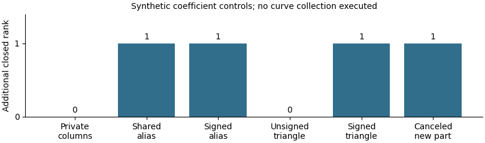

The fixed split-tangent collector and its separate arithmetic checker are
implemented and strictly compiled. Synthetic polynomial and coefficient
fixtures pass, including complete elimination witnesses. **Actual collection
of the 102 split residuals remains unexecuted.** This component prepares that
next experiment; it supplies no new curve points, relation yield or measured
closed-rank gain. [pcc:unverified]

## What is implemented

The [parent report](../recorded_pool_20261123/REPORT.md) records 102 split
quadratic residuals among the 226 original tangents. The unchanged
[parent successor protocol](../recorded_pool_20261123/TANGENT_COLLECTION_PROTOCOL.md)
asks whether their individual projected images produce additional relations
on the original 225 columns. Its competing explanation is growth in fresh
unknown columns. Neither outcome is assumed here. [pcc:unverified]

The new [collector](collector.cpp) checks every tangent label and exact
restriction, reconstructs both roots of each selected residual, checks full
quartic incidence, verifies the actual target principal class and evaluates
every individual image using the existing degree6 map. It preserves the
original point/base prefixes, merges full coordinates and signed images,
retains all original and selected rows, and checks their elliptic sums.
These production branches are compiled but have not been run on the fixture. [pcc:unverified]

New quartic x-coordinates are arbitrary field elements. The original target
pool stores its restricted x-window as machine integers. The collector keeps
that evaluation pool fixed and uses the qualified quotient-ring section
encoder directly on the tangent restriction. It never truncates new support
coordinates or inserts them into that old pool. The map interface and new
point records use full GMP field coordinates. [pcc:unverified]

The [separate checker](checker.cpp) includes the prior independent
GMP/OpenSSL rational-map path, with no producer field, group or polynomial
implementation. It rederives tangent restrictions, all selection decisions,
residual products, individual images, canonical signed bindings and every
row coefficient and elliptic sum. It rejects unwitnessed or duplicate curve
points and unused base columns. Production corruption controls change a
residual, selection label, row coefficient, mapped image and elimination
witness. Those actual-fixture controls remain unexecuted.

{width=95%}

\newpage

## Coefficient-aware closure has explicit witnesses

The producer eliminates only columns outside the original base. For each
surviving row it emits coefficients c and the old-column vector v, binding

$$\sum_i c_i M_i=(v,0).$$

The checker recomputes that complete equation modulo the standard subgroup
order. It also checks that the emitted coefficient vectors are independent
and number exactly the row count minus the new-column rank. Thus they span
the entire left kernel, rather than a favorable subset. An independent dense
elimination checks both ranks and the dimension identity

$$\operatorname{rank}(M)-\operatorname{rank}(M_{new})
  =\operatorname{rank}(\text{closed old-column rows}).$$

The baseline rank is then subtracted. Full rank growth alone cannot pass
this test. All resulting old-column rows must also have zero elliptic sum
in the production checker. This is standard finite-field row-space
projection, with concrete witnesses, rather than a new rank algorithm.
[pcc:unverified]

## Synthetic qualification actually executed

The [qualification protocol](PROTOCOL.md) froze the polynomial and matrix
controls before either worker ran. Five scalar quadratics cover distinct
roots, a nonmonic leading coefficient, a repeated root, an irreducible
quadratic and roots close to the field modulus. They are scalar algebra
fixtures, not points on a curve. The separate checker uses discriminants
and coefficient/product identities to verify the producer's roots.
[pcc:unverified]

The six coefficient matrices are unchanged fixtures from the preceding
closure study. Their additional closed ranks are 0,1,1,0,1,1 for private
columns, a shared alias, opposite signed alias, unsigned triangle, signed
triangle and canceled new part. The checker verifies every witness and full
kernel dimension. Changing a root, witness coefficient, projected old row
or claimed rank is rejected. [pcc:unverified]

{width=88%}

Both programs reject unknown and ambiguous modes and pre-existing output
paths. Collision controls leave the original result bytes unchanged. Both
strict builds and both synthetic workers finish with exit0; all six CLI
rejection calls finish with the expected exit1. First-attempt collector
compilation passed, but checker compilation rejected a duplicated type token
before any worker ran. That failed source/build record remains intact.
The fixed attempt uses a fresh directory and unchanged mathematical criteria.
[pcc:unverified]

The generic quadratic expansion has evaluated record IDC1hfc525decb5f2a663,
with 32 issuer-derived evaluations over 2^61-1 and changed-constant rejection.
It supports scalar root-product bookkeeping only. It is not a formal or
independently signed proof of rank, principality or the P-192 construction.
The issuer-only build lacks a separate process-cost record; no timing claim
uses it. Source, binary binding, compiler diagnostics and record are retained.
[pcc:unverified]

Record PCC-20261123-b27a48 pins the successful synthetic sources and raw
results. The driver/identity record is PCC-20261123-7c5b09.
All remain producer-unverified; separate arithmetic is not an independent
signed verdict. Compiler caps are 300seconds/1GiB, synthetic workers
120seconds/1GiB. Actual production workers have the proposed 600second/1GiB
caps. Local diagnostics are retained without a performance comparison.

## Prepared execution and remaining acceptance

[run-admitted.sh](run-admitted.sh) binds an externally admitted campaign
envelope, recompiles and qualifies the native source on that job image,
then runs the original fixed relation/transfer panel, the tangent collector
and the separate checker. The original panel includes fresh public-input
forward/dual/norm composition and exceptional-input checks. The driver
records builds, worker processes, baseline and outer pipeline costs and
retains partial failures. A compiler wrapper bounds legacy native builds.
Its production path has not executed. [pcc:unverified]

The two rejecting entry guards confirm that an unknown mode and a missing
envelope fail before directory creation or pipeline entry. The envelope's
presence and the --admitted flag do not grant authorization. Original map
synthesis still needs its complete setup accounting: replaying pinned map
inputs does not make their construction free. External job/image/source
admission, total billing and independent signing remain separate obligations.
[pcc:unverified]

The [isolab-eks skill](https://github.com/isogeny-labs/workspace/blob/main/.agents/skills/isolab-eks/SKILL.md)
requires: “Stop new launches when the budget is exhausted or its remaining
balance is unknown.” The existing role denial prevents the budget read;
the deployed signer separately reports PCC_SIGNING_KEY unset. No unchanged
failing probe, paid launch or real collection was repeated. These limit the
next run, not the completed source/synthetic qualification.

Sources checked: the exact parent protocols, original BRMap and
relation_openssl_check.cpp, qualified quotient-ring encoder, prior synthetic
closure matrices and Diem/Magma references recorded in the parent. KB is
unavailable in this runtime; no novelty claim follows from that gap.
