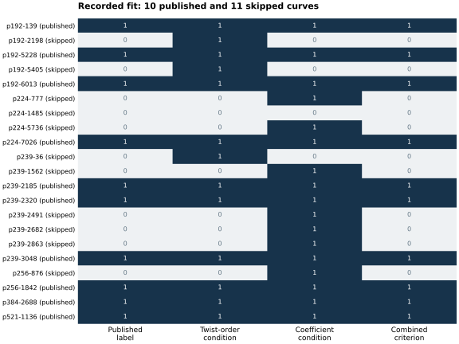
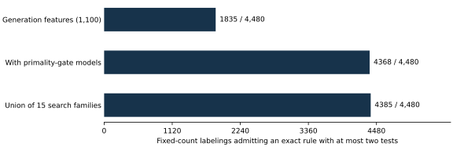

# Searching for the skipped-curve criterion

Search started 25 October; report 26 October 2026. Exploratory analysis of
21 eligible prime curves: ten published and eleven skipped.

An exact two-test empirical separator was found and independently recomputed
from the parameters. The historical selection mechanism remains unestablished.
The search also produced many other exact separators, and calibration shows
that such fits are common in the searched families. No attack is established.

## The concrete empirical criterion

Moduli, counts and stream indices below are decimal. Exact input parameters
retain their explicit hexadecimal prefixes.

Let `n` be the prime full curve order and define the base-field quadratic
twist order `M = 2p + 2 - n`. On the reconstructed historical root convention:

```text
accept if and only if
    M mod 8 is 5 or 7
and (b + 1) mod 19 <= 13.
```

This accepts **10 of 10 published curves** and rejects **11 of 11 skipped
curves**. The [direct truth table](results/criterion-truth-table.tsv) was
calculated from the exact parameters by `native/verify_rules.cpp`, separately
from the feature-mask search. This is an empirical separator, without a
historical code path, security rationale or independent historical holdout.

The first condition alone accepts every published curve and rejects eight
of the eleven skips. Its three false acceptances are P-192 indices 2198 and
5405, and the p239 stream's index 36. Their `(b+1) mod 19` values are 14, 16
and 17, so the second condition removes all three. The second condition also
removes P-224 index 1485, already removed by the first condition.



### Root convention matters

For the fields congruent to 3 modulo 4, the reconstruction uses the documented
exponentiation root. For P-224 it uses the negative of textbook Tonelli-Shanks
with the least nonresidue, 11; this reproduces the published coefficient.
Every normalized P-224 model was rechecked natively. The source models are
preserved in [inputs.tsv](inputs.tsv), and the normalized models are separately
frozen in [inputs/historical.tsv](inputs/historical.tsv).

Using the smaller P-224 root instead makes the two-test rule reject the
published P-224 model. Those two models are isomorphic over the base field.
Thus the coefficient test is representation-dependent. This does not exclude
its use in a particular generator, but it prevents interpreting it as an
intrinsic weakness of the isomorphism class.

A second exact separator uses trace `t = p+1-n`:

```text
accept if and only if
    M mod 8 is 5 or 7
and t mod 7 != 0
and t mod 13 != 6.
```

This fits all 21 labels under either P-224 sign. It is another post hoc rule;
no historical mechanism or attack follows from these residue exclusions.

## How much does a perfect fit tell us?

The six streams have published counts 3 of 5, 1 of 4, 3 of 8, 1 of 2,
1 of 1 and 1 of 1. Keeping those counts fixed yields exactly 4,480 possible
label assignments. The same finite rule search was applied to every one.

| Declared search | Assignments admitting an exact rule with at most two tests |
| --- | ---: |
| Extended generation features, 1,100 features per curve | 1,835 / 4,480 |
| Generation features including incomplete-primality-test models | 4,368 / 4,480 |
| Union of the 15 comparable 21-curve search families | 4,385 / 4,480 |

The union rate is **97.8795%**. It measures how readily this search can fit
labels, under the within-stream exchangeability model. It is not a posterior
probability about the historical rule, an attack, or the designers' intentions.
The 19-curve auxiliary search is reported separately and is not included in
that union. These calibration results do not establish either security or
the absence of an undiscovered selection mechanism.



These are exploratory results. Existing labels and earlier analyses were
already visible. `SEARCH_PROTOCOL.md` was committed before calculating the
first expanded feature set, but this is not a claim of blinded preregistration.
Later feature families and root comparisons are explicitly post hoc.

## Work actually completed

| Work | Recorded result |
| --- | --- |
| Exact source population | 19 curves in the four streams with skips, plus published P-384 and P-521 controls |
| Native input certificates | 21 / 21: seed reconstruction, coefficient relation, prime field and full order, point witness/Hasse certification, embedding degree at least 1024 |
| Initial feature extraction | 1,062 integer features per curve |
| Extended feature extraction | 1,100 per curve across all 21; 1,118 on the separately labeled 19-curve subset |
| Primality-gate extension | 4,282 features per curve, including 1,591 proposed bases per curve and Euler/2-adic-order consistency checks |
| Short-rule search | Single predicates and AND/OR combinations through three predicates; equivalent masks deduplicated |
| RNG/generation models | 52,520 defined models; zero exact fits; best compatible model has six errors |
| Integer factorization targets | 80 / 84 complete with prime proofs and exact products; four remain incomplete |
| Base-field twist factorizations | Complete and proved for all 21 curves |
| Independent formula evaluation | Two-test and three-test rules have zero errors on the historical convention |

All research calculations use native C++ with PARI and OpenSSL. Python only
renders existing records. The exact models, source snapshots, native feature
tables, proofs/checks, per-assignment calibration, failures and commands are
in the evidence archive, `evidence/runs.tar.xz`. The archive is
also attached to the PDF, along with the historical input table and truth table.

### Mechanistic families tested

The RNG experiment varied initial warmup over 0 through 64 generator calls,
fixed and field-dependent extra draws, and eleven trigger types. Triggers
include coefficient existence, small-point lifting, seed-derived points and
zero-byte conditions. It also tried one-shot and retrying point generation
with 8-bit and 31-bit outputs, optional extra limbs and sign draws. Parameters
are shared across streams; they were not fitted separately to each field.

The published P-384 and P-521 seeds are mandatory controls. Pruning models
that miss either leaves 778 models with 56 distinct compatible visitation
patterns. None explains all labels. This excludes the defined family only.
Group-order-dependent draw schedules, arbitrary manual choices, and an
unrecovered historical SEA implementation are not exhausted by that test.
An unaligned visitation fit, if found, would additionally require counting
the newly visited curves before it could establish a complete reconstruction.

The primality-gate extension tested quadratic characters and 2-adic orders
for fixed small bases and bases derived from generator output after each
candidate seed. These model incomplete acceptance checks on known primes;
they do not assert that a historical library contained such a bug. No single
tested gate exactly separates the labels. The best single gate in the broad
generation family makes two errors and depends on a fitted RNG offset.

Rejecting every seed containing a zero byte is inconsistent with the published
P-384 and P-521 seeds. Simple fixed-x, seed-derived and FreeLIP first-x gates
also supply no exact single-predicate separator in the declared search.

### Factorization evidence and limits

The first factoring pass used two native workers and a 30-second limit per
target, retaining 76 complete results and eight timeouts. Public FactorDB
responses supplied hints for four additional completions. Every hinted prime
and product was independently checked in native PARI; four composite-residual
hints were rejected. No composite residual was accepted as a prime.

The four unresolved targets are p239 index 2491's `n+1`, P-384's Frobenius
discriminant, and P-521's `n-1` and `n+1`. Complete-factor features were added
to a cohort only when every row had a proved complete factorization. Unknown
values were not used as numeric labels or silently dropped from that cohort.
The separate 19-row search can use complete `n-1` and discriminant features;
it does not certify an untested rule on the two omitted controls.

No measured DLP attack, scalar-multiplication speedup, independent-host replay
or Lean formalization is claimed. The first-point witness used to certify an
order does not explain the historical choice of a standardized generator.
The original four-curve assessment and its frozen SageMath archive are unchanged.

## What remains unresolved

The exact empirical criteria above reproduce the recorded labels. Available
evidence does not identify either as the historical reason for the skips.
Many equally short alternatives fit, and the tested generation mechanisms
do not reproduce the choices. The original hypotheses about weaknesses in
selected or skipped curves therefore remain open.

Discriminating evidence would be an original generator or acceptance log,
additional genuine historical decisions outside the fitted dataset, or an
explicit mathematical mechanism with independent predictions. Newly generated
random streams have no historical chosen/skipped labels and cannot, alone,
validate a claim about the old selection process. A vulnerability claim
additionally needs an applicable attack and its complete cost.

The [problem record](../../problems/nist-candidate-selection-weakness-hypotheses.md)
preserves these obligations. This report completes the recorded search round
and supplies exact candidate criteria; it does not close the historical question.

## Validation and delivery

Strict C++ builds pass `-Wall -Wextra -Werror`. Planted-rule, constant-feature,
grouped-label and RNG-visitation controls pass. Four corruptions of a seed,
coefficient, order or index are rejected. Direct arithmetic verifies every
truth-table row. A separate digit-stream implementation, using neither PARI
nor a big-integer library, agrees on every residue and rule output under both
root conventions. Archive integrity and SHA-256 manifests bind the evidence.

An early primality search bucket mistakenly included RNG-derived bases in
the structural category. The final bucket excludes them; the generation and
combined results are unchanged. Superseded summaries and the correction are
preserved in the archive, with final records clearly identified.

Cargo and Conductor remain unavailable locally; actual attempts are retained.
There are no Rust-library edits. The repository transfer was resolved to
`isogeny-labs/crypto`, preserving the original repository ID and PR 2378.
The latest artifact policy requires the PDF, raw archive and large PNG in
the S3 artifact store. The first upload attempt lacked the AWS CLI. After a
temporary client was installed, its identity and artifact-tool checks could
not locate AWS credentials. Those files are delivered locally and bound by
`ARTIFACT_DELIVERY.json`; uploading them remains blocked. The PR carries the
report source, native code, truth tables, calibration summaries and SVGs.
No nonexistent remote object is represented as available.

No leaderboard, IC/rho comparison, solver or active curve-catalogue result is
promoted. The new figures describe this selection search; the earlier graphs
retain their original scope and values.

## Primary sources

- [Anthropic: curve-origin reconstruction](https://www.anthropic.com/research/ecdsa-curve-origins), October 16, 2026.
- [Valsorda: independent enumeration and remaining question](https://words.filippo.io/seeds-solved/), October 16, 2026.
- [Mattsson's parameter file](https://github.com/emanjon/share/blob/main/ecdsa_skipped_curves.txt), linked from the October 18 TLS-list discussion.
- [Independent enumeration source](https://github.com/FiloSottile/mostly-harmless/blob/main/seeds/seeds.go).

Source files, source hashes and the pinned local standard-parameter catalogue
are recorded in `sources.json`. The source authors are not being attributed
the empirical criteria found in this study.
