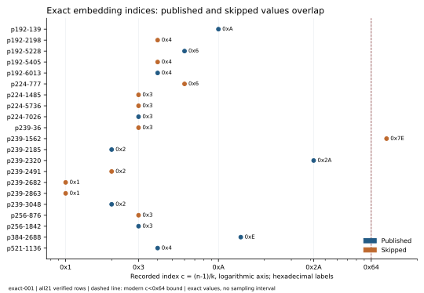

# Exact embedding degree: two proposed filters fail

26 October2026. Run exact-001 computes k=ord_n(p) exactly for all21
recorded eligible curves, using the newly complete n-1 factorizations.
All21 degrees agree with native PARI znorder and pass a separate direct-power
minimality check. Neither of the two fixed filters explains the choices.
Counts, bit lengths and dates are decimal; other integers use0x hexadecimal.

The plotted index is c=(n-1)/k. A smaller index means a larger fraction of
the maximal possible degree. Maximal degree is c=0x1. None of the ten
published curves has maximal degree; two skipped p239 curves, indices2682
and2863, do. A rule requiring maximal degree therefore makes12 label
errors, including every published curve. Its failure is exact for this
cohort, without a sampling model or inference about a historical program.

The second fixed rule is the modern RFC7748 Appendix A MOV threshold,
k>(n-1)/0x64, equivalently c<0x64. All ten published curves pass, but so
do ten of the eleven skipped curves. Only skipped p239 index1562 fails,
with c=0x7E and a233-bit exact degree. This one rejection does not explain
the other skips. Failing this modern design threshold is not a practical
pairing attack: no finite-field DLP, ordinary-input ECDLP or attack cost was
measured. The RFC dates to2016 and is not evidence of a1997 acceptance rule.

Published P-256 and skipped P-256 both have c=0x3, giving the same exact
normalized degree k/(n-1)=1/0x3 over the same prime field. A deterministic
filter whose inputs are only that field and normalized degree must return
the same decision for both. It cannot explain their opposite labels.
Published P-224 and skipped1485/5736 also share c=0x3. This obstruction is
limited to those inputs; it does not rule out a more complicated use of
exact group parameters, implementation behavior or other invariants.

The [complete table](results/degrees.tsv) retains all21 rows and their exact
hexadecimal degrees/indices. Individual native certificates are
`results/curve-0.json` through `results/curve-20.json`. The
[summary](results/summary.json) lists every mismatch. No row was silently
dropped and no unknown became a numeric feature. The two rules were frozen
in [the protocol](PROTOCOL.md); no additional cutoff was searched.

The producer first reproved every prime n and every factor of n-1 and checked
the full original product. It then removed prime divisors while the modular
order remained valid and cross-checked PARI's separate znorder implementation.
The checker never calls znorder or reduces an order: it checks k divides n-1,
p^k=1 modulo n and p^(k/q)!=1 for each prime q dividing k. With the proved
factorization, those direct witnesses certify minimality. This is separate
same-session checking with a shared native arithmetic library, without an
independent host or Lean formalization.

Three fixed positive producer controls passed. The verifier's three positive
and three rejecting controls passed, including rejection of a nonminimal
exponent that still gives1. Strict C++17 builds, producer controls, checker
controls, all21 computations and the separate verification all exited0.
The source/protocol/input/binary snapshots and every stdout/stderr/status
are in the raw archive. Each phase had a300-second watchdog; no phase was
censored. The configured local envelope was four CPU cores and16GiB memory;
no performance isolation or timing result is claimed. Cargo and Conductor
are unavailable; neither missing check is represented as passing.

The [raw manifest](evidence/manifest.json) binds74 files. A full S3 GET,
byte-equal internal manifest and all74 file hashes
[verified](evidence/delivery.json). The PDF embeds that archive, the
protocol, exact-value table, summary and separate verification receipt.
Previous factorization, SEA and short-rule reports remain frozen. No new
attack, cost or curve-registry value changes any canonical frontier figure.

Primary sources checked were the [curve-origin report](https://www.anthropic.com/research/ecdsa-curve-origins),
[RFC7748 Appendix A](https://www.rfc-editor.org/rfc/rfc7748.html#appendix-A),
and the version-bound installed PARI2.17.3 znorder documentation. The online
PARI arithmetic page timed out. The curve-origin authors still describe the
skip criterion as unknown. Related
[period-ECPP source work](https://github.com/isogeny-labs/crypto-autoresearcher/blob/main/research/nist_seed_ecpp_source_20261024/report.md)
identifies a conditional certificate-search exhaustion path; its
[runtime report](https://github.com/isogeny-labs/crypto-autoresearcher/blob/main/research/nist_seed_ecpp_compat_20261024/runtime-report.md)
and final implementation report execute zero named orders. Those retrieved
reports provide no cohort selection result. A new actual trial would require
its own fixed native contract, controls and exact input/certificate binding.

The original objective remains open. A historical explanation needs an
applicable mechanism with independently validated predictions or original
acceptance evidence. These exact counterexamples remove two proposed
filters; they do not establish curve weakness, security or a unique cause
of the historical decisions.
