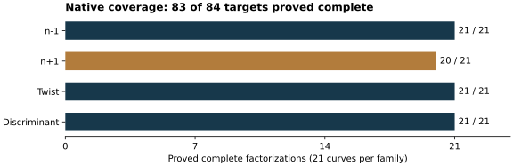
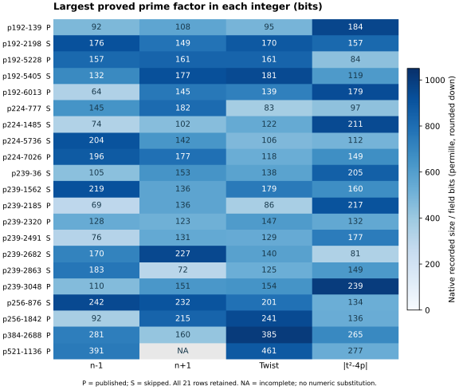
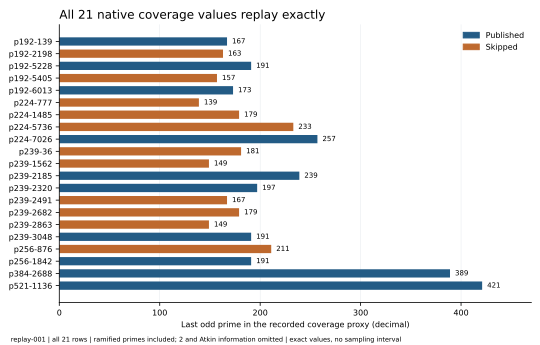
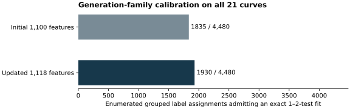

# Factorizations and the skipped-curve comparison

26 October 2026. Native follow-up to the frozen 21-curve study.

All four requested factorizations are independently proved complete.
The comparison keeps all 21 curves and uses
complete-factor search features only when every row has a proved complete
factorization. No discrete-log experiment is part of this follow-up.

| Requested target | Verified status | Largest prime factor |
| --- | --- | --- |
| p239 index 2491, `n+1` | Complete | 131 bits |
| Published P-384, Frobenius discriminant magnitude | Complete; square-free | 265 bits |
| Published P-521, `n-1` | Complete | 391 bits |
| Published P-521, `n+1` | Complete | 270 bits |

The records [p239](results/curve-13-plus.json),
[P-384](results/curve-19-disc.json), and
[P-521 minus](results/curve-20-minus.json), and
[P-521 plus](results/curve-20-plus.json) contain every prime factor and
exact target integer as explicitly decimal strings. The
[hexadecimal factorizations](results/completed-targets-hex.md) give the same
integers with `0x` prefixes. Bit lengths, counts, indices and exponents are
decimal throughout this report. Here `t=p+1-n`; the discriminant target is
the positive integer `|t^2-4p|`.

## What was proved

Native GMP-ECM split the P-384 discriminant and P-521 `n-1` residuals.
Native Msieve SIQS split the p239 `n+1` residual. Native YAFU GNFS split the
remaining P-521 `n+1` composite. A pre-existing independent
C++ verifier recomputed each full target from the frozen curve parameters,
proved every proposed prime using PARI `isprime`, and checked the exact
product. Printed backend labels such as PRP were not admitted as proofs.
The later native summary separately repeated these checks over all admitted
records. This is separate same-session checking, without independent-host
replay or Lean formalization.

P-384's discriminant has three distinct prime factors, all with exponent
one. P-521 `n-1` has seven distinct prime factors and nine factors counting
multiplicity. These are descriptive traits, not an attack construction.

P-521 `n+1` has seven distinct primes and nine factors counting multiplicity.
The former 125-digit composite splits into primes of 145 and 270 bits.
The earlier partial record remains a historical artifact; the new complete
record supersedes it for the current comparison. The 75-bit prime was also
present in an earlier lab computation; this work makes no novelty claim.
The PDF includes the native-generated hexadecimal factor listing as an
appendix and embeds all four full-target admission records.

The native [coverage record](results/factor-summary.json) has 84 complete
targets out of 84: all 21 `n-1`, `n+1`, twist and discriminant records.
The [complete census table](results/cohort-factor-bits.tsv) retains every
control. Earlier unknowns were kept as `NA` until proved. Counts are exact
for this finite census; no sampling uncertainty is inferred.

## Traits across every control

These exact recorded sizes do not give a single security ordering. For the
original P-224 comparison, skipped index 1485 has a 122-bit largest twist
prime, versus the published curve's 118 bits. For P-256, the published twist
has a 241-bit largest prime, versus the skipped curve's 201 bits, while the
published `n-1` has a 92-bit largest prime versus 242 bits for the skipped
curve. The new P-384 and P-521 results do not turn those differences into
a common skipped-curve weakness. Auxiliary-input and twist attacks require
their actual protocol preconditions; factoring these integers is not an
ordinary-input ECDLP attack.

An [exact native replay of the recorded SEA coverage feature](../sea_replay_20261026/REPORT.md)
matches all 21 values, with fixed arithmetic controls and byte-identical
fresh-process outputs. The metric includes ramified primes, omits 2 and
ignores Atkin information; it is a coverage proxy, not measured SEA cost.
A uniform preference for larger bounds fails on P-256: published 191 versus
skipped 211. The reverse preference fails on P-224: published 257 versus
skipped 139, 179 and 233. These are exact counterexamples for this metric;
no new unusualness claim or p-value is admitted.

The earlier PDF and raw archive remain byte-identical. Six existing study
payloads were subsequently uploaded, remotely verified and downloaded for
SHA-256 checking; the [delivery record](../ARTIFACT_DELIVERY.json) documents
the resolved upload obstruction. This report adds a dated comparison and
separate run reports. The initial fit and calibration graphs remain frozen;
the new coverage and full-cohort trait graphs show the changed evidence.
Canonical attack-cost and IC leaderboard figures receive no new verified
attack or performance value and remain unchanged.

## Updated comparison

The unchanged feature and rule-search programs were replayed over all 21
curves, including the published P-384 and P-521 controls. There are now
1,127 features per row. Complete `n-1`, `n+1`, twist and discriminant
families can enter this full cohort. The earlier 19-row result remains a separate search; it does not
validate a rule on its two omitted published controls.

That [19-row structural rule](results/old19-structural-summary.json),
`M mod 0x8 > 0x3 AND j mod 0x1F <= 0x14`, fails published P-521:
its recorded residues are `0x7` and `0x1A`. P-384 passes with residues
`0x5` and `0x0`. The [native feature lines](results/old19-control-features.txt)
are retained. These are retrospective checks of already available labels,
not genuine new historical holdouts.

| Search family | Features per row | Best single-test errors | Exact conjunction |
| --- | --- | --- | --- |
| Structural | 1,127 | 3 | 3 tests |
| With generation features | 1,127 | 3 | 2 tests |
| With seed-bit features | 1,127 | 3 | 2 tests |

The [structural summary](results/full21-structural-summary.json) retains the
same three-test fit based on the twist order and trace residues. The
[generation summary](results/full21-generation-summary.json) retains the
same two-test fit. With `M=2p+2-n`, its conditions are `M mod 0x8` in
`{0x5,0x7}` and `(b+1) mod 0x13 <= 0xD`. It matches the ten published and
eleven skipped labels under the historical coefficient-root convention.
The earlier study's P-224 root-convention counterexample still applies.
Completing all four factorizations did not produce a simpler structural
separator.

All 4,480 label assignments preserving published counts within the six
streams were enumerated again. The structural minimum-clause histogram is
`[0,1094,3386,0]` for one, two, three and more-than-three tests. Its
`short_rule_search_as_good_count=4480` compares with the observed
three-test complexity; it does not mean every labeling has a two-test fit.
The generation family has 1,973 labelings with an exact fit of at most two
tests, versus 1,930 in the intermediate 1,118-feature round and 1,835 in
the initial 1,100-feature round. The seed-bit family has 2,157/4,480. This
is finite search calibration under an exchangeability model, not a
probability of weakness or of historical use. The earlier 15-family union
remains a separately frozen result, 4,385/4,480; it was not recomputed here.

The new chart compares the same generation family before and after the
additional proved factors. The original study's 1,100-feature chart stays
as its frozen baseline; this dated chart carries the changed 1,127-feature
count. All 21 controls and all 4,480 permitted label assignments remain.

## Executed methods and retained failures

The [run index](results/run-index.json) links exact commands, native binary
and source hashes, parameters, exit statuses and raw paths. The native
libraries are PARI 2.17.3, GMP 6.3.0 and GMP-ECM 7.0.6. Msieve is pinned to
`c8727d91305bdbe0972d160ef0ce61dd02ce9193`; YAFU is pinned to
`c7d90283972820f99b3b4920bfc1eff05c1f6342`. No Python research harness runs;
Python only plots recorded values and typesets documents.

The first ECM batch requested 64 curves per target at B1=1,000,000 with
900-second watchdogs. It completed P-384 and P-521 `n-1` after independent
proofs and partially split P-521 `n+1`. The follow-on ran p239 SIQS and
256 ECM curves at B1=3,000,000 on the reduced P-521 composite. SIQS completed
p239; the 256 curves found no further P-521 factor. One P-1 attempt at
B1=10,000,000 and four P+1 attempts at B1=3,000,000 also found no factor.
Those bounded negative outcomes do not prove that a factor cannot be found.

The first two YAFU commands exited zero without reading the target. Their
failed admissions and original launcher source are retained. Corrected
commands supply the validated integer on stdin with `ecm(@,1024)` or
`nfs(@)`. Vector ECM requests B1=11,000,000; GNFS preserves polynomial and
relation progress. Execution markers only establish that the target ran.
All discovered divisors still require the independent prime/product proof.
Current method status must be read from the run index; an active run is not
a completed factorization.

The later 320-curve vector ECM attempt completed without another divisor.
GNFS saved 2,313,299 merged relations before a requested stop. Its closed
[progress archive](evidence/backend-progress-001-delivery.json) passed a
full S3 GET and all 108 member hashes. A four-thread continuation reuses
that pool and uses native filtering with an adaptive threshold. It completed
on 26 October at 17:32:47 UTC, with native exit status zero. Its final
[run report](reports/run-yafu-nfs-014-final/REPORT.md) records the closed attempt.

The later [running-progress snapshot002](reports/run-yafu-nfs-014-progress-002/REPORT.md)
preserves the native pool whose filter reported 17,831,805 raw relations
and 14,715,396 unique relations after duplicate removal. Its full S3 GET,
internal manifest and all 21 listed file hashes
[verified](evidence/backend-progress-002-delivery.json). This is an immutable
resume copy of an active run, without a final exit status or factorization
result at that snapshot's time. The previous snapshot and closed archives
remain unchanged.

GNFS014 ultimately reported 26,716,780 raw relations, a reduced matrix of
709,365 rows by 709,592 columns, and 31 dependencies. These are successive
native counters, not performance arms. Its two proposed divisors passed
[separate full-target admission015](reports/run-p521-plus-proof-015/REPORT.md).
The [full84 replay016](reports/run-full84-replay-016/REPORT.md) then completed
the native controls, extraction, prime/product summary and three-family
search/calibration, all with exit zero. Its original inputs and source
snapshots are in the [final archive manifest](evidence/final-manifest-003.json).

The pinned YAFU [success cleanup](evidence/success-cleanup-audit.json)
automatically removed its final relation/matrix scratch before the outer
launcher regained control. The final archive contains all surviving logs,
proposals, proof and replay records, with a [verified full S3 readback](evidence/final-native-003-delivery.json)
and all 223 listed member hashes. It does not contain the final larger pool
or matrix. Snapshot002 is the last retained pool. This retention gap limits
independent GNFS replay; it does not affect the independently checked prime
factors and exact original-target product. No full GNFS replay is claimed.

The local host has a four-core CPU quota and 16 GiB memory. Configured
thread limits are not measured CPU accounting. Backend timing diagnostics
are preserved but are not performance comparisons or cost estimates.
Every new experiment passed the required S3 checkpoint gate. The initial
credential and launcher failures remain part of the record. Cargo and
Conductor are absent; their required checks could not execute. No Rust
library, active curve registry, IC solver or leaderboard row changes.

## Sources and remaining questions

The four requested computations and resulting full-cohort replay are complete.
The method reuses the existing native verifier and unchanged feature/search
programs. Primary sources checked include the parent study's
[curve-origin references](../REPORT.md), the
[PARI arithmetic manual](https://pari.math.u-bordeaux.fr/dochtml/html-stable/Arithmetic_functions.html)
for proof-enabled primality, and the pinned
[YAFU cleanup source](https://github.com/bbuhrow/yafu/blob/c7d90283972820f99b3b4920bfc1eff05c1f6342/factor/nfs/nfs.c#L1070).
Backend PRP labels, factored neighboring integers and post hoc fits are not
substitutes for the respective proof, attack or historical evidence.

The original historical explanation remains unresolved. Exact post hoc
separators do not establish a selection mechanism. An original acceptance
log, provenance-linked generator, genuine new historical labels or a
specified mechanism with independently validated predictions would resolve
different parts of that gap. The separate
[period ECPP source study](https://github.com/isogeny-labs/crypto-autoresearcher/blob/main/research/nist_seed_ecpp_source_20261024/report.md)
identifies a conditional certificate-search failure path; its
[runtime report](https://github.com/isogeny-labs/crypto-autoresearcher/blob/main/research/nist_seed_ecpp_compat_20261024/runtime-report.md)
now completes the reported fixed runtime controls. Its later
[final mock implementation report](https://github.com/isogeny-labs/crypto-autoresearcher/blob/main/research/nist_seed_ecpp_compat_20261024/implementation-followup-20261024/final-v9/report.md)
passes its nine methods using fake execution boundaries; no named cohort
order has executed. A real frozen cohort trial and its admission remain pending.
It remains an untested software hypothesis for this cohort, without an
original-caller link or an explanation established by this factorization work.
