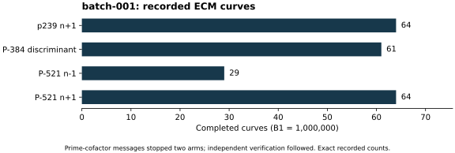

# Native ECM batch: four requested targets

Run `batch-001`, 26 October 2026, source baseline `dd5a729d790f`. Command:
`NIST_FACTOR_OUT=<fresh runs/batch-001> sh run.sh`. The launcher records
compiled helper and backend hashes, exact residuals, parameters and all raw
stdout/stderr/status files. It passed the S3 gate before native execution.

Four residuals were validated against their original curve targets. Two
GMP-ECM workers requested 64 curves each, B1=1,000,000, with a 900-second
watchdog per target. PARI 2.17.3, GMP 6.3.0 and GMP-ECM 7.0.6 ran locally
under a four-core quota and 16 GiB memory limit. No performance isolation
tier or speed comparison is claimed. Sigmas are retained in raw output;
no prescribed RNG seed was set for this GMP-ECM batch.

p239 completed 64 curves without a factor, exit 0. P-384 found a divisor on
curve 61 and printed a prime cofactor, exit 14. P-521 minus found a divisor
on curve 29 and printed a prime cofactor, exit 14. P-521 plus found a
75-bit divisor and a remaining C125 composite, then completed 64 curves,
exit 6. These are backend outcomes, not independent primality proofs.
The following `refine-001` run admits or rejects full factorizations.

Raw evidence: [batch records (archive manifest)](../../evidence/.artifacts.json), including all failed
or negative arms. [Run index](../../results/run-index.json) binds these
counts; the curve numbers are exact recorded values, with no inferred
sampling interval. Backend timing diagnostics are retained without a
performance claim. No DLP was attempted.
