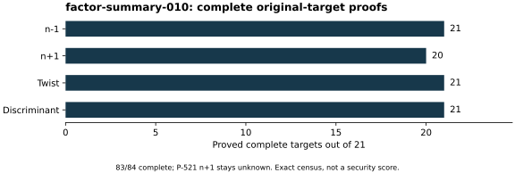

# Native summary with every control retained

Run `factor-summary-010`, 26 October 2026, program `summarize_factors.cpp`.
The command read the exact historical parameter table and all 83 admitted
complete records after a successful checkpoint gate. It recomputed every
target, proved every factor and rechecked every exact product before writing
the summary, comparison table and hexadecimal factor listing. Exit 0;
source/input/binary hashes and stdout/stderr/status are retained in
[the raw directory (archive manifest)](../../evidence/.artifacts.json).

There are 21/21 complete minus, twist and discriminant targets and 20/21
plus targets. The sole permitted missing record is P-521 plus; its trait
values are `NA`, never zero, a composite's size or a dropped row. The native
table provides largest-prime bits and the integer part of 1,000 times that
size divided by field bits for plotting. Those are descriptive values, not
attack estimates. The complete plus search family remains unavailable.

The count is an exact census of 21 rows and 84 targets, with no inferred
sampling interval. This check is separate same-session computation under
native PARI 2.17.3, without independent-host replay or Lean formalization.
No performance isolation tier, speed comparison or DLP experiment is
claimed. The [run index](../../results/run-index.json) records the four-core,
16-GiB configured local environment. A checkpoint followed completion.
